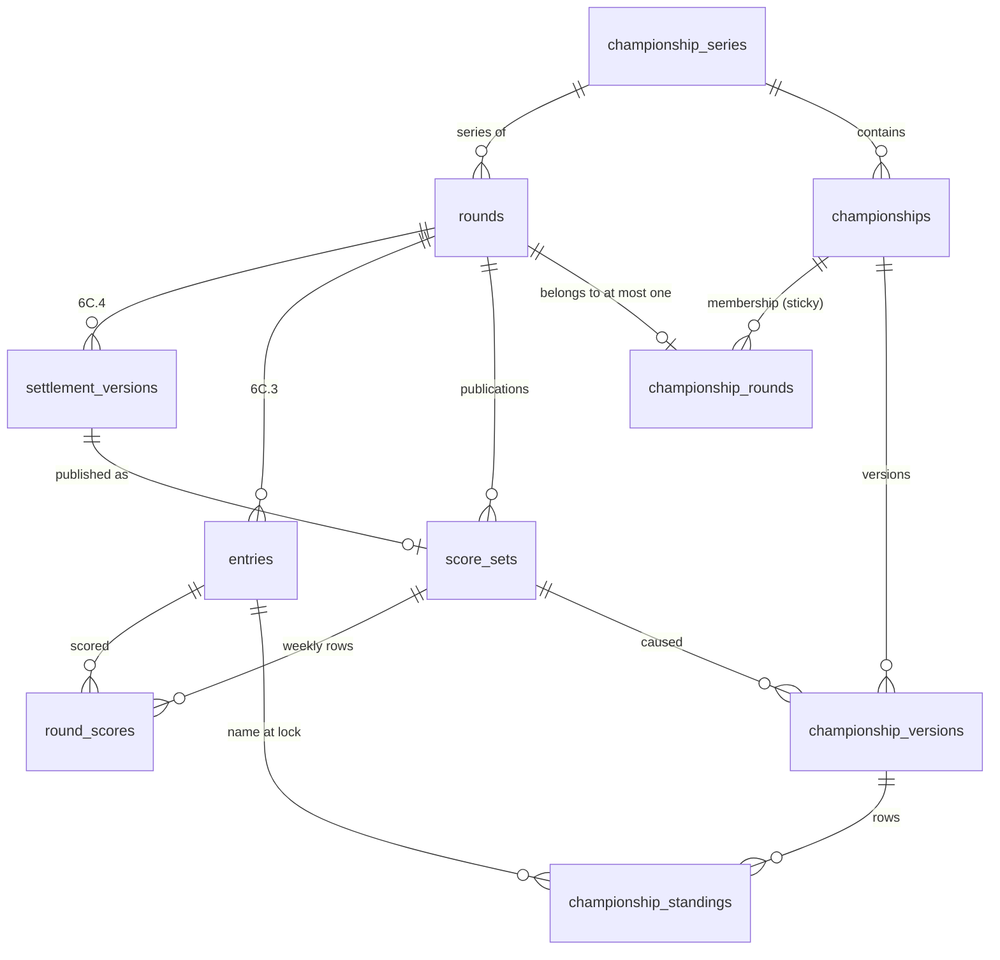

# Phase 6C.5 — Leaderboards and Championships: Stage A design and specification

**Status:** Stage A deliverable for owner review (20 Nov 2026). **Nothing in this
document is implemented.** No migration has been written or run; no application
code, settlement rule, engine or configuration has changed. Stages B–G wait for
the owner's explicit approval of this specification and of the decisions in §20.

**Baseline:** v4.2.0 (`main` at `06a9a6a`, tag `v4.2.0`), migrations
`app_0001`–`app_0006`, quantitative fingerprint `88bcd717deca6c1c…`.
**Branch:** `feature/phase-6c5-leaderboards` (from `06a9a6a`).

**How to read this document.** Every statement is labelled by its origin:

| Label | Meaning |
|---|---|
| **[OWNER]** | Owner-approved business requirement from the Phase 6C.5 brief (20 Nov 2026), IDs `L-xx` |
| **[6C.4]** / **[REG]** | Existing authoritative behaviour (v4.2.0 code, or an approved decision in the [decision register](../product/weekly_challenge_decisions.md)) |
| **[PROPOSED]** | Claude's technical design, IDs `LT-xx`; adopted unless the owner objects |
| **[ASSUMPTION]** | A new assumption; listed again in §20.3 |
| **[DECISION]** | Outstanding owner decision, IDs `Q-xx`, each with a recommendation (§20) |

---

## 1. Executive summary

Phase 6C.5 turns settled Weekly Challenge entries into **weekly leaderboards**,
**recovery-gated championship points** and **continuous ten-round
championships**, and gives every participant a **full personal history**.

The main findings of the review:

1. **The ranking and points engine already exists.** `diski9.challenge.scoring`
   (Phase 6A.3, approved D-26, D-27, D-31, D-33) implements standard competition
   ranking, `points-150-75-v2`, recovery gating, all-void refunds and championship
   aggregation with the approved tie-breakers. It is covered by the quantitative
   fingerprint. **Phase 6C.5 reuses it unchanged.** It adds an adapter from
   settlement records to scoring inputs, with no second implementation.
2. **Settlement already supplies everything the ranking needs** [6C.4]:
   - entry gross and net, completeness and the all-void basis;
   - D-32b round validity, current and final designations;
   - settlement versions, including `reopened`.

   Phase 6C.5 reads these and never computes settlement.
3. **`app_0001` already contains placeholder tables** from the approved Phase 6C
   database design, all empty and never written:
   - `score_sets` and `round_scores` (insert-only weekly scores, with CHECKs
     for D-31 and D-33);
   - `championship_series` (`beta`, `official`);
   - `championship_freezes`.

   Weekly results reuse `score_sets` and `round_scores` with small additive
   changes. `championship_freezes` and the planned *derived* membership view
   cannot express the owner's new correction rules (§10), so they are superseded
   by a small versioned championship model (§7).
4. **Recommended architecture (hybrid, as the owner preferred):**
   - provisional weekly standings are computed read-only from current
     settlement;
   - official weekly results and championship standings are written **once per
     finalisation**, insert-only and versioned, **inside the same database
     transaction as the 6C.4 finalisation**. Publication is therefore atomic
     with the settlement it reflects, and a reopening naturally *retains* the
     last published results.
5. **Championship membership is assigned in round-deadline order and never moves
   afterwards** ("sticky"). This makes every lifecycle case deterministic:
   - rollover;
   - out-of-order finalisation;
   - reopening while a later round settles;
   - invalidation before or after the next championship starts.
6. **Conflicts to record:**
   - The brief's exceptional "historical championship with fewer than ten
     rounds" (L-34) contradicts D-30 ("never shortened"), so D-30 needs a
     recorded amendment.
   - The brief does not mention the beta/official series (D-38).
   - The completion threshold is measured over **prediction instances**, not
     fixtures.

   Details are in §4.4.
7. **Twelve owner decisions** are listed in §20 with recommendations. Five of
   them block Stage C; none blocks Stage B.

---

## 2. Approved business requirements (owner brief, 20 Nov 2026)

Stable IDs for traceability (§21). All **[OWNER]**.

| ID | Requirement |
|---|---|
| L-01 | Rank participants by authoritative **gross** settled virtual return, descending; 100 credits per entry |
| L-02 | Settlement (6C.4) is the only source of allocation, gross, net, recovery, eligibility, refunds, round validity and status; the ranking never recomputes settlement |
| L-03 | Weekly ties use standard competition ranking (1, 1, 3, 4, 4, 6); tied entrants share the rank and receive that rank's full points (if recovered); no time, identity or name tie-breaks; a deterministic secondary *display* order is allowed |
| L-04 | Unsuccessful recovery stays rankable; individually refunded (all-void) entries get no rank, recovery, points or recovery observation |
| L-05 | Points: 150/135/125/120/115/110/105/100/95/90 for ranks 1–10 with recovery, 75 for any other rank with recovery, 0 without recovery |
| L-06 | Missed, refunded, practice, invalidated and provisional results earn no official points; no best-X; no carry-over; no estimated or projected points; maximum 1,500 per championship |
| L-07 | Championship ranking: points, then successful recoveries, then qualifying top-ten finishes (with recovery), then shared rank (competition ranking); no financial tie-breakers |
| L-08 | One valid round is enough to appear; mid-championship joiners score from their first round; no retrospective points; zero-point participants with rankable participation stay visible; joint champions allowed; no champion when everyone has zero |
| L-09 | A championship is ten **finalised valid competitive** rounds; the counter advances only on valid competitive finalisation; missed rounds still advance it; practice and invalid rounds never do |
| L-10 | Automatic enrolment through Weekly Challenge entries; no registration workflow |
| L-11 | Continuous championships: the tenth valid round completes one; the next begins with the next Weekly Challenge; history kept; everyone restarts at zero |
| L-12 | No production scheduler in 6C.5 (6C.6) |
| L-13 | Display name **"Championship MMM-YY"** from the championship **start** date; immutable identity; name never changes after it is established; not renamed by practice rounds, invalidations, postponements or corrections; timezone consistent with the app; collisions handled without compromising identity; no sequential numbering as the primary name |
| L-14 | Participant statuses Upcoming, In Progress, Completed, Under Review (model to be assessed, §8) |
| L-15 | Provisional weekly standings during settlement from authoritative current settlement only: position, name, predictions settled and pending, returns so far, recovery status, provisional messaging; pending never shown as lost; unresolved returns never shown as 0 |
| L-16 | No official points during provisional settlement; the championship table shows the last published standings; no simulated final table |
| L-17 | Leaderboard reads are read-only and make no football API requests |
| L-18 | Corrections before finalisation update the provisional table only |
| L-19 | On reopening, keep the last published round results and points, mark them Under Review and "last published, no longer definitive"; do not remove points |
| L-20 | On re-finalisation, recalculate the whole round, all affected points and the championship (including tie-breakers), publish atomically, keep the previous version |
| L-21 | A correction in a completed championship whose round stays valid: recalculate it, update the champion if needed, keep the previous version; later championships unaffected |
| L-22 | Historical invalidation rules: see L-32 to L-34 |
| L-23 | Leaderboards area with **Weekly** and **Championship** views; defaults to the current competition; historical navigation; existing design system |
| L-24 | Weekly official columns: rank, name, gross, net, recovery, points, round status; Provisional / Final / Corrected / Under Review / Void states; no misleading standings for practice or invalid rounds; explanatory empty states |
| L-25 | Championship columns: rank, name, valid rounds played, recoveries, qualifying top tens, points, progress (n of 10), status; recovery rate optional; short historical championships shown accurately |
| L-26 | Personal ranking summary always visible; own row highlighted; correct handling of not entered, late joiner, no rankable entry, refunded, zero points, shared rank; never a manufactured rank |
| L-27 | 50 rows per page, paginated access to the rest |
| L-28 | My Challenge **Current** and **History**; every own entry (competitive, practice, provisional, reopened, refunded, invalidated, corrected); summary fields; drill-down to the nine predictions, four accumulators, frozen odds, 90-minute scores, verdicts, void reasons, refunds and calculations; reuse 6C.4 read services |
| L-29 | Personal statistics with explicit denominators; recovery rate excludes refunded entries, invalid rounds and practice rounds; missed opportunities distinct from unsuccessful entries; no mixing of populations |
| L-30 | Charts limited to allocated versus returned by round and cumulative championship points (a championship progression chart only if it fits naturally); no volatility, Sharpe, drawdown, Monte Carlo, forecasting or calculators |
| L-31 | Privacy: public display name and approved competitive statistics only; no email, authentication data, internal IDs, predictions, portfolio choices, frozen individual odds or detailed settlement records of others; display-name changes never break history |
| L-32 | **Active championship:** a previously valid round becoming invalid removes its contribution and reduces the counter; the championship continues until ten valid rounds |
| L-33 | **Completed championship, next not started:** losing a valid round reopens it; an extra qualifying round restores ten |
| L-34 | **Completed championship, next already started:** boundaries fixed; recalculate with the remaining valid rounds; may exceptionally have fewer than ten; identity, start date, name and round boundaries preserved; disclosed as corrected after completion; no transfer of rounds; no replacement rounds; no disruption to the active championship |
| L-35 | Deterministic, idempotent, no duplicate awards, no partial publication, no mixed versions, reproducible from settlement evidence, auditable, concurrency- and failure-safe |
| L-36 | Exclusions: private mini-leagues (removed from the MVP roadmap; no anticipatory tables or abstractions), social profiles, following, messaging, public sharing of portfolios, badges (Phase 9), prizes, advanced analytics, simulations, estimated points, production scheduling, monitoring and administration dashboard (6C.6) |
| L-37 | Development-only workflows exercise the full lifecycle without real weekends, without weakening authentication, evidence, cutoff or authorisation safeguards |

---

## 3. MVP scope and exclusions

**In scope** [OWNER] (§3.1 of the brief):
- global weekly leaderboards, with provisional and official views;
- the championship points engine (reused) and the championship lifecycle with
  rollover;
- global and historical championship leaderboards;
- the personal ranking summary and pagination;
- full personal history with drill-down, statistics and the two charts;
- corrections and recalculation, and versioned official results;
- privacy controls;
- development scenarios, integration tests and performance tests.

**Out of scope** [OWNER]: everything in L-36. Private mini-leagues are **removed
from the MVP roadmap**; the roadmap is updated in
[`weekly_challenge_phase6c_plan.md`](../product/weekly_challenge_phase6c_plan.md).
This design contains no league tables, membership concepts or "group" abstractions.
Leaderboard queries are scoped by round, championship or series only.

---

## 4. Verified Phase 6C.4 settlement and round-validity rules

Verified against the v4.2.0 code and the decision register. These are
**authoritative and unchanged**; 6C.5 only consumes them.

### 4.1 Round publication and classification

| Rule | Authority | Verified behaviour |
|---|---|---|
| Publication eligibility | D-28, T-18 | ≥ 15 eligible fixtures, ≥ 3 eligible leagues, an exact strict 4/3/2 feasibility check, ≥ 3 bookmaker groups fresh within 24 h, a snapshot constructed ≤ 60 min before publication (`services/rounds.py::_publication_problem`) |
| Competitive vs practice | D-28, T-07 | Fixed **once, at the lock** (`lock_round`): ≥ 5 *valid entries* → base designation `championship` (meaning *competitively classified*), otherwise `practice`; stored once (`uq_designation_deadline`) |
| Valid entry | D-28, T-09 | A confirmed entry with a valid current submission at the deadline, one per participant; withdrawn entries are excluded; the locked set is stamped on `entries.locked_at` |
| Development rounds | S-08 | `rounds.is_development`; never part of the official series |
| Series | D-38 | `rounds.series_id` comes from the schedule; every schedule today points to **`beta`**; `official.started_at` is NULL; `RoundView.counts_toward_official_championship` is hard-wired `False` |

### 4.2 Round validity at settlement (D-32b, D-32b-Q1, D-33)

`challenge/settle.py::evaluate_round` (exact integers over the locked set):

* **Denominator:** every **prediction instance** of every valid entry locked at the
  deadline (9 × locked entries). Instances are counted, not unique fixtures. All-void
  entries are included.
* **Played** = verdicts `won` or `lost`. **Void** and **pending** are not played.
* **Not evaluated while any prediction is pending.** Pending evidence never
  invalidates a round; the completion-based cutoff (S-03) bounds the wait,
  and unresolved evidence raises blocking alerts that stop finalisation (S-02).
* **Competitive round:** valid only if `2 × played > total` (exactly 50% fails)
  **and** ≥ 5 rank-eligible entries (`complete and not all_void`). Outcomes:
  `pass`, `fail_majority`, `fail_ranked`.
* **Practice round:** majority rule only (D-32b-Q1); it can become void, but the
  five-ranked rule does not apply.
* **Invalid round:** designation `void` (basis `d32b` or audited `operator`):
  - every confirmed participant gets 100 back (net 0);
  - no ranks, points, recoveries or top-ten finishes;
  - the counter does not advance;
  - submissions, results and calculations are retained.
* **All-void entry (D-33):**
  - gross 100.00, net 0;
  - not rank-eligible, no recovery, no top-ten, no points;
  - it counts toward the five valid entries at the deadline but not toward
    the five ranked entries at settlement.

### 4.3 Finalisation and reopening (S-02, S-06, S-09)

* `finalise_round` (one transaction holding the round row lock):
  1. runs a final settlement;
  2. refuses on a material change, a pending prediction, an open blocking alert,
     or a database clock before max(cutoff, last material change) + 24 h;
  3. writes a non-provisional designation, `status = final` and a `final`
     settlement version.
* `reopen_round` (owner only, T-14): `final → settling`, a `reopened` version, and
  recalculation. The previous final version stays in history.
* Lifecycle: `open → locked → settling → final`, and `final → settling` on
  reopening.

### 4.4 Discrepancies between the brief and the authoritative rules

None of these requires a change to settlement. Items 4 and 5 need owner
confirmation (§20).

| # | Brief wording | Authoritative rule | Effect |
|---|---|---|---|
| 1 | "strictly more than 50% qualifying **fixture** completion" | Strictly more than 50% of **prediction instances** across the locked valid entries were **played** (won or lost); fixtures are not deduplicated (D-32b clarification) | Wording only; implementation unchanged |
| 2 | "five confirmed eligible participants … at lock" | Five **valid entries** at the deadline (locked, valid final submission; withdrawals excluded; all-void entries *do* count, D-33) | Consistent; the nuance is recorded |
| 3 | Practice rounds "settle normally" (implicit) | Practice rounds are also subject to the majority rule and can become void (D-32b-Q1) | A void practice round shows "Round void", not a practice table |
| 4 | L-34: a historical championship may end with **fewer than ten** valid rounds | D-30: a championship "is always ten … never shortened … no champion is crowned early" | **Amendment to D-30 required** (Q-11). The brief explicitly approves it as an exceptional rule; it is recorded as **D-30a** once Stage A is approved |
| 5 | Continuous championships named "Championship MMM-YY" | D-38: beta rounds are unofficial; **Official Championship 1** begins only after D-29 validation and launch approval; every current schedule is `beta` | The brief does not mention the series. Q-1 recommends beta championships now (badged "Beta") and official ones later. The D-29 target "before Official Championship 1" becomes "before the first official championship" |
| 6 | Hybrid persistence | Database design §7.2/§7.3: membership **derived** by a view grouping rounds in tens; `championship_freezes` with sequential `number` | **Superseded technically** (LT-06); the new owner rules need stored, versioned membership (§7.6) |
| 7 | Rank by **gross** | C-07/C-21 say "net" | Equivalent, because allocation is always 100 (net = gross − 100) |
| 8 | Brief 8.2: "the next Weekly Challenge begins the next championship" | Rounds overlap: round N+1 can be published while round N is still in its correction window (cutoff 48 h + window 24 h) | A round in flight while the previous championship's tenth round is unresolved belongs to whichever championship has room when it is processed (§8.3) |
| 9 | "No champion if everyone has zero" | `scoring.ChampionshipTable.champions` returns rank-1 participants even with 0 points | Applied in the lifecycle layer (LT-12); `scoring.py` unchanged |
| 10 | Short historical championships | `ChampionshipTable.is_complete` requires exactly ten rounds | Completion is decided in the lifecycle layer; `scoring.py` unchanged |

---

## 5. Existing architecture assessment

### 5.1 Repository state

| Item | State (20 Nov 2026, verified) |
|---|---|
| `main` | `06a9a6a` (v4.2.0 release), unchanged since the release |
| `claude/gifted-newton-h6o5hk` | the odds-trial branch, latest `952accf` (06:14Z capture); it holds only `monitoring/odds_trial/` commits and is far behind `main` (no 6C code). Not touched by this work |
| `research/weekly-pools` | `a2d1bed` (collector); no changes since the release; not touched |
| Phase 6C.5 work | separate worktree on `feature/phase-6c5-leaderboards` (from `06a9a6a`), so the trial's checkout in the main working directory is never disturbed |
| Migrations | `app_0001`–`app_0006` |

### 5.2 Reusable components

| Component | Reuse |
|---|---|
| `challenge/scoring.py` (`score_round`, `aggregate_championship`, `competition_ranks`, `POINTS_150_75_V2`, `AllVoidPolicy.REFUND_UNRANKED`) | **The ranking and points engine.** Called unchanged; covered by `tests/test_challenge_scoring.py`, `test_championship_scoring.py`, `test_championship_refinement.py` and the fingerprint |
| `entry_settlements` (latest revision per entry: gross, net, `complete`, `basis`, legs JSON) | Input to the weekly table, provisional and official |
| `designations`, `round_evaluations`, `settlement_versions`, `rounds.status` | Classification, validity, reopening state ("Under Review") |
| `corrections.finalise_round` | The single integration point (§11.1) |
| `participant_results.my_settlement` (owner-scoped; any round ID) | Historical drill-down unchanged |
| `app/challenge/results_ui.py` (`panel`, `summary`, `accumulators`, `predictions`, `notices`) | Drill-down rendering |
| `auth/accounts.py::leaderboard_name`, `entries.public_name_at_lock`, `privacy_mode_at_lock`, `privacy_history` | D-04/D-05 naming at lock with retroactive anonymity |
| `permissions` (`Capability`, `authorize`, `SENSITIVE`) and the operator CLI (`operator_cli.authenticate_operator`) | Operator commands |
| `challenge/demo.py`, `pages.leaderboards`, `pages.my_challenge_body` (illustrative championship and history), `components.weekly_table`, `championship_table`, `podium`, `you_summary`, `metric`, `timeline` | The accepted Phase 6B visuals, whose data source changes |
| `settlement_scenarios.py`, `dev-open --deadline-minutes/--spacing-minutes`, `dev-results`, `submit_test_entry` | Base for the development lifecycle tooling (§17) |
| `tests/backend/pty_cli.py`, the real PostgreSQL and Supabase Auth harnesses, `tools/e2e_6c4/` | Test infrastructure |

### 5.3 Risks of coupling or duplication

| Risk | Mitigation |
|---|---|
| Re-deriving recovery or eligibility in SQL | The adapter maps settlement rows to `scoring.EntryResult` (basis `all_selections_void` for D-33) and lets `score_round` decide; a reconciliation test compares with `my_settlement` |
| Settlement importing competition code (cycle) | The competition module imports only `db.schema` and `challenge.scoring`; `finalise_round` calls one function `competition.publish_finalised(conn, round_id, version_id, actor)`, passing its open connection. Competition never imports `corrections` or `settlement` |
| Changing approved maths | `scoring.py` untouched; the fingerprint is checked at every stage |
| Two sources of truth for membership (`championship_freezes` and new tables) | `championship_freezes` is dropped by the migration (it is empty, never written) |

### 5.4 Dependencies on deferred items

| Item | Effect on 6C.5 | Approach |
|---|---|---|
| D-29 (real-pool validation) | Gates the **official** series only | Beta championships run; official start stays a launch action (Q-1) |
| D-36 (retention) | Standings keep `user_id`; deleted accounts display their alias | Pseudonymisation-compatible; no new personal data |
| S-07 follow-up (6C.3 round commands without a password) | New 6C.5 operator commands follow S-07 (password per command); the 6C.3 commands are unchanged | No scope expansion |
| 6C.6 scheduling | Finalisation, and therefore publication, stays an operator command | Publication is inside finalisation, so the future scheduler needs no extra step |
| 6C.6 "full results re-check before finalising" | Unchanged | — |
| Hosted Supabase (Phase 10) | None | — |

---

## 6. Proposed competition architecture

```
Settlement (6C.4, authoritative)            Competition (6C.5)
──────────────────────────────────          ─────────────────────────────────────────
entry_settlements, designations,   ──read──► weekly adapter → scoring.score_round
round_evaluations, settlement_versions        (provisional: in memory, never stored)
                                              (official: at finalisation ↓)
corrections.finalise_round ──same txn──────► publish_finalised():
                                               1. score set + round scores (weekly)
                                               2. assign round to championship (§8.3)
                                               3. scoring.aggregate_championship
                                               4. new championship version + standings
                                                                    │
                                              read services (read-only) ◄────┘
                                              leaderboards · personal summary · history
```

**LT-01 Hybrid with publication at finalisation** [PROPOSED]:

* **Provisional** weekly standings are computed **on read** from the latest
  `entry_settlements` revision per entry. Nothing is persisted. An in-process cache
  is keyed by `(round_id, latest settlement run id)`, so a new settlement run
  invalidates it automatically.
* **Official** results are written only when a round is **finalised** (first time or
  after a reopening), in the same transaction:
  - an insert-only **score set** (weekly ranks and points);
  - a new insert-only **championship version** with materialised standings rows.
* **Reads** use the persisted current versions only, so a paginated page is two
  indexed queries.

**Why this is the simplest robust option:**

| Alternative | Rejected because |
|---|---|
| Fully derived on read (database design §7.2 view) | Cannot retain the "last published" standings during a reopening (L-19), cannot fix boundaries once the next championship starts (L-34), and re-scores every championship on every page view |
| Persisting provisional snapshots on each settlement run | Unnecessary history (L-16, brief §14.1); more writes in the hot path |
| A separate asynchronous publication job after finalisation | Leaves a window where the round is final but unpublished (partial publication, L-35), and adds a failure mode and a scheduler (6C.6) |

**Trade-off:** finalisation now also scores the round and recomputes one
championship (estimated well under a second for 1,000 participants; to be
measured, §14). If publication fails, finalisation rolls back and is simply retried.
This is preferable to a final round with inconsistent standings.

---

## 7. Database design (`app_0007`, proposed; not written)

### 7.1 Principles

- Additive only.
- New history tables are insert-only (existing trigger and privilege pattern).
- Projections are mutable current-state tables, rebuilt only inside publication
  transactions.
- Migration and runtime role privileges follow `app_0002`.
- Row-level security uses a policy for `diski9_app` only.

### 7.2 Changes to existing (empty) tables

**`score_sets`** [H] (one per round publication):

| Column | Change |
|---|---|
| `settlement_version_id bigint NOT NULL UNIQUE REFERENCES settlement_versions(id)` | **add**: the final settlement version published; the uniqueness makes publication idempotent |
| `scoring_version text NOT NULL` | **add** (`points-150-75-v2`) |
| `published_at timestamptz NOT NULL DEFAULT clock_timestamp()` | **add** |
| `revision` | meaning: publication number of the round (1, then 2 after a re-finalisation, …) |
| `final` | always true (kept; provisional results are not stored) |
| `kind` | `championship` (competitive), `practice`, `void` (unchanged) |

**`round_scores`** [H] (one per locked entry per publication):

| Column | Change |
|---|---|
| `display_order integer NOT NULL` | **add**: the deterministic display order from `score_round` (rank, then gross, then an internal key). The internal key is never shown or sent to the browser |
| `status` | **extend** CHECK to `ranked`, `void_refunded`, `round_void` (+ CHECK `status = 'round_void'` ⇔ `kind = 'void'`) |
| existing CHECKs | kept: points set (D-31), refund rules (D-33), `qualifying_top10 ⇒ recovered and rank ≤ 10`, no points outside competitive sets |
| index | `(score_set_id, display_order)`; `(user_id, score_set_id)` |

Net is not stored; it equals gross − 100.00 by definition. No name is stored either:
names are resolved at read time, so retroactive anonymity also applies to past
tables (D-05).

### 7.3 New tables

**`championships`** [projection: identity immutable, status fields updated
only by publication]:

| Column | Notes |
|---|---|
| `id uuid PK` | immutable internal identity, never shown |
| `series_id bigint FK championship_series` | `beta` or `official` |
| `is_development boolean NOT NULL` | development stream, isolated (LT-09) |
| `ordinal integer NOT NULL` | internal order within `(series, is_development)`; `UNIQUE (series_id, is_development, ordinal)`; never the participant-facing name |
| `start_date date NULL` | SAST date of the start (L-13, Q-3); set once |
| `display_name text NULL` | e.g. `Championship Nov-26`; set once together with `start_date`; `UNIQUE (series_id, is_development, display_name)`; CHECK pattern |
| `status text NOT NULL` | `upcoming`, `in_progress`, `completed` (§8) |
| `rounds_required smallint NOT NULL DEFAULT 10` | from the series |
| `counted_rounds smallint NOT NULL` | valid finalised rounds counted (the counter) |
| `boundary_fixed_at timestamptz NULL` | set when the next championship starts (§8.4); after that no rounds join |
| `completed_at timestamptz NULL` | first completion |
| `corrected_after_completion boolean NOT NULL DEFAULT false` | disclosure flag (L-21, L-34) |
| `current_version integer NULL` | pointer to the latest `championship_versions.version` |
| `created_at` | |
| Trigger | `id`, `series_id`, `is_development`, `ordinal`, and `start_date` / `display_name` once non-null, can never change |

**`championship_rounds`** [projection plus history in versions]: one row per
competitive round processed into a championship.

| Column | Notes |
|---|---|
| `round_id uuid PK FK rounds` | a round belongs to at most one championship, **forever** (sticky, LT-05) |
| `championship_id uuid FK championships` | |
| `counted boolean NOT NULL` | true while the round's current published result is valid competitive |
| `slot smallint NULL` | 1–10 order of counted rounds by deadline (recomputed on change; display only) |
| `assigned_at timestamptz NOT NULL`, `assigned_version_id bigint` | audit |
| index | `(championship_id, counted)` |

**`championship_versions`** [H]: one per publication affecting a championship.

| Column | Notes |
|---|---|
| `id bigint PK`, `championship_id`, `version integer` | `UNIQUE (championship_id, version)` |
| `cause text` | `round_published`, `round_republished`, `round_invalidated`, `round_restored`, `backfill`, `repair` |
| `cause_round_id uuid`, `cause_score_set_id bigint` | the publication that caused it |
| `status`, `counted_rounds`, `round_ids uuid[]` | state after this version |
| `champion_count integer NOT NULL` | 0 while incomplete or when everyone has zero (LT-12) |
| `scoring_version text`, `content_hash text` | SHA-256 of the canonical standings, for reproducibility checks |
| `actor_user_id uuid NULL`, `reason text NULL`, `created_at` | from the finalisation or reopening actor |

**`championship_standings`** [H]: materialised rows per version.

| Column | Notes |
|---|---|
| `version_id bigint FK championship_versions`, `user_id uuid` | `PK (version_id, user_id)` |
| `rank`, `points`, `rounds_played`, `recoveries`, `qualifying_top10`, `display_order` | from `scoring.aggregate_championship`; CHECK `points ≤ 150 × rounds_played` |
| `name_entry_id uuid FK entries` | the entry whose name at lock is shown (Q-7) |
| index | `(version_id, display_order)` |

### 7.4 Dropped

`championship_freezes`, empty and never written, is superseded by
`championship_versions`. It is dropped only if it is empty; otherwise the
migration refuses. Downgrade recreates it.

### 7.5 Entity relationships



### 7.6 Why membership is stored (supersedes database design §7.2/§7.3)

The approved database design derived membership by grouping rounds in tens,
plus a freeze at completion. The owner's 6C.5 rules require state that a pure
derivation cannot express:
- "boundaries fixed once the next championship has started" (L-34);
- "no transfer of rounds" (L-34);
- retained results under review (L-19).

Sticky stored membership with versioned standings is the smallest model that
satisfies them, and it is still fully reproducible: the reconciliation in §11.6
recomputes every version from score sets and compares hashes. The plan's
`championship_rounds` *view* becomes a table.

### 7.7 Transaction boundaries, migration, upgrade and downgrade

* **One transaction per finalisation:** settlement, score set, membership and
  championship version. **Lock order:** the round row (as today), then the
  `championship_series` row (`FOR UPDATE`) to serialise all publications in a
  series.
* **`app_0007`** is additive (the drop applies only to the empty
  `championship_freezes`). It checks that `score_sets` and `round_scores` are
  empty before altering their constraints.
* **Upgrade on databases that already hold final rounds:** the migration does not
  run application logic. An operator command, `competition backfill` (§17.2), then
  publishes all already-final rounds in deadline order, exactly as live
  finalisation would. It is idempotent.
* **Downgrade:** refused once any score set or championship exists (the same
  principle as `app_0006`: competitive history is never discarded). Otherwise the
  migration restores the `app_0006` shapes exactly.
* **Retention (D-36):**
  - all new rows reference users by ID only;
  - deleted accounts are displayed by alias (`leaderboard_name`);
  - history is kept subject to the final retention policy.
* **Recovery and reconciliation:** §11.6.

---

## 8. Championship lifecycle and state transitions

### 8.1 State model (answer to brief §8.4)

**LT-04, Q-6.** Use a clean three-state lifecycle, plus **orthogonal indicators**
rather than a fourth state:

| Element | Values | Derivation |
|---|---|---|
| **Status** | `upcoming` → `in_progress` → `completed` | stored, changed only by publication |
| **Under Review** indicator | yes or no | derived on read: at least one counted round is currently reopened (`rounds.status = 'settling'` with a published score set) |
| **Corrected** indicator | yes or no | a version after the first completion exists (`corrected_after_completion`) |
| **Short** disclosure | yes or no | `completed`, boundary fixed and `counted_rounds < 10` (L-34 only) |

Why not a separate Under Review state? A reopened round can sit in a championship
that is in progress *or* completed, and several rounds can be under review at
once. As a state, Under Review would hide whether the championship is still
accumulating results, and leaving it would be ambiguous (return to which state?).
As an indicator it is exact and needs no transitions.

```mermaid
stateDiagram-v2
    [*] --> upcoming: previous championship completed<br/>(or first publication in an empty series)
    upcoming --> in_progress: first counted round published<br/>(name and start date fixed; previous boundary fixed)
    in_progress --> in_progress: valid round published (counter +1)<br/>counted round invalidated (counter −1, L-32)
    in_progress --> completed: counter reaches 10
    completed --> in_progress: counted round invalidated<br/>and next championship not started (L-33)
    completed --> completed: correction or invalidation<br/>after next started (fixed boundary; L-21, L-34)
    note right of completed
      Under Review, Corrected and Short
      are indicators, not states
    end note
```

A championship with `status = upcoming` has no name yet (Q-3). An empty series
shows "The first championship begins with the first valid competitive round".

### 8.2 Championship streams

A **stream** is `(series, is_development)`:
- `beta` / real: today's competition;
- `official` / real: after launch (D-38);
- `beta` / development: the development rounds only (LT-09).

Streams never share championships, counters or standings.

### 8.3 Round assignment (LT-05, Q-2)

**Rule.** Every competitively classified round of a stream is processed in **deadline
order** (`deadline_at`, then `id`). A round is processed when it is **final** and
every earlier competitive round of the stream has been processed. Processing:
1. **Valid** (current designation `championship`): the round is assigned to the
   **open** championship (the earliest one not completed and without a fixed
   boundary; created as `upcoming` if none exists) and counted. The counter
   increases; at ten the championship becomes `completed`.
2. **Void** (current designation `void`): the round is assigned to the open
   championship with `counted = false`. It is shown in that championship's timeline
   as "void, did not count".
3. **Practice rounds** are never assigned and never block. History shows them as
   practice, with no championship.

**Assignments never change afterwards (sticky).** Only `counted` (and therefore
the counter and standings) can change, through re-finalisation.

**Out-of-order finalisation.** If round N+1 is finalised while competitive round N
(earlier deadline) is still settling:
- round N+1's **weekly** official results are published immediately (they are
  round-local);
- its **championship** processing waits until round N is final;
- then both are processed in deadline order in that transaction.

Meanwhile, the weekly view shows "Final · counts toward the championship once Round
N is final". This keeps every championship's rounds contiguous by date and never
lets a later round take a slot that an earlier round might need.

### 8.4 Start, naming and boundaries (L-13, Q-3, Q-4)

* **Start:** a championship *starts* when its **first counted round is
  published**. At that moment:
  - `start_date` = the SAST calendar date (`Africa/Johannesburg`, as T-19) of
    that round's **publication** (`rounds.published_at`), the opening date of
    the Weekly Challenge, as the owner preferred;
  - `display_name` = `Championship ` + `MMM-YY` of `start_date` (English month
    abbreviation, two-digit year: `Championship Nov-26`);
  - both are written once and protected by a trigger;
  - the **previous** championship's boundary is fixed (`boundary_fixed_at`):
    from then on no round can join it (L-34).
* Why the first *counted* round and not the first assigned round? A void round
  can precede the first valid one; naming the championship after a round that never
  counted would be confusing. Once established, the name never changes, even if
  that first round is later invalidated (L-13).
* **Collision:** two championships of a stream starting in the same month (only
  possible with future midweek rounds or exceptional reopenings) get a suffix:
  `Championship Nov-26 (2)`. The suffix is derived from `ordinal`, is unique by
  constraint and never changes.
* **Series badge:** beta championships display a small "Beta" badge next to the
  same name; development ones display "Development" and are visible only when
  development rounds are enabled (Q-1).
* **Selectors** show display names, or "Next championship" for an `upcoming` one.
  They never show IDs or ordinals.

### 8.5 Completion and champions (L-08, LT-12)

* `completed` when `counted_rounds` reaches `rounds_required` (10).
* **Champions** = participants with standings rank 1 **and points > 0**. If the
  top total is 0, no champion is declared. Joint champions are allowed.
* While a championship is in progress the table shows **leaders**, never
  "champion".

### 8.6 Edge cases

| Case | Behaviour |
|---|---|
| Empty series | No championship rows. The page shows the explanatory state |
| A round whose valid entries are all refunded | Impossible as a counted round: D-32b requires ≥ 5 ranked entries |
| Participant with only refunded entries in a championship | Not in the standings, since they have no rankable participation (Q-8). Their personal summary shows "No ranked round in this championship yet" and their history shows the refunds |
| Participant who entered, never recovered | Listed with 0 points, ranked (L-08) |
| Mid-championship joiner | Points from their first round; earlier rounds count as missed opportunities in their statistics, not as unsuccessful entries |
| Username change | Each weekly row shows the name at lock. The championship row shows the name at lock of the participant's latest counted entry in that championship (Q-7). Retroactive anonymity applies everywhere (D-05) |
| Account deleted (D-36) | Rows remain; the name shows the alias ("Former participant" if none) |
| Account suspended | Results stand; the name is shown as recorded (no rule changes results retroactively) |
| Round postponed before publication | Never classified, never assigned |
| Round voided at its first finalisation | Assigned as void; does not advance the counter (L-09) |
| A void round later restored to valid by a re-finalisation | Counted if its championship has room (< 10 counted) and no fixed boundary; otherwise it gets weekly official results but is **not counted**, with a disclosure. Never moved, never exceeds ten (Q-5) |

---

## 9. Ranking and points methodology

### 9.1 Weekly (official)

At finalisation the adapter builds `scoring.RoundResult`:

| `RoundResult` field | Source (all [6C.4]) |
|---|---|
| `classification` | current final designation: `championship` → `COMPETITIVE`, `practice` → `PRACTICE`, `void` → `VOID` |
| `entries` | every locked valid entry: `participant_id` = internal entry key (never displayed), `gross` = latest `entry_settlements.gross` (exact 0.01), `basis` = `ALL_SELECTIONS_VOID` when `entry_settlements.basis = 'all_void'`, else `SETTLED` |
| `scoring_version` | `rounds.scoring_version` (`points-150-75-v2`) |
| `final` | true |

`score_round` returns rank, points, recovery, top-ten, the counted flag, refunded
and display order. They are stored verbatim in `round_scores`. **No ranking
arithmetic exists outside `scoring.py`.**

* **Precision (D-15):** each accumulator payout is rounded half-up to 0.01 by
  settlement; gross is their sum, stored as `numeric(14,2)`; ranks compare these
  exact values. Gross is displayed with exactly two decimals, so **two rows show the
  same return if and only if they share a rank**. No hidden-precision ties are
  possible.
* **Display order** within a shared rank: gross (equal), then an internal key.
  It is used for pagination only; ranks are never altered.
* **Practice rounds:** ranks shown with the "Practice" label; points always 0;
  recovery shown as informational.
* **Void rounds:** no ranks; every row is `round_void` (refunded 100, net 0).

### 9.2 Weekly (provisional)

* **Rows:** every locked valid entry. Columns: provisional position, name,
  settled-so-far return, predictions settled and pending, and status.
* **Position:**
  - `scoring.competition_ranks` over the settled-so-far gross of entries that
    are not complete-and-all-void;
  - entries confirmed as all-void are shown "Void — Refunded", unranked;
  - entries still incomplete are ranked on their return so far and labelled
    "n pending".
* **Recovery:** "Recovered" once settled-so-far ≥ 100.00 (a lower bound, so it can
  only stay true); otherwise "Not decided yet" while pending; "Not recovered" only
  when complete. The round validity check is still pending, so a notice reads
  "Recovery and points are confirmed when the round is final".
* **Never shown:** points, projected points, maximum still possible,
  or "lost" for pending payouts (S-11, L-15, L-16).
* **Explanatory copy:** "Provisional: matches finish at different times, so
  positions change as results arrive. Official ranks and points are published when
  the round is final."

### 9.3 Championship standings

* `scoring.aggregate_championship(championship_id, counted rounds' RoundResult …)`,
  reconstructed from the **current published** `round_scores` of the counted rounds.
* Its ordering already implements L-07: points, then recoveries, then qualifying top
  tens; still level means shared rank; the display order uses an internal key.
* Columns: `rounds_played` (counted rounds entered, excluding refunds), `recoveries`,
  `qualifying_top10`, `points`.
* **Recovery rate** (optional column, recommended on desktop only) =
  recoveries ÷ rounds played.

### 9.4 Personal statistics (L-29), definitions

The scope is the selected championship, or "All championships" within the stream.

| Statistic | Numerator | Denominator / population |
|---|---|---|
| Championship position, points | standings row | — (none if no rankable participation) |
| Valid competitive rounds played | counted rounds with a ranked entry (excl. refunded) | — |
| Missed competitive opportunities | counted rounds in scope − rounds entered (any entry, including refunded) | — |
| Successful recoveries | ranked entries in counted rounds with gross ≥ 100 | — |
| Recovery rate | successful recoveries | valid competitive rounds played (refunds, practice and invalid rounds excluded) |
| Qualifying top-ten finishes | rank ≤ 10 with recovery | — |
| Total virtual allocated / returned / net / ROI | Σ 100, Σ gross, Σ net, net ÷ allocated | **Competitive population:** ranked entries in counted rounds only. Refunds, practice and void rounds are excluded (their net is 0 by rule and they would dilute the ratio) |
| Practice record (separate line) | count, recoveries | practice entries only; never mixed into the above |
| Refunded entries / void rounds | counts | shown as counts only |

Every statistic carries a one-line population note in the UI.

**Reopened rounds:** statistics use the **published** version (the same numbers
as the leaderboards) and are marked Under Review.

---

## 10. Reopening and historical correction methodology

All corrections use the 6C.4 mechanisms (`correct_result`, `invalidate_round`,
`reopen_round`, `finalise_round`). **6C.5 adds no correction path.**

| Situation | Weekly (round) | Championship |
|---|---|---|
| Correction **before** finalisation (L-18) | Provisional table recomputed on read | Unchanged; last published standings |
| Owner **reopens** a final round (L-19) | Latest score set stays current; "Under Review: last published results, no longer definitive" | Last published version stays current; Under Review indicator; points are not removed |
| Reopened round **re-finalised, still valid** (L-20, L-21) | New score set (revision + 1), whole round re-scored | New version: whole championship re-aggregated (ranks, points, tie-breakers, champion); `corrected_after_completion` if it was completed; later championships untouched |
| Re-finalised **void**, championship in progress (L-32) | New score set, kind `void` | Round stays assigned with `counted = false`; counter −1; the next processed valid round fills the slot |
| Re-finalised void, championship completed, **next not started** (L-33) | as above | Status back to `in_progress` (9/10); the next processed valid round joins it; audit records "championship reopened by invalidation of Round X" |
| Re-finalised void, **next already started** (L-34) | as above | Boundary fixed: recalculated on the remaining rounds; stays `completed` with fewer than ten rounds; Short and Corrected disclosed; identity, name, start and membership unchanged; nothing transferred; the active championship is untouched |
| Several rounds under review | each independent | Recalculated at each re-finalisation; indicator while any remain reopened |
| A later round settles while an earlier one is under review | Published normally | Processed normally: the reopened round keeps its published contribution (Q-4) |

**Why the whole round and championship are recomputed** (L-20, T-06): ranks depend
on every entrant, so a single correction can move other participants' ranks and
points. Each publication rebuilds the round's full score set and the championship's
full standings from scratch (the scoring engine is pure). There are no incremental
point adjustments.

**Q-4: should the next championship wait while a completed championship is under
review?** Recommendation: **no.** Waiting could block the live competition for as
long as an investigation takes. If the reopened round is then invalidated, L-34
already defines the outcome (a fixed, shorter, disclosed championship).

---

## 11. Transaction, concurrency and idempotency design

### 11.1 Integration point

`corrections.finalise_round` gains one call before its audit record. It runs only
on a successful finalisation, inside the same transaction:

```python
competition.publish_finalised(conn, round_id, settlement_version_id, actor=uid)
```

`publish_finalised`:
1. **Idempotency:** if a score set exists for `settlement_version_id`, return it
   (no-op).
2. Build the `RoundResult` from the current settlement rows and run `score_round`.
   Insert the score set and its rows.
3. Lock the stream's series row (`SELECT … FROM championship_series WHERE id = …
   FOR UPDATE`).
4. If the round is already assigned (re-finalisation): update `counted`, recompute
   slots and the counter, apply §10, insert a new championship version and its
   standings, and update the projection.
5. Otherwise run the **processing queue** (§8.3) from the earliest unprocessed
   competitive round of the stream: process every round that is now processable,
   in deadline order.
6. Record domain events (`round_published`, `championship_completed`) and an audit
   row.

`reopen_round` and `invalidate_round` need **no** competition call. Reopening only
makes the Under Review indicator true (derived); invalidation of a settling round
is published at its finalisation.

### 11.2 Concurrency and failure scenarios

| Scenario | Protection |
|---|---|
| Concurrent finalisation of the **same** round | Existing round row lock; the second sees `status = final` and is refused (6C.4) |
| Concurrent finalisation of **different** rounds in one series | Series row lock serialises championship processing; the queue makes the outcome independent of commit order |
| Repeated finalisation or re-publication | `score_sets.settlement_version_id` UNIQUE; publish is a no-op for an already-published version |
| Duplicate championships | Created only under the series lock; `UNIQUE (series_id, is_development, ordinal)`; the open championship is looked up under the lock |
| Duplicate point awards | Points are never incremented: standings are a full re-aggregation stored as a new version; the counter = count of `counted` rows, checked against the version |
| Reopening during a leaderboard read | Readers use one `REPEATABLE READ, READ ONLY` transaction per page, so they see either the pre-reopen or the post-reopen state, never a mixture; reopening writes no competition rows anyway |
| Reopening during rollover | Reopening takes the round lock only; rollover happens inside a later finalisation under the series lock, which reads the reopened round's status consistently |
| Out-of-order finalisation | Queue (§8.3) |
| Invalidation affecting completion | §10 rules, evaluated inside the publication transaction under the series lock |
| Process crash or database failure mid-publication | Single transaction, so a full rollback: the round stays `settling` and the operator re-runs `round finalise`. There is no state where a round is final and unpublished |
| Application or database restart | No in-memory state except the read cache (keyed by settlement run id, so it is safe to lose); verified by a restart test as in 6C.4 |
| Mixed versions | Each score set references exactly one settlement version; each championship version records the score sets it aggregated (`round_ids` plus the current revision); reconciliation verifies both |

### 11.3 Reads

All leaderboard and history reads use `read_only(engine)` (READ ONLY) at
`REPEATABLE READ`. Each page uses one transaction, a few indexed queries and no
writes. **No read path calls the football provider or the settlement engine.**
The provisional table reads `entry_settlements` only. Tests assert that no rows
are written and no provider client is constructed (§16.4).

### 11.4 Isolation level

As 6C.4: READ COMMITTED with explicit row locks for writes.

### 11.5 Auditing

Every championship version stores its cause, actor and reason (from the
finalisation or reopening). `audit_log` gets `competition.publish` and
`championship.version`. Domain events support Phase 9 badges and Phase 7 Lucy
(read-only).

### 11.6 Reconciliation (recovery and integrity)

`competition verify [--stream …]`, a read-only operator command:
1. For every final round, re-run the adapter and `score_round` from the current
   settlement and compare with the current score set (same rows, ranks and points).
2. For every championship, recompute membership by replaying the queue rules over
   the published history and compare it with `championship_rounds`. Re-aggregate
   and compare the hash with the current version.
3. Report the differences.

`competition repair` (operator, password per S-07, preview and confirmation token)
writes a **new** version with cause `repair` for any championship that differs. It
never edits history. It is expected to be needed only after manual database
intervention.

---

## 12. UI and participant experience

### 12.1 Navigation (minimal change)

The top navigation is unchanged: Match Lab · Weekly Challenge · My Challenge ·
Leaderboards.
- `/leaderboards`: the existing segmented control is relabelled **Weekly |
  Championship**, and the existing selector becomes a round or championship
  selector.
- `/challenge/me`: a new segmented control **Current | History** at the top.
  **Current** is today's 6C.4 page, unchanged except that the illustrative
  championship block is replaced by the real personal summary.

The demonstration data and its ribbon are removed when real data exists. In a
database with no published rounds, the explanatory empty states are shown instead.

### 12.2 Weekly leaderboard (desktop)

```
Leaderboards                                   [ Weekly | Championship ]
Round 2026-W48 · 27–30 Nov ▾      Championship Nov-26 · Round 4 of 10   [Beta]
┌ Your result ───────────────────────────────────────────────────────────┐
│ #12 (shared)   Returned 131.40 · Net +31.40 · Recovered · 75 pts       │
└────────────────────────────────────────────────────────────────────────┘
FINAL · published 3 Dec 10:02 SAST          (podium: existing component)
 Rank  Name              Returned   Net      Recovery    Points
  1    kasi_king          412.80   +312.80   Recovered    150
  1    lindiwe            412.80   +312.80   Recovered    150
  3    …
 12    You · dsg_9        131.40    +31.40   Recovered     75   ◄ highlighted
  …
 Showing 1–50 of 214     [‹ Prev]  [Next ›]   [Go to my position]
```

**State banners** (existing ribbon component):

| State | Banner / table |
|---|---|
| Provisional | "Provisional · 61 of 90 predictions settled · positions change as results arrive · official ranks and points when final". Columns: Position, Name, Returned so far, Settled, Pending, Status |
| Final | Columns as above |
| Corrected | "Corrected on 5 Dec (version 2)"; the table is the current version |
| Under Review | "Under review: these are the last published results and are no longer definitive. They will be republished when the review ends." Retained table |
| Round void | "Round void: [reason in plain words]. Every entry was refunded 100 credits; no ranks or points." No table (only "Your result: Refunded 100") |
| Practice | "Practice round: fewer than five entries. Results shown for interest; no championship points." Table without the points column |
| Locked, not settled | "Entries locked · settlement starts when results arrive." The number of entries only |
| Open | "Entries are revealed after the deadline." |

**Tablet:** the same table with the Net column hidden. **Mobile (≤ 640 px):** a
card list with rank, name and return on one line, recovery and points on a second
line; no horizontal scroll. The pagination buttons become full width.

### 12.3 Championship leaderboard

```
Championship Nov-26 ▾  [Beta]   In progress · 4 of 10 rounds   [Under review]
┌ Your championship ─────────────────────────────────────────────────────┐
│ #7 of 188 · 300 pts · 3 of 4 rounds played · 3 recoveries · 1 top ten  │
└────────────────────────────────────────────────────────────────────────┘
 Rank  Name        Played  Recoveries  Top tens  Points   (Rate: desktop only)
  1    lindiwe       4         4          3        510
 …
```

* **Completed:** "Completed · 10 of 10 rounds · Champion: lindiwe" (or "Joint
  champions: …", or "No champion: no participant scored points").
* **Short (L-34):** "Completed with 9 valid rounds: Round 2026-W51 was invalidated
  after the next championship had started (corrected 14 Feb)". No "remaining
  rounds" wording.
* **Upcoming:** "Next championship: starts with the next valid competitive round.
  Everyone starts at zero."
* **Selector:** the current championship first, then completed ones, newest first.
  Badge per series.
* **Progress chart (optional, Stage E):** only if it fits the card. Recommendation:
  defer; the two approved personal charts suffice.

### 12.4 Personal summary states (L-26)

| Situation | Summary shows |
|---|---|
| Ranked | `#12 (shared with 3)` plus metrics |
| Not entered this round | "You did not enter this round" |
| Entered, refunded | "Void — Refunded · 100 credits returned · not ranked" |
| No rankable participation in the championship | "No ranked round in this championship yet" (no rank) |
| Zero points | `#41 · 0 pts · no recovery yet` |
| Guest | "Sign in to see your position" (Q-9) |

### 12.5 My Challenge: History

```
My Challenge                                       [ Current | History ]
Scope: All championships ▾       [Beta]
┌ Statistics ── population note ─────────────────────────────────────────┐
│ Championship Nov-26: #7 · 300 pts │ Played 3 of 4 · Missed 1           │
│ Recoveries 3 (rate 100%) │ Top tens 1 │ Allocated 300 · Returned 412.6 │
│ Net +112.60 · ROI +37.5% (competitive entries only)                    │
└────────────────────────────────────────────────────────────────────────┘
[Chart: allocated vs returned by round]   [Chart: cumulative points]
 Round       Date      Championship   Type         Status    Returned Net  Rank Pts
 2026-W48  27 Nov    Nov-26         Competitive  Final       131.40 +31.40 12  75
 2026-W47  20 Nov    Nov-26         Competitive  Under review  …                ⚑
 2026-W46  13 Nov    —              Practice     Final        88.10 −11.90  —   —
 2026-W45   6 Nov    Nov-26         Competitive  Refunded    100.00   0.00  —   0
 …                                         [‹ Prev] [Next ›] (20 per page)
```

Selecting a row opens the drill-down. It reuses `results_ui.panel` on
`my_settlement(round_id)`: nine predictions, frozen odds, 90-minute scores,
verdicts, void reasons, four accumulators, refunds, allocation and return. It also
shows the official weekly rank and points. During a review it shows the current
settlement values marked "under review" next to the last published rank and points
(Q-10). Pre-match Market and Diski 9 estimates are shown where stored, labelled as
pre-match expectations; Your View stays as in T-21.

**Charts (L-30):** two small charts with the existing chart styling, competitive
population only.
- Grouped bars of allocated versus returned per round. Practice rounds are greyed
  and labelled; refunds are shown as refunds.
- A cumulative points step line per championship.

Mobile: the charts stack, and the table becomes cards.

### 12.6 Loading and empty states

- Dash loading spinner on table changes.
- Empty states: "No published rounds yet", "You have no entries yet — join this
  week's challenge" (with a link).

---

## 13. Authentication, authorisation and privacy

| Surface | Guest | Participant | Operator / owner |
|---|---|---|---|
| Weekly and championship leaderboards (names, approved statistics) | **Yes** (as approved in the 6C.2 access table, "Public leaderboard information: Yes"; Q-9) | Yes | Yes |
| Personal summary, highlight, "go to my position" | No | Own only | Own only |
| My Challenge History and drill-down | No | **Own entries only** (`entries.user_id = principal.user_id`, server-side) | Own only in the UI; no participant drill-down UI (support uses existing operator reports) |
| `competition verify/repair/backfill/status` | — | — | Operator (`RUN_JOBS`), password per command (S-07); `repair` with preview and token |

**Privacy rules:**
* Leaderboard DTOs contain: rank, display name, gross, net, recovery, points,
  counts, `is_me`.
  - **Never:** user IDs, entry IDs, emails, predictions, selections, odds or
    accumulator details.
  - The highlight flag is computed on the server; pagination parameters are page
    numbers only, never identifiers.
* **Names** are resolved through a set-based version of `leaderboard_name`:
  - the name at lock, or the alias if anonymous at lock, retroactively hidden, or
    deleted;
  - immutable user IDs link history internally;
  - renames never rewrite past rows (D-05).
* Settlement detail of **another** participant is never retrievable:
  `my_settlement` already has no way to request another user's entry.
* The provisional table shows only counts and amounts, never which predictions are
  pending.
* No browser access to the database (RLS, `app_0002`).

**Security tests (Stage F):**
- guest access;
- a participant requesting another participant's history or drill-down by
  crafted callback;
- leaderboard payload scanning (no UUIDs or emails);
- anonymous and retroactive anonymity rendering;
- a deleted account's alias;
- operator commands without a TTY or password;
- `repair` without recent authentication.

---

## 14. Performance and scalability

**Observed v4.2.0 benchmarks** (median, local, 1,000 entries; implementation record
§24):
- My Challenge page 422–452 ms;
- the participant's own result 4–7 ms;
- settlement 422 ms;
- correction 1,270 ms.

**Proposed targets** (to be measured in Stage F; nothing below is a result):

| Operation | Population | Target (median, local) |
|---|---|---|
| Weekly publication (adapter, scoring, insert) inside finalisation | 1,000 entries | ≤ 400 ms added to finalisation |
| Championship re-aggregation and new version | 1,000 participants × 10 rounds | ≤ 600 ms |
| Re-finalisation with recalculation, end to end | 1,000 × 10 | ≤ 2.5 s |
| Paginated official page read (50 rows plus names) | 1,000 / 10,000 | ≤ 50 ms / ≤ 80 ms |
| Personal rank lookup | 10,000 | ≤ 20 ms |
| Provisional page (uncached / cached) | 1,000 | ≤ 250 ms / ≤ 30 ms |
| History list (20 rows) plus statistics | 50 entries | ≤ 100 ms |
| Leaderboards page load (Dash) | 1,000 | ≤ 600 ms |
| Reads during a concurrent publication | 20 readers | no errors, no mixed versions, p95 ≤ 2× idle |

**Scalability:**
- Official reads are O(page) via `(score_set_id, display_order)` and
  `(version_id, display_order)` indexes.
- Publication is O(entries + participants).
- Standings storage is about 1,000 rows per version.
- A 10,000-participant run is included as a measured stretch scenario with no
  pass/fail SLA.
- Offset pagination is acceptable at these sizes; keyset pagination on
  `display_order` is used anyway, since it is equally simple and stable.

---

## 15. Migration and operational considerations

* `app_0007` (Stage B) carries the full schema in §7, so Stages C and D need no
  further migration.
* **Upgrade guide for the owner's Mac** (Stage G):
  1. back up;
  2. upgrade;
  3. `competition backfill` publishes earlier final rounds (development rounds
     into the development stream);
  4. `competition verify`.
* No scheduler. The 6C.6 scheduler will call `round finalise`, which already
  publishes. The 6C.6 requirement for a full results re-check before finalising is
  unchanged.
* **Operational alert:** a round final while an earlier competitive round is not
  final is listed by `competition status` ("championship processing waiting for
  Round X").

---

## 16. Detailed acceptance criteria

Each criterion maps to tests in §17.

### 16.1 Weekly rankings and points

| # | Criterion |
|---|---|
| W-1 | Ranks equal `scoring.score_round` on the same settlement inputs for every final round (reconciliation) |
| W-2 | Shared ranks: (350, 350, 290) → 1, 1, 3 → 150, 150, 125; several entrants sharing first; several sharing tenth all get 90 and the next rank is skipped |
| W-3 | Gross exactly 100.00 recovers; 99.99 scores 0 at any rank; 0.00 is ranked with 0 points |
| W-4 | Recovery at rank 11+ earns 75; no recoveries means everyone has 0 points |
| W-5 | An all-void entry is refunded and unranked, other entries are ranked as if absent, it is excluded from recovery statistics |
| W-6 | Practice: table with ranks, no points; void: no table, all refunded |
| W-7 | Equal displayed returns ⇔ equal rank (two-decimal precision) |
| W-8 | Pagination is stable; shared ranks across page boundaries keep their rank number on both pages; "go to my position" lands on the right page |
| W-9 | Provisional: pending is never "lost", unresolved is never 0, no points shown, refunds unranked, recovery only once ≥ 100 or complete |

### 16.2 Championship lifecycle

| # | Criterion |
|---|---|
| C-1 | The first valid publication creates the first championship, named from its round's SAST publication date |
| C-2 | Participants appear without any registration; joiners score from their first round; missed rounds give 0 |
| C-3 | Practice and void rounds never advance the counter; a championship needing more than ten weeks completes correctly |
| C-4 | The tenth valid round completes the championship; the next valid round starts the next one at zero and fixes the previous boundary |
| C-5 | Month and timezone boundary: a round published 30 Nov 23:30 SAST (21:30 UTC) is "Nov-26"; one published 1 Dec 00:30 SAST (30 Nov 22:30 UTC) is "Dec-26" |
| C-6 | The name never changes after it is established, including when the first round is invalidated later; the collision suffix is applied |
| C-7 | No duplicate championships under concurrent finalisation of two rounds |
| C-8 | Joint champions; no champion when all have zero points |
| C-9 | Out-of-order finalisation processes in deadline order; the weekly result is published at once |
| C-10 | Development rounds never appear in beta or official championships, and vice versa |

### 16.3 Reopening and corrections

| # | Criterion |
|---|---|
| R-1 | A correction before finalisation changes only the provisional table |
| R-2 | Reopening keeps the published weekly and championship results and shows Under Review; no rows are written |
| R-3 | Re-finalisation after a correction republishes the whole round; other participants' ranks and points change where required; championship points, tie-breakers and champion are recalculated; the previous versions remain |
| R-4 | L-32, L-33 and L-34 scenarios behave exactly as in §10 (counter, status, membership, disclosure, no transfer) |
| R-5 | Multiple simultaneous reviews; repeated re-finalisation gives a deterministic result and no duplicate versions for the same settlement version |
| R-6 | A failure injected after the score-set insert rolls back the whole finalisation; a retry succeeds; no partial rows |
| R-7 | `competition verify` reports zero differences after any sequence of corrections (property-based sequences) |
| R-8 | Standings always equal a from-scratch recomputation (plan acceptance criterion) |

### 16.4 UI and security

| # | Criterion |
|---|---|
| U-1 | All states in §12.2–12.4 are rendered with the specified copy |
| U-2 | Desktop, tablet and mobile without horizontal overflow, console errors or page errors |
| U-3 | History lists every own entry type; drill-down shows 9 predictions and 4 accumulators matching `my_settlement` |
| U-4 | Guests see public tables only; cross-participant history and drill-down are impossible; payloads contain no IDs or emails |
| U-5 | Leaderboard and history page loads write no rows (row counts before and after) and construct no provider client |

### 16.5 Performance

The §14 targets are measured and reported. A missed target is reported, not hidden.

### 16.6 Regression

- The full existing suite passes.
- The fingerprint is byte-identical.
- The protected modules are unchanged (diff check).
- All 6C.4 settlement and operator-CLI tests pass.

---

## 17. Testing strategy and development tools

### 17.1 Automated tests (new files indicative)

| Layer | Tests |
|---|---|
| Adapter (pure) | settlement rows to `RoundResult` mapping, including all-void, void rounds and practice; equality with `my_settlement` recovery |
| Weekly publication (PostgreSQL) | W-1…W-8, idempotency, constraint violations rejected by the database |
| Championship lifecycle (PostgreSQL) | C-1…C-10; queue order; naming and timezone; collision |
| Corrections (PostgreSQL) | R-1…R-8, using the real 6C.4 services (`correct_result`, `reopen_round`, `invalidate_round`, `finalise_round`) with synthetic results; property-based random correction sequences against a from-scratch oracle |
| Concurrency (PostgreSQL) | two finalisations in parallel threads; reads during publication (REPEATABLE READ consistency) |
| Failure | injected exception at each publication step; restart test |
| Read services | pagination, shared ranks across pages, personal lookup, privacy DTO scan, no writes |
| Operator CLI (genuine pty, real Supabase Auth) | `competition status/verify/backfill/repair`: no TTY refused, wrong password, non-operator, `repair` recency |
| Browser (Playwright) | §17.3 journeys at three widths |
| Migration | upgrade from `app_0006` with existing data (checksums unchanged), downgrade refused with data, downgrade clean when empty, `backfill` equivalence with live publication |
| Regression | full suite, fingerprint, protected-module diff |

Existing scoring tests are kept unchanged; the engine is not modified.

### 17.2 Development tooling (minimum additions; development only, refused in production)

Stream: development rounds (`is_development`) form their own championship stream
(LT-09), so the whole lifecycle can run locally without touching beta data.

| Command (proposed) | Purpose |
|---|---|
| `dev-results participants --count N` | Creates N development-only participant accounts (no Supabase identity, cannot sign in, flagged in the database as development; refused in production) to reach ≥ 5 entries per round |
| `dev-results test-entry --round … --all-dev-participants [--variant …]` | Extends the existing command to submit entries for all development participants (distinct variants, so ties and spreads are realistic) |
| `dev-championship run --rounds K --scenario-plan plan.json` | Orchestrates, with the real services, per round: `dev-open` (short deadline) → entries → lock (after the real deadline) → apply a 6C.4 scenario → `settle run --as-of` → `round finalise --as-of`. The operator password is entered once per command run (recency checked before each write, as in 6C.4) |
| scenario plan presets | `ten-round-complete`, `with-practice`, `with-invalidated`, `weekly-ties`, `championship-tie`, `zero-points`, `rollover`, `historical-invalidation-before-next`, `historical-invalidation-after-next`, `reopen-and-correct` |
| `competition status / verify / backfill / repair` | Operator commands (not development-only) |

**Safeguards unchanged:**
- synthetic evidence only in synthetic development rounds;
- time overrides only for settle and finalise, development only;
- the real deadline for lock (a 10-round run with 1-minute deadlines takes
  about 15 minutes);
- owner-only reopening with T-14;
- no authorisation bypass.

Automated tests build the same scenarios directly through the services; no CLI is
needed in pytest.

### 17.3 Browser acceptance journeys

1. Provisional weekly view.
2. Final weekly view with own highlight and page 2.
3. Shared ranks across the page boundary.
4. Practice round.
5. Void round.
6. Championship in progress and personal summary.
7. Completed championship with joint champions.
8. No-champion championship.
9. Under Review (weekly and championship).
10. Corrected championship and short historical championship.
11. History list, filters and drill-down.
12. Guest view.

Each runs at desktop, tablet and mobile widths.

### 17.4 Manual owner acceptance (Stage G)

A Mac guide like `phase6c4_local_acceptance_mac.md`:
1. Upgrade and backfill.
2. A three-round development championship with a ten-round preset run.
3. Reopen and correct.
4. Historical invalidation.
5. History drill-down.

---

## 18. Staged implementation plan (refined)

The engine already exists, so the original Stage B becomes an adapter, and the
publication persistence moves into it. Stage B therefore delivers end-to-end
official weekly results.

| Stage | Content | Exit |
|---|---|---|
| **B: Weekly results and publication** | `app_0007` (full §7 schema); settlement→scoring adapter; `publish_finalised` (weekly part) inside `finalise_round`; provisional and official weekly read services and pagination; the name resolver; unit, PostgreSQL and migration tests | W-1…W-9; fingerprint |
| **C: Championships** | Streams, queue, sticky assignment, naming, standings versions, completion and champions, `backfill`, `status`; concurrency tests | C-1…C-10 |
| **D: Corrections and recalculation** | Re-finalisation paths, L-32/L-33/L-34, Under Review derivation, `verify` and `repair`, failure and property-based tests | R-1…R-8. **Owner checkpoint** (as after 6C.4 B–D) |
| **E: UI** | Leaderboards (weekly, championship, summary, pagination, selectors, states); My Challenge Current/History, drill-down, statistics, the two charts; responsive layouts | U-1…U-3 |
| **F: Development tooling, integration, performance, security** | §17.2 commands; browser journeys; §14 measurements; privacy and security tests; full regression | U-4, U-5, §16.5, §16.6 |
| **G: Acceptance and release** | Mac guide, owner acceptance, docs, release notes, merge and tag **after explicit approval** | Owner approval |

**Not authorised by this document:** any of Stages B–G.

---

## 19. Dependencies and deferred requirements

| Item | Status / target | Relation to 6C.5 |
|---|---|---|
| D-29 real-pool validation | outstanding; before the first official championship | Gates the official series only |
| D-36 retention policy | outstanding; before launch | Design is pseudonymisation-compatible |
| S-07 follow-up (6C.3 round commands) | 6C.6 | New commands comply; old ones unchanged |
| Production scheduling, monitoring, alerting, admin UI, backup and restore | 6C.6 | Publication needs no scheduler step |
| Hosted Supabase acceptance | Phase 10 | None |
| `settle run` without `--confirm`; development time overrides limited to settle and finalise | documented 6C.4 behaviour | Unchanged |
| 6C.3 backlog (Screener latency and fixture URLs → 6D; CLI tracebacks → 6C.6; D-41 Your View freezing) | unchanged | None |
| **Private mini-leagues** | **removed from the MVP roadmap**; reconsider only with active users and feedback | Nothing anticipatory built |
| Badges and achievements | Phase 9 | Domain events written (already designed) |
| Official series start (D-38) | launch decision | A schedule version pointing to `official`, no code change (Q-1) |

---

## 20. Outstanding decisions, risks and assumptions

### 20.1 Owner decisions (each with a recommendation)

**Blocking Stage C:** Q-1, Q-2, Q-3, Q-6, Q-11. **Needed before Stage E:** Q-7,
Q-9, Q-10, Q-12. The others can be confirmed at any point before Stage D. **None
blocks Stage B.**

| ID | Question | Options | Recommendation |
|---|---|---|---|
| **Q-1** | How do beta championships relate to D-38's official series? | (a) Run beta championships now with identical mechanics and names plus a "Beta" badge; official championships begin when a schedule version points to the `official` series after D-29 and launch approval. (b) No championships until official start | **(a)**: lets the full lifecycle run in beta as D-28's clarification anticipated; D-38 stays intact. Development rounds form a separate, hidden stream |
| **Q-2** | When does a round join a championship? | (a) Deadline order, processed when final and all earlier competitive rounds are processed; sticky. (b) Order of finalisation, no waiting | **(a)**: contiguous, chronological championships; no round ever moves; a later round's championship standing waits only while an earlier round is unresolved (its weekly result is published at once) |
| **Q-3** | Championship start date and when the name is fixed | (a) SAST publication date of the first **counted** round, fixed when that round is first published; "Next championship" until then. (b) Publication date of the first assigned round, even if void. (c) Creation date of the championship record | **(a)**: matches "opening date of the first Weekly Challenge"; never names a championship after a round that didn't count; immutable once set. Collisions get " (2)" |
| **Q-4** | Should the next championship wait while the previous completed one has a round under review? | wait / don't wait | **Don't wait** (L-34 already covers the outcome) |
| **Q-5** | A void round later restored to valid (reverse of L-32) | (a) Counts if its championship has room and no fixed boundary, otherwise weekly results only and disclosed. (b) Always counts, possibly 11 rounds. (c) Move later rounds | **(a)**: never exceeds ten, never moves rounds |
| **Q-6** | Under Review as a state or an indicator | state / indicator | **Indicator**, with the status Upcoming / In Progress / Completed (§8.1) |
| **Q-7** | Which display name appears in a championship table? | name at lock of the latest counted entry in that championship / current name | **Name at lock of the latest counted entry** (D-05 consistency); retroactive anonymity respected |
| **Q-8** | Participants whose only entries in a championship were refunded | listed with 0 / not listed | **Not listed**, since they have no rankable participation; their personal summary explains why |
| **Q-9** | Leaderboard access for guests | public (as the 6C.2 access table) / signed-in only | **Public**, as already approved; personal views signed-in only |
| **Q-10** | My Challenge during a review | show current recalculated settlement (labelled under review) plus last published rank and points / show only the published version | **Both, clearly labelled**: 6C.4 already shows the participant's current settlement; hiding it would be a regression |
| **Q-11** | Record the L-34 exception as an amendment to D-30 | approve wording "D-30a: a completed championship whose boundaries are fixed because the next championship has started may, exceptionally, end with fewer than ten valid rounds after a later invalidation; it is disclosed as corrected after completion" | **Approve** (already approved in substance in the brief; this only records it) |
| **Q-12** | Practice rounds in the Weekly view | labelled table without points (D-28 "shows results and a weekly table") / explanatory state only | **Labelled table without points**, as D-28 |

### 20.2 Risks

| Risk | Mitigation |
|---|---|
| Finalisation becomes slower or can fail on publication | Measured targets; a failure rolls back atomically and is retried |
| Lifecycle complexity (reopen, invalidate, rollover) | Small explicit rules (§8.3, §10), a from-scratch oracle and property-based sequences, `verify` |
| Under Review confusion between My Challenge (current settlement) and Leaderboards (published) | Consistent labels (Q-10); the history row flag |
| Name resolution cost (privacy history per row) | Set-based resolver for page rows only |
| Many development participants in local data | Development-only flag, refused in production, excluded from all non-development views |

### 20.3 Assumptions

* A1:
  - The development stream uses the beta series row with
    `is_development = true` (no new series code).
  - Development championships are visible only with
    `DISKI9_SHOW_DEVELOPMENT_ROUNDS=1`.
* A2: Month abbreviations are English (`Jan`…`Dec`); the year has two digits.
* A3: Weekly leaderboards are per round only; no "all rounds" weekly aggregate.
* A4: History page size 20; leaderboard page size 50 (L-27).
* A5: The provisional table is available for `settling` rounds that have at least
  one settlement run; `locked` rounds show the entry count only.

---

## 21. Requirement traceability

| Requirement | Design § | Stage | Acceptance |
|---|---|---|---|
| L-01, L-02, L-03, L-04 | 9.1, 4 | B | W-1, W-2, W-5, W-7 |
| L-05, L-06 | 9.1 | B | W-2, W-3, W-4, W-6 |
| L-07, L-08 | 9.3, 8.5, 8.6 | C | C-2, C-8 |
| L-09, L-10, L-11 | 8.3, 8.4 | C | C-1, C-3, C-4 |
| L-12 | 6, 15 | — | (no scheduler) |
| L-13 | 8.4 | C | C-5, C-6 |
| L-14 | 8.1 | C/D | U-1 |
| L-15, L-16, L-17 | 9.2, 11.3 | B/E | W-9, U-5 |
| L-18, L-19, L-20, L-21 | 10, 11 | D | R-1…R-3 |
| L-32, L-33, L-34 | 10, 8.1 | D | R-4 |
| L-35 | 11 | B–D | R-5…R-8, C-7 |
| L-23, L-24, L-25, L-26, L-27 | 12.1–12.4 | E | U-1, U-2, W-8 |
| L-28, L-29, L-30 | 12.5, 9.4 | E | U-3 |
| L-31 | 13 | B/E/F | U-4 |
| L-36 | 3, 19 | — | (scope review) |
| L-37 | 17.2 | F | journeys, scenarios |

---

## 22. Protected functionality

This Stage A changed **documentation only**. The following are untouched:
- the quantitative engine (`challenge.structured`, `analysis`, `scoring`,
  `settle`, the round-sheet maths, Goal Model 1.0);
- Portfolio Analysis;
- football ingestion, odds processing and the API clients;
- research services and collectors, with their schedules and verification tasks;
- the odds trial (`trig_01T4GYs8Nma5ERz7NiEQpUhx`, still enabled, last successful
  run 06:14Z on 20 Nov, ending 21 Nov 15:00 UTC);
- the `claude/gifted-newton-h6o5hk` and `research/weekly-pools` branches.

No live API request was made.
