# Phase 6C — Proposed database design (competition backend)

**Status:** implemented as revision `app_0001` in Phase 6C.1 (see §14 for the differences from this proposal). Original status: proposal for owner review. It refines the
Phase 6A.2 schema sketch in the [technical design](weekly_challenge_design.md) §4
for the approved direction: PostgreSQL (D-03), SQLAlchemy 2 Core, Alembic, managed
OIDC sign-in (D-01, provider pending), roles and entitlements (D-34), and the
approved settlement and championship rules (D-26 to D-33, D-32b, T-06 to T-11).

## 1. Principles

* **One PostgreSQL database, schema `app`,** separate from the existing SQLite
  football store during Phase 6C (see §9). Competition data never depends on the
  football store at request time: everything a round needs is **copied** into the
  round snapshot at publish, and results are **copied** in as observations.
* **History is insert-only; current state is a small projection.** Every fact
  (a submission version, a result observation, a verdict, a settlement, a
  designation, a score set, an audit record) is appended. A few mutable
  "current" columns exist for speed and locking, and each can be rebuilt from
  history. This is not event sourcing: there is no event bus or replay
  infrastructure, only append-only tables plus ordinary queries.
* **The database enforces what it can:** foreign keys, unique and partial unique
  indexes, CHECK constraints, set-once triggers, insert-only triggers, and
  privileges (the application role cannot UPDATE or DELETE history tables).
  The service layer enforces the rest inside transactions.
* **Derived, never accumulated:** points, recoveries, top-ten finishes,
  championship membership, round numbers and the championship counter are
  computed from the current designation and current settlement, so a correction
  can never count something twice.
* **Personal data is isolated** in a few tables so deletion (D-36) is a
  bounded operation.
* Conventions: `uuid` keys for user-facing IDs (generated in the database),
  `bigint` identity keys for internal history; `timestamptz` (UTC) for all times;
  `numeric(14,2)` credits, `numeric(8,2)` odds, `numeric(30,18)` combined odds,
  `double precision` probabilities; `text` with CHECK constraints instead of enum
  types (easier migrations); `jsonb` only for audit snapshots and small
  calculation records.

**Legend:** **[H]** insert-only history (UPDATE/DELETE blocked by trigger and
privileges); **[P]** mutable current-state projection; **[C]** configuration
(versioned, append new versions); **[PII]** holds personal data.

## 2. Relationship diagram

```mermaid
erDiagram
    users ||--o{ user_identities : "signs in with"
    users ||--|| user_private : "has (PII)"
    users ||--|| profiles : "has"
    users ||--o{ username_history : "renamed"
    users ||--o{ privacy_history : "changed privacy"
    users ||--o{ user_roles : "holds"
    users ||--o{ entitlement_grants : "is granted"
    features ||--o{ entitlement_grants : "for"
    users ||--o{ terms_acceptances : "accepts"
    terms_versions ||--o{ terms_acceptances : "version"
    users ||--o{ app_sessions : "has"

    round_schedules ||--o{ rounds : "generates"
    rounds ||--o{ round_status_history : "moves through"
    rounds ||--|| round_snapshots : "frozen as"
    round_snapshots ||--o{ snapshot_fixtures : "contains"
    snapshot_fixtures ||--o{ snapshot_offers : "offers"

    users ||--o{ your_view_adjustments : "keeps (private)"
    users ||--o{ portfolio_drafts : "drafts"
    rounds ||--o{ entries : "has"
    users ||--o{ entries : "enters"
    entries ||--o{ submissions : "versions"
    submissions ||--|{ submission_selections : "nine picks"
    snapshot_offers ||--o{ submission_selections : "chosen from"
    entries ||--o{ entry_events : "confirm, replace, withdraw, lock"

    snapshot_fixtures ||--o{ result_observations : "observed"
    rounds ||--o{ settlement_runs : "settled by"
    settlement_runs ||--o{ selection_verdicts : "writes"
    settlement_runs ||--o{ entry_settlements : "writes"
    settlement_runs ||--o{ round_evaluations : "writes (D-32b)"
    rounds ||--o{ designations : "designated"
    rounds ||--o{ score_sets : "scored"
    score_sets ||--o{ round_scores : "contains"

    championship_series ||--o{ rounds : "contains"
    championship_series ||--o{ championship_freezes : "frozen at completion"

    users ||--o{ audit_log : "acts"
    job_runs ||--o{ settlement_runs : "runs"
    users ||--o{ domain_events : "subject of"
```

## 3. Identity, profiles, roles, entitlements, terms

### 3.1 `users` [P]
* **Purpose:** the stable internal identity of a person in Diski 9.
* **Key fields:** `id uuid PK`, `status` (`active`, `suspended`, `deleted`),
  `created_at`, `deleted_at`.
* **Constraints:** `CHECK (status IN (...))`; `deleted_at` set exactly when
  `status = 'deleted'`.
* **Relationships:** referenced by every user-owned row. Competition history
  references only `users.id`, never personal data.

### 3.2 `user_identities` [P][PII-light]
* **Purpose:** maps an identity-provider account to a user (allows a second
  provider later).
* **Key fields:** `id`, `user_id FK`, `provider` (for example `supabase`),
  `subject` (the provider's stable `sub`), `created_at`, `last_sign_in_at`.
* **Constraints:** `UNIQUE (provider, subject)`.
* **Index:** `(user_id)`.

### 3.3 `user_private` [P][PII]
* **Purpose:** the only place for contact data: `email`, `email_verified`, and
  the age self-declaration (D-37: `age_confirmed_at`). Never shown publicly or
  copied into history or logs.
* **Key fields:** `user_id PK FK`.
* **Deletion:** row deleted on account deletion.

### 3.4 `profiles` [P]
* **Purpose:** public-facing settings.
* **Key fields:** `user_id PK FK`, `username`, `username_key` (lower-cased,
  normalised), `username_changed_at`, `privacy_mode` (`public`, `anonymous`),
  `anonymous_alias` (for example "Anonymous 4821"), `updated_at`.
* **Constraints:** `CHECK (char_length(username) BETWEEN 3 AND 24)`; `CHECK`
  on the allowed character set; `UNIQUE (username_key)` (case-insensitive
  uniqueness, D-05); `UNIQUE (anonymous_alias)`. The 30-day change rule and the
  blocklist are enforced by the service in the same transaction that writes
  `username_history`.

### 3.5 `username_history` [H]
* **Purpose:** auditable name history (D-05).
* **Key fields:** `id`, `user_id`, `username`, `valid_from`, `changed_by`
  (self or operator), `reason`.
* **Index:** `(user_id, valid_from)`.
* **Use:** a leaderboard shows the username **recorded on the entry at lock**
  (`entries.public_name_at_lock`), so later renames never rewrite past tables.

### 3.6 `privacy_history` [H]
* **Purpose:** respects historical anonymity preferences (D-04, D-05).
* **Key fields:** `id`, `user_id`, `privacy_mode`, `retroactive boolean`,
  `effective_at`.
* **Rule:** anonymity can be applied **retroactively** (hide past entries) but is
  never removed retroactively: switching back to public affects only entries
  locked afterwards.

### 3.7 `user_roles` [P] (changes audited)
* **Purpose:** D-34 roles. Every active user is implicitly a participant; rows
  exist for `operator` and `owner`.
* **Key fields:** `user_id FK`, `role`, `granted_by`, `granted_at`.
* **Constraints:** `PRIMARY KEY (user_id, role)`; `CHECK (role IN ('operator',
  'owner'))`. Owner grants only through a server CLI command (never the web).
* **Capabilities** (publish, postpone, void round, correct result, reopen,
  rename user, view audit) are a fixed map in code, tested; no permissions table
  is needed at this scale.

### 3.8 `features` [C] and `entitlement_grants` [H with revocation]
* **Purpose:** independent feature access (D-34), for example `lucy.research`,
  `lucy.voice`, `lucy.presenter`.
* **`features`:** `key PK`, `description`, `created_at`.
* **`entitlement_grants`:** `id`, `user_id`, `feature_key FK`, `source`
  (`owner`, `manual`, later `subscription`), `granted_by`, `valid_from`,
  `valid_to NULL`, `revoked_at NULL`, `revoked_by`, `reason`.
* **Constraints:** a partial unique index on `(user_id, feature_key) WHERE
  revoked_at IS NULL` (one live grant per feature).
* **Rule:** entitlements never grant roles, and roles never imply entitlements
  except that the owner is granted the Lucy features explicitly. All checks are
  server-side through one `can_use(user, feature)` function.

### 3.9 `terms_versions` [C] and `terms_acceptances` [H]
* **`terms_versions`:** `version PK`, `published_at`, `content_hash`,
  `minimum_age` (18), `requires_reacceptance boolean`.
* **`terms_acceptances`:** `id`, `user_id`, `terms_version FK`, `accepted_at`,
  `age_confirmed boolean`. `UNIQUE (user_id, terms_version)`.
* **Rule:** a write action requires acceptance of the current version when it is
  marked `requires_reacceptance`.

### 3.10 `app_sessions` [P]
* **Purpose:** Diski 9's own server-side sessions after OIDC sign-in.
* **Key fields:** `id` (hash of a random 256-bit token; the cookie holds the
  token), `user_id`, `created_at`, `last_seen_at`, `idle_expires_at`,
  `absolute_expires_at`, `revoked_at`, `user_agent_hash`.
* **Index:** `(user_id) WHERE revoked_at IS NULL`. Expired rows purged daily.

## 4. Rounds and snapshots

### 4.1 `round_schedules` [C]
* **Purpose:** configurable calendars (D-11): weekend rounds now, midweek and
  European rounds later.
* **Key fields:** `id`, `code` (`weekend`), `version`, `timezone`
  (`Africa/Johannesburg`), `eligible_competitions int[]`, `window_rule` (start and
  end weekday and time), `publish_rule` (Thursday 08:00 SAST),
  `deadline_buffer_minutes` (15, D-06), `settle_cutoff_hours` (48, D-08),
  `correction_window_hours` (24, R-14), `config_version` (`broad60-432-v1`),
  `series` (`beta` or `official`, D-38), `active_from`, `active_to`.
* **Constraints:** `UNIQUE (code, version)`. A change is a new version; rounds
  keep the version they were published under.

### 4.2 `rounds` [P with set-once columns]
* **Purpose:** one round of the competition.
* **Key fields:** `id uuid`, `code` (for example `2026-W48-weekend`),
  `schedule_id FK`, `series` (`beta`/`official`), `window_start_at`,
  `window_end_at`, `published_at`, `deadline_at`, `settle_cutoff_at`,
  `finalised_at`, `status` (current: `draft`, `open`, `locked`, `settling`,
  `final`, `postponed`), `config_version`, `rules_version` (`settle/v1`),
  `scoring_version` (`points-150-75-v2`), `model_version`, `valid_entries`.
* **Constraints:** `UNIQUE (code)`; `deadline_at < settle_cutoff_at`;
  `published_at`, `deadline_at`, `settle_cutoff_at` set once (trigger).
* **Index:** `(status)`, `(series, deadline_at)`.
* **6C.3 (`app_0003`):** `is_development boolean` (set once): development rounds
  (codes `dev-…`, synthetic fixtures) are never confused with real rounds.
* **Note:** `status` is a projection of `round_status_history`; whether the round
  is competitive, practice or void is **not** stored here but in `designations`.

### 4.3 `round_status_history` [H]
* `id`, `round_id`, `from_status`, `to_status`, `at`, `actor_user_id NULL`,
  `job_run_id NULL`, `reason`. Index `(round_id, at)`.

### 4.4 `round_snapshots` [H]
* **Purpose:** the immutable round sheet (replaces the prototype's in-memory
  pinned snapshot). Since 6C.3 `feasibility` also keeps the opening report, the
  data source, the fixture and outcome order and league names, so the engine's
  `RoundSnapshot` is rebuilt exactly and its fingerprint re-checked on load;
  `snapshot_fixtures` and `snapshot_offers` accept rows only while the round is
  `draft` (trigger).
* **Key fields:** `id`, `round_id UNIQUE`, `as_of`, `fingerprint` (SHA-256 of the
  canonical content), `model_version`, `params_hash`, `forecast_cutoff_at`,
  `feasibility jsonb` (eligible fixtures, leagues, matching result),
  `source_job_run_id`.

### 4.5 `snapshot_fixtures` [H]
* `snapshot_id`, `fixture_id` (provider fixture ID), `competition_id`,
  `home_team`, `away_team`, `kickoff_at_publish`, `estimated_goals_home`,
  `estimated_goals_away`. `PRIMARY KEY (snapshot_id, fixture_id)`.

### 4.6 `snapshot_offers` [H]
* **Purpose:** every outcome on the sheet with the values frozen at publish.
* **Key fields:** `snapshot_id`, `fixture_id`, `market`, `outcome`, `model_prob`,
  `consensus_odds`, `market_prob` (full precision), `bookmaker_groups`,
  `latest_observation_at`, `provider_updated_at`, `eligible`, `bucket` (`A`, `B`,
  `C` or NULL), `ineligible_reason`.
* **Constraints:** `PRIMARY KEY (snapshot_id, fixture_id, market, outcome)`;
  `CHECK (eligible = (bucket IS NOT NULL))`; FK to `snapshot_fixtures`.

## 5. Your View, drafts and portfolios

### 5.1 `your_view_adjustments` [P][private] (T-10)
* `user_id`, `fixture_id`, `model_context` (the Phase 6B.3 stamp: model version,
  fixture, estimated goals), `state jsonb` (numbers only: Section B, Section C and
  manual adjustments per team; no free text since D-41), `updated_at`.
  `PRIMARY KEY (user_id, fixture_id)`.
* Never read by submission, settlement or scoring. Deleted with the account.
  A stored adjustment whose context no longer matches is ignored, as in the
  prototype.
* **6C.3 (`app_0003`):** `version int` for optimistic concurrency (an older tab
  cannot overwrite newer numbers).

### 5.2 `portfolio_drafts` [P]
* `user_id`, `round_id`, `selections jsonb`, `snapshot_fingerprint`,
  `updated_at`. `PRIMARY KEY (user_id, round_id)`.
* Convenience only: lets a draft follow the participant between devices. It is
  never authoritative; confirmation re-validates everything from the snapshot.
* **6C.3 (`app_0003`):** `version int` (optimistic concurrency; a reset keeps the
  row so versions are never reused); writes only while the round is `open` and
  before `deadline_at` (trigger, database clock). Selections hold outcome keys
  only.

### 5.3 `entries` [P with set-once columns]
* **Purpose:** one participant's place in one round; the lock point for
  concurrency.
* **Key fields:** `id uuid`, `round_id`, `user_id`, `state` (current: `confirmed`,
  `withdrawn`), `current_submission_id NULL`, `version int` (optimistic
  concurrency), `locked_at`, `locked_submission_id`, `public_name_at_lock`,
  `privacy_mode_at_lock`.
* **Constraints:**
  * `UNIQUE (round_id, user_id)`: one entry per user per round, so there can be
    only one active submission (the `current_submission_id` pointer);
  * `UNIQUE (id, user_id)` (target for the ownership foreign key below);
  * `FOREIGN KEY (current_submission_id, id) REFERENCES submissions (id,
    entry_id)`: the current submission must belong to this entry;
  * `locked_at`, `locked_submission_id`, `public_name_at_lock`,
    `privacy_mode_at_lock` set once (trigger);
  * `CHECK (state <> 'withdrawn' OR current_submission_id IS NULL)`.
  * the two foreign keys between `entries` and `submissions` are circular, so the
    one from `entries` is `DEFERRABLE INITIALLY DEFERRED` (checked at commit).
* **Index:** `(round_id) WHERE locked_submission_id IS NOT NULL` (the locked set).

### 5.4 `submissions` [H]
* **Purpose:** every confirmed portfolio version (confirm and replace).
* **Key fields:** `id uuid`, `entry_id`, `user_id`, `round_id`, `snapshot_id`,
  `version`, `idempotency_key`, `submitted_at` (database time), `inputs_hash`,
  `p_recover_market`, `p_recover_model`, `expected_gross_market`,
  `expected_gross_model`, `max_gross`, `states jsonb` (eight states, both
  sources), `config_version`, `calc_version`, `model_version`, `rules_version`.
* **Constraints:**
  * `FOREIGN KEY (entry_id, user_id) REFERENCES entries (id, user_id)`: a
    submission can only belong to its owner's entry (**invalid ownership is
    impossible**);
  * `UNIQUE (entry_id, version)`; `UNIQUE (user_id, idempotency_key)`;
    `UNIQUE (id, entry_id)`;
  * an insert trigger rejects rows when the round is not `open` or
    `transaction_timestamp() >= deadline_at` (defence in depth for the deadline).

### 5.5 `submission_selections` [H]
* `submission_id`, `position` (0–8), `fixture_id`, `market`, `outcome`,
  `bucket`, plus copies of `model_prob`, `consensus_odds`, `market_prob`,
  `bookmaker_groups`.
* **Constraints:** `PRIMARY KEY (submission_id, position)`;
  `UNIQUE (submission_id, fixture_id)` (nine distinct fixtures); `FOREIGN KEY
  (snapshot_id, fixture_id, market, outcome) REFERENCES snapshot_offers`
  (only real offers of that round's sheet); the service checks `eligible`, the
  stored bucket and the exact 4/3/2 count in the same transaction.

### 5.6 `entry_events` [H] (T-09)
* `id`, `entry_id`, `kind` (`confirmed`, `replaced`, `withdrawn`, `locked`),
  `submission_id NULL`, `previous_submission_id NULL`, `at`, `actor_user_id`.
* Gives the complete replacement and withdrawal history. Index
  `(entry_id, at)`.

## 6. Results, settlement and designations

### 6.1 `result_observations` [H] (D-08, D-35)
* **Purpose:** every result value used for settlement.
* **Key fields:** `id`, `fixture_id`, `observed_at`, `source` (`api-football`,
  `operator`), `status_short`, `kickoff_at`, `ft_home`, `ft_away`, `raw_hash`,
  `job_run_id`.
* **Operator corrections:** `corrects_observation_id` (the original), the
  original and corrected values, `actor_user_id`, `reason`, and
  `withdraws_correction_id` for withdrawing a correction. CHECK: operator rows
  require actor and reason.
* **Constraints:** a provider row is inserted only when `raw_hash` differs from
  the latest provider row for the fixture (unique index on
  `(fixture_id, raw_hash, source)`).
* **Current result:** a view picks the latest live operator correction, otherwise
  the latest provider observation.

### 6.2 `settlement_runs` [H]
* `id`, `round_id`, `job_run_id`, `trigger` (`scheduled`, `manual`, `correction`,
  `reopen`), `started_at`, `finished_at`, `status`, `inputs_hash`,
  `changed_verdicts`, `changed_entries`.
* **Concurrency:** one run per round at a time (a row lock on the round, plus a
  partial unique index `(round_id) WHERE status = 'running'`).

### 6.3 `selection_verdicts` [H]
* `id`, `run_id`, `round_id`, `fixture_id`, `market`, `outcome`, `verdict`
  (`won`, `lost`, `void`, `pending`), `void_code` (V1–V4 or NULL),
  `result_observation_id`, `revision`.
* **Constraints:** `UNIQUE (round_id, fixture_id, market, outcome, revision)`;
  written only when the verdict changes. Current = highest revision.

### 6.4 `entry_settlements` [H]
* `id`, `run_id`, `entry_id`, `submission_id` (= the locked submission),
  `revision`, `gross`, `net`, `legs jsonb` (per bucket and the nine-fold:
  verdicts, effective odds, payout), `basis` (`settled`, `all_void` for D-33),
  `complete boolean` (no pending legs).
* **Constraints:** `UNIQUE (entry_id, revision)`; written only when values change.

### 6.5 `round_evaluations` [H] (D-32b)
* `id`, `run_id`, `round_id`, `total_predictions`, `played_predictions`,
  `void_predictions`, `pending_predictions`, `ranked_entries`, `outcome`
  (`not_evaluated`, `pass`, `fail_majority`, `fail_ranked`), `rule`
  (`d32b-competitive` or `d32b-practice`, D-32b-Q1).
* **CHECK:** `outcome = 'not_evaluated'` exactly when `pending_predictions > 0`.

### 6.6 `designations` [H] (T-07, T-11)
* **Purpose:** what the round counts as.
* **Key fields:** `id`, `round_id`, `designation` (`championship`, `practice`,
  `void`, `postponed`), `basis` (`opening_checks`, `deadline`, `d32b`,
  `operator`), `round_evaluation_id NULL`, `actor_user_id NULL`, `reason`,
  `provisional boolean`, `created_at`.
* **Rules:**
  * at the deadline: `championship` (≥ 5 valid entries) or `practice`, fixed
    for the life of the round (this **base designation** never changes);
  * D-32b may add `void` (basis `d32b`) and, after a later correction, a new row
    restoring the base designation (basis `d32b`, outcome pass);
  * an operator void requires the capability, a reason and an audit record;
  * current designation = latest row.

### 6.7 `score_sets` [H] and `round_scores` [H]
* **Purpose:** weekly ranks and points (D-26, D-31) per settlement revision.
* **`score_sets`:** `id`, `round_id`, `revision`, `run_id`, `designation_id`,
  `kind` (`championship`, `practice`, `void`), `final boolean`.
  `UNIQUE (round_id, revision)`.
* **`round_scores`:** `score_set_id`, `entry_id`, `user_id`, `gross`, `rank NULL`,
  `points`, `recovered`, `qualifying_top10`, `status` (`ranked`,
  `void_refunded`). `PRIMARY KEY (score_set_id, entry_id)`;
  `CHECK (points IN (0,75,90,95,100,105,110,115,120,125,135,150))`;
  `CHECK (kind <> 'void' OR points = 0)` via the set.
* **Current scores** = the latest score set of the round. A void round's latest
  set has every entry refunded with 0 points, so the previous set remains in
  history but no longer counts.

## 7. Championships

### 7.1 `championship_series` [C]
* `id`, `code` (`beta`, `official`), `scoring_version`, `rounds_per_championship`
  (10), `started_at`. Official Championship 1 begins only after D-29 validation
  and launch approval (D-38).

### 7.2 Derived championship membership
* Not stored as editable rows. A query orders a series' rounds whose **current**
  designation is `championship` by `deadline_at`, after the last frozen boundary,
  and groups them in tens: rounds 1–10 are championship *n*, and so on. The
  counter is the number of such rounds; standings aggregate the current scores of
  those rounds (D-27).
* A view `championship_rounds` exposes this for pages and reports.

### 7.3 `championship_freezes` [H]
* `id`, `series_id`, `number`, `frozen_at`, `round_ids uuid[]`,
  `standings jsonb`, `champions jsonb`, `content_hash`, `reopened_from_id NULL`,
  `actor_user_id`, `reason`.
* Written when the tenth round becomes final. It fixes the boundary for the next
  championship. A later correction affecting a frozen championship requires the
  audited reopen path (T-06), which writes a new freeze row; the old row stays.

## 8. Audit, jobs and events

### 8.1 `audit_log` [H]
* `id`, `at`, `actor_user_id`, `actor_role`, `action`, `target_type`,
  `target_id`, `reason`, `before jsonb`, `after jsonb`, `request_id`,
  `job_run_id`. Index `(target_type, target_id, at)`, `(actor_user_id, at)`.
* No email addresses or other contact data; references by ID only.

### 8.2 `job_runs` [H with status update]
* `id`, `job`, `scope` (for example the round code), `args jsonb`, `started_at`,
  `finished_at`, `status`, `api_requests`, `error`, `host`.
* **Overlap protection:** each job takes a PostgreSQL advisory lock on
  `(job, scope)` for its whole run; a second run exits immediately and records
  `skipped`.

### 8.3 `domain_events` [H]
* `id`, `at`, `kind` (`submission_confirmed`, `entry_withdrawn`, `round_final`,
  `recovery`, `top_ten_finish`, `championship_completed`, ...), `user_id NULL`,
  `round_id NULL`, `payload jsonb`.
* Written by the service layer in the same transaction as the fact. Used later
  for achievements (Phase 9) and Lucy's read model (Phase 7); nothing in Phase 6C
  depends on it.

## 9. Transactions and race protection

| Risk | Protection |
|---|---|
| **Duplicate active submissions** | `UNIQUE (round_id, user_id)` on `entries`; a single `current_submission_id` pointer; every confirm, replace or withdraw runs in one transaction holding `SELECT ... FOR UPDATE` on the entry row |
| **Duplicate clicks** | `UNIQUE (user_id, idempotency_key)`; a repeated key returns the existing submission |
| **Simultaneous edits (two tabs)** | optimistic `version` check on the entry; a mismatch returns a conflict |
| **Invalid ownership** | composite foreign keys `submissions (entry_id, user_id) → entries (id, user_id)` and `entries (current_submission_id, id) → submissions (id, entry_id)`; the user ID always comes from the server session |
| **Deadline races** | the write transaction takes `FOR SHARE` on the round row and checks `status = 'open' AND transaction_timestamp() < deadline_at` (database clock); the lock job takes `FOR UPDATE` on the round, so it waits for in-flight submissions, then moves the round to `locked` and stamps the locked set; the submission insert trigger repeats the deadline check |
| **Duplicate settlement effects** | one running settlement per round; history rows are written only on change, with unique revisions; points and counters are derived from the current score set and designation, never incremented |
| **Overlapping jobs** | advisory locks per `(job, scope)` |
| **History tampering** | insert-only triggers and a database role for the application that has only `INSERT, SELECT` on history tables |

Isolation level: READ COMMITTED with explicit row locks (as above); settlement
runs per round in one transaction.

## 10. How corrections change void status and championship progression safely

1. A corrected result arrives (provider observation or audited operator
   correction).
2. The next settlement run writes new verdict revisions, new entry settlement
   revisions, a new D-32b evaluation and, if the outcome changed, a new
   designation row (for example `void` → back to `championship`, basis `d32b`).
3. It writes a new score set for the round reflecting the current designation.
4. Championship membership, round numbers, the counter and standings are
   queries over current designations and score sets, so they update without any
   cascade. Rounds after the corrected one renumber automatically while their
   championship is still open.
5. If the affected championship is already frozen, the run stops with an alert;
   the owner or operator uses the audited reopen path, which writes a new freeze.
6. Nothing is overwritten: every previous verdict, settlement, evaluation,
   designation and score set stays in history with its run ID.

## 11. Account deletion (D-36)

* Delete: `user_private`, `user_identities`, `app_sessions`,
  `your_view_adjustments`, `portfolio_drafts`, live entitlement grants (revoked).
* Anonymise: `profiles.username` replaced by "Former participant" (or the
  existing anonymous alias), `privacy_mode = 'anonymous'` retroactively;
  `username_history` names replaced by a tombstone.
* Keep (non-identifying): entries, submissions, settlements, scores and audit
  records keyed by the user's UUID.
* Outside the database: delete the user at the identity provider (admin API);
  application logs contain no contact data and expire within 30 days; backups
  expire on the provider's retention schedule (for example 7–14 days), after
  which deleted data is gone. The final retention policy needs review before
  launch (D-36).

## 12. The existing SQLite football store: recommendation

**Current state:** `data/diski9.sqlite` (about 37 MB) holds reference data,
8,430 fixtures, odds fetches, observations and quotes, standings, the screener
cache, ingestion runs and the insert-only `forecast_snapshots` (Alembic
migrations 0001–0004). SQLite-specific code is small: the upsert helper in
`ingestion/common.py` uses the SQLite dialect, migration 0004 uses SQLite
trigger syntax, and the engine sets WAL and foreign-key pragmas. Research
datasets (`data/research_crossleague.sqlite`, `docs/research/`) and the odds trial
(git files, no database) are separate.

**Recommendation: keep it separate during Phase 6C; migrate it to PostgreSQL
(schema `football`) before hosted deployment (late Phase 6D or Phase 10).**
* Phase 6C needs no change to ingestion: the publish job reads the football store
  and copies everything into `round_snapshots`; the results job copies results
  into `result_observations`. The competition backend never joins across the two
  stores.
* A hosted container should not depend on a local file database, and a single
  managed database simplifies backups; so the migration belongs before Phase 10.
* **Migration plan (later, separately approved):** make the upsert helper
  dialect-aware; port migration 0004's triggers to PostgreSQL; copy data with a
  verified script (row counts per table, a checksum over `forecast_snapshots`);
  confirm the Goal Model checksum and screener output are identical; keep the
  research SQLite files as they are.
* The odds trial and the D-29 research collection are unaffected either way.

## 13. Indexing summary

| Table | Indexes beyond primary keys |
|---|---|
| user_identities | UNIQUE (provider, subject); (user_id) |
| profiles | UNIQUE (username_key); UNIQUE (anonymous_alias) |
| entitlement_grants | UNIQUE (user_id, feature_key) WHERE revoked_at IS NULL |
| rounds | UNIQUE (code); (status); (series, deadline_at) |
| entries | UNIQUE (round_id, user_id); UNIQUE (id, user_id); (round_id) WHERE locked_submission_id IS NOT NULL |
| submissions | UNIQUE (entry_id, version); UNIQUE (user_id, idempotency_key); (round_id) |
| submission_selections | UNIQUE (submission_id, fixture_id); (fixture_id) |
| result_observations | (fixture_id, observed_at); UNIQUE (fixture_id, raw_hash, source) |
| selection_verdicts | UNIQUE (round_id, fixture_id, market, outcome, revision) |
| entry_settlements | UNIQUE (entry_id, revision) |
| designations, round_evaluations, score_sets | (round_id, created_at or revision) |
| audit_log | (target_type, target_id, at); (actor_user_id, at) |
| job_runs | (job, scope, started_at) |
| domain_events | (user_id, at); (kind, at) |

## 14. Implementation notes (revision `app_0001`)

The schema was implemented as proposed, with these refinements:
* `submissions` also stores `round_id` and `snapshot_id`, so composite foreign
  keys enforce that a submission belongs to its owner's entry **and** uses its
  round's snapshot; `submission_selections` stores `snapshot_id`, so every
  selection must be an offer on that snapshot.
* `entries` has `UNIQUE (id, round_id, user_id)` (target of the ownership key)
  and both submission pointers are `DEFERRABLE INITIALLY DEFERRED`.
* `result_observations` distinguishes `observed_at` (provider receipt time),
  `recorded_at` (database time) and `actual_kickoff_at`, keeps the raw payload and
  hash, and requires operator corrections to carry the original values, actor and
  reason (D-08, D-35).
* `round_scores` repeats its score set's `kind` so that a composite foreign key
  and CHECKs can enforce "no points outside championship rounds" and the
  void-refund shape.
* `round_evaluations` CHECKs encode D-32b: pending predictions force
  `not_evaluated`, `pass` requires `2 × played > total`, and the five-ranked-entry
  failure exists only for competitive rounds (D-32b-Q1).
* `designations` allows one `deadline` designation per round (partial unique
  index); operator designations require actor and reason.
* `app_sessions` adds `authenticated_at` (operator recency, T-12) and
  `rotated_from` (session rotation).
* `rounds` set-once columns include `finalised_at` and the configuration, rules,
  scoring and model versions, so the published cutoff and settlement policy cannot
  change silently.
* The runtime role and its privileges are applied by the migration only if the
  role exists; roles are created by the Docker init script or the operator.
