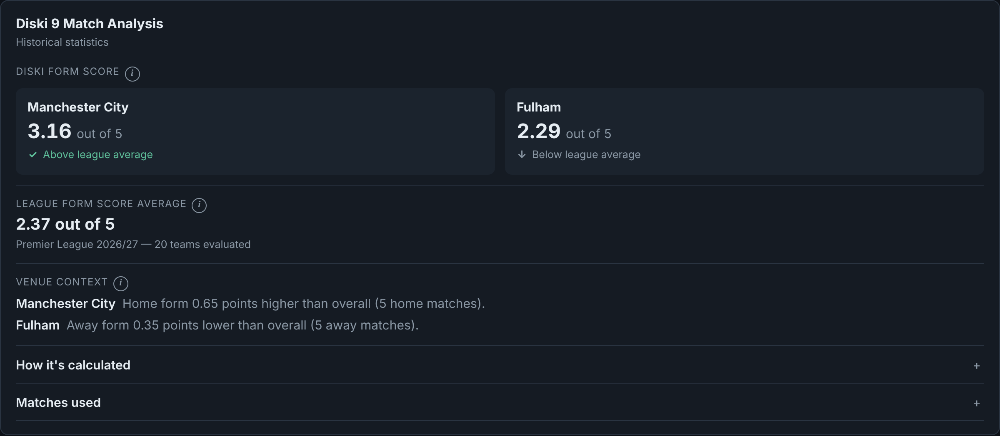
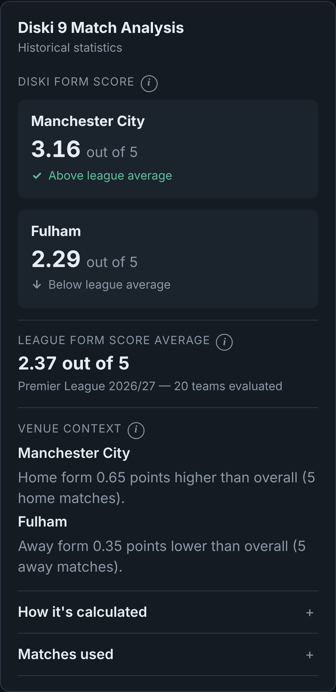
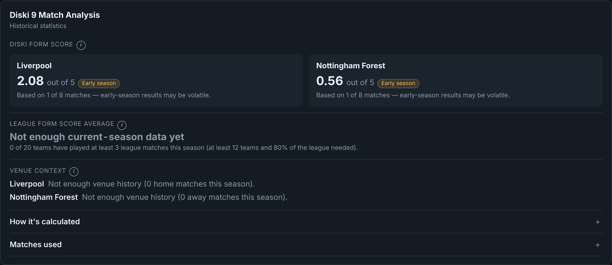

# Match Result Form Score: current season, last eight (engine 2.4.0)

Engine 2.4.0 changes how the Match Result (1X2) Diski Form Score is built and shown.
BTTS and Over/Under 2.5 were reviewed against the same rules and are unchanged.

## Rules (all three markets)

| | Match Result | BTTS | Over/Under 2.5 |
|---|---|---|---|
| Window | last 8 league matches, home or away | last 10 | last 10 |
| Seasons / divisions | current season, current competition only | same | same |
| Denominator | actual matches N | actual matches N | actual matches N |
| Limited-history indicator | "Early season" when N < 8 | "Limited" when N < 6 | "Limited" when N < 6 |
| League average | current season (see policy below) | current season, from 30 matches | same |
| No matches | Unavailable | Unavailable | Unavailable |

All calculations are point in time: only matches that kicked off before the
fixture's kickoff (and before the calculation time) are used.

BTTS and Over/Under already met these rules before 2.4.0 (`team_window(...,
competition_id, season)`, actual-N rates, current-season baseline, Unavailable
states, "Matches used" lists exactly those matches). Their Limited tag starts below
**six** matches rather than below ten; this existing behaviour was kept.

## Form Score with N matches

Model D, generalised to the matches actually played (N = 1…8):

* points part = 2.5 × points ÷ 3N
* goal-difference part = 2.5 × (GD clipped to ±1.8N, + 1.8N) ÷ 3.6N
* Form Score = points part + goal-difference part (0–5)

With N = 8 the cap is ±14.4. Unlike engines 2.1–2.3, a short window is no longer
scored against a fixed denominator: two wins score the same as eight wins by the
same margins. There is no penalty for fewer matches; instead the card says
"Based on N of 8 matches — early-season results may be volatile."

## League Form Score average — early-season policy

One average per competition and season: every team that has played at least one
current-season match contributes its (normalised) score once.

It is **shown only when**:

* at least **12** teams have played **three or more** matches, and
* those teams are at least **80%** of the season's teams.

The season's teams come from the published fixture list (the schedule), not just
the teams that have already played, so round one cannot look like full coverage.
Before the threshold the card reads "Not enough current-season data yet" with the
current count; no 2.5 or zero is substituted. In a 20-team league this normally
switches on after the third round. The thresholds are in `ScreenerConfig`
(`form_benchmark_min_teams`, `form_benchmark_min_share`,
`form_benchmark_min_matches`).

Concerns flagged before implementation:

1. **Coverage denominator** — using the schedule avoids a misleading "100%" when only
   a few teams have played.
2. **Volatility** — one 3-0 win scores 5.00. Requiring three matches for most of the
   league before showing an average keeps the comparison from swinging wildly in
   weeks one and two. (Earlier research found every window performs about the
   same in the first eight weeks.)
3. **Meaning change** — partial windows are now normalised, so early-season scores
   use the full 0–5 range.

## Venue context (display only)

Beneath the cards: the home team's last five current-season **home** matches and
the away team's last five **away** matches, scored the same way, compared with
the team's overall score — e.g. "Home form 0.65 points higher than overall
(5 home matches)". Fewer than two venue matches: "Not enough venue history".
Two to four: "Limited history". It never changes the headline score, the league
average, the Form Difference or the rankings, and has no league benchmark.
Research (`docs/form_adjust_research.md`) found a venue adjustment adds nothing
to the overall eight-match score.

## UI

The Venue/Overall selector is hidden for Match Result (it remains for BTTS and
Over/Under). Screenshots:

* 
* 
* 

## Rebuild

Cached results from older engines are retired automatically and never shown.

```bash
git pull origin claude/gifted-newton-h6o5hk
uv sync
uv run diski9 screener-refresh --days 21
uv run diski9 serve
```

`screener-refresh` makes no API requests.
