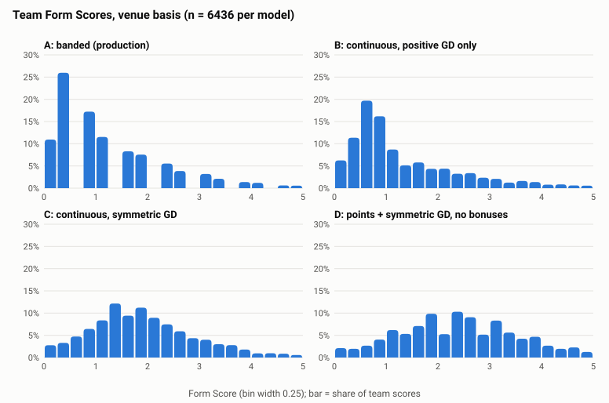
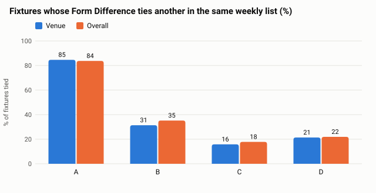

# Milestone 5.2 — Diski Form Score: four candidate methods

*16 November 2026. Research only: the production Form Score (Model A, engine
2.0.0) is unchanged. The plan, formulas and decision rule were written down
before any evaluation ran: [`research/m52/preregistration.md`](research/m52/preregistration.md).*

**Reproduce:**

```
uv run python scripts/research_m52_form.py
```

* Code: `src/diski9/research/form_models.py` (models and dataset) and
  `src/diski9/research/evaluation.py` (scoring rules, walk-forward evaluation,
  bootstrap).
* Tests: `tests/test_m52_form_models.py`.
* Outputs: `docs/research/m52/form_*`.

## Summary

* **Models C and D give a small but real improvement on the Overall basis.**
  Both distinguish negative goal differences. On Overall form their 95%
  intervals against A exclude zero. On Venue form the improvement is not
  significant.
* **The improvement is small.** In log loss it is about 0.0035, roughly 0.3%,
  or a fifth of the gap between A and a no-information baseline.
* **The bonuses add nothing measurable.** C (with bonuses) and D (without)
  perform the same.
* **D is the simplest candidate.** It is "points plus goal difference", and it
  performs the same as the best simple benchmark (a model fitted on last-five
  PPG and goal difference), without fitting any weights.
* **B only reduces ties; it does not improve prediction.**
* **Recommendation: Consider D for Milestone 5.3, with your approval.** The
  main reasons are interpretability and ties, with a modest, statistically
  supported gain on Overall form. C is equivalent but more complicated. B
  should be rejected.

## 1. Baseline reproduced (Milestone 5.1)

Both Milestone 5.1 research scripts were rerun on 16 November. Their CSV and
JSON outputs are **byte-identical** to the committed versions.

The Milestone 5.2 pipeline independently reproduces every finding checked:

| Finding (5.1) | 5.1 | 5.2 reproduction |
|---|---|---|
| Weekly-list fixtures tied, A / B (venue) | 84.6% / 31.4% | 84.6% / 31.4% |
| Distinct team scores, A / B (venue) | 14 / 94 | 14 / 94 |
| Most common A score | 0.38, 1,672 times (26%) | same |
| Share of A scores ≤ 1.0 | 54.1% | 54.1% |
| Windows with GD ≤ 0 | 55.1% | 55.1% (5.1 script rerun, identical output) |
| B − A log loss, first split | −0.0005 (CI includes 0) | walk-forward: −0.0006 [−0.0016, +0.0003] |

## 2. Data and evaluation period

* **Fixtures:** 3,237 eligible completed league fixtures. 2023/24 is used only
  as history for the windows.

  | League | 2024/25 | 2025/26 | 2026/27 (to 8 Nov) |
  |---|---|---|---|
  | EPL | 380 | 380 | 100 |
  | Championship | 552 | 552 | 180 |
  | PSL | 221 | 240 | 73 |
  | PSL 1st Division | 240 | 239 | 80 |

* **Outcomes:** home 1,389 (42.9%), draw 902 (27.9%), away 946 (29.2%).
* **Windows:**
  * 94.5% of fixtures have complete five-match windows for both teams.
  * 23.5% involve a team that changed division since last season (promoted or
    relegated).
  * 8.2% have a window that reaches into another division.
* **Point in time:** a window uses only matches that kicked off strictly before
  the fixture. Tests confirm that rebuilding every row from a store truncated at
  kickoff gives identical scores, and that adding later results never changes
  an earlier row.
* **Out-of-sample:** rolling-origin evaluation with 14 monthly folds, August 2025
  to November 2026.
  * For each month, the secondary model is fitted on every fixture before that
    month and scores that month.
  * Common sample: 1,690 fixtures where every feature, including season-to-date
    venue PPG, exists for both teams.

## 3. Candidate formulas (predeclared)

pts = points in the window; GD = goals for − goals against. Partial windows
use the actual totals of the matches available, as production does.

| Model | Score on 0–5 | Why |
|---|---|---|
| **A** | production bands (points 0–2.5, GD 0–2.5, bonuses 3 × 0.5) × 5 ÷ 6.5 | baseline |
| **B** | 5/6.5 × [2.5·pts/15 + 2.5·min(max(GD,0)/9, 1) + bonuses] | removes steps only |
| **C** | 5/6.5 × [2.5·pts/15 + 1.25 + 1.25·clip(GD/9, −1, 1) + bonuses] | goal difference counts below zero too |
| **D** | 2.5·pts/15 + 2.5·(clip(GD, −9, 9) + 9)/18 | points and goal difference only |

**Weights.**
* Every model keeps production's equal 2.5 / 2.5 split between points and
  goal difference.
* ±9 is production's existing goal-difference cap (1.8 per match).
* No coefficient was fitted to outcomes.
* D is exactly C without the bonuses, rescaled to 5. So C against D measures
  what the bonuses add.

**Properties (tested):**
* Every model is bounded 0–5. A perfect window scores 5; a worst-possible
  window scores 0.
* A better result never lowers a score (3,000 random windows per model).
* Under C and D, GD −1 > GD −8 at equal points. Under A and B they are equal.
* A team with no eligible match is *unavailable*, never 0.

**In plain terms:**
* D: 2.5 points for a perfect points record, plus 2.5 for a goal difference of
  +9 or better.
* An average team (7–8 points, goal difference 0) scores about 2.5, the middle
  of the scale. Under A the same team scores about 0.8.

## 4. Score distributions



**Venue basis, team scores (n = 6,436 per model):**

| | A | B | C | D |
|---|---|---|---|---|
| Mean / median | 1.20 / 0.77 | 1.31 / 0.90 | 1.92 / 1.84 | 2.38 / 2.36 |
| Standard deviation | 1.07 | 1.07 | 1.00 | 1.11 |
| Distinct team scores | 14 | 94 | 188 | 146 |
| Most common value (share) | 0.38 (26%) | 0.64 (10%) | 1.50 (3%) | 1.94 (3%) |
| Share in bottom fifth (≤ 1.0) | 54% | 53% | 17% | 11% |
| Home team (home window) mean | 1.52 | 1.63 | 2.23 | 2.74 |
| Away team (away window) mean | 0.88 | 1.00 | 1.61 | 2.03 |
| Distinct Form Differences | 25 | 192 | 329 | 269 |

* The Overall basis is the same picture: A has 14 distinct scores, 54% at or
  below 1.0; D has 148 distinct scores, 10% at or below 1.0.
* D's histogram has a mild comb pattern, because points move in steps of 1 and
  3 and goal difference in whole goals.

## 5. Ties and rankings



This uses Screener-like lists: every fixture in the same ISO week across the
four leagues, giving 86 weekly lists.

| Venue basis (Overall similar) | A | B | C | D |
|---|---|---|---|---|
| Fixtures tied with another in the list | 85% | 31% | **16%** | 21% |
| Distinct differences per fixture | 0.39 | 0.82 | 0.92 | 0.89 |
| Rank correlation with A | — | 0.987 | 0.957 | 0.930 |
| Top-5 "strongest home form" overlap with A | — | 89% | 79% | 68% |
| Top-5 "strongest away form" overlap with A | — | 90% | 82% | 77% |
| Top-5 "most evenly matched" overlap with A | — | 69% | 57% | 53% |

C and D change the rankings more than B does. The changes come mainly from
teams with negative goal differences, which A and B cannot separate.

## 6. Form Difference and results (predeclared bands)

**Venue basis:** observed home / draw / away rates, with n.

| Form Difference | A | C | D |
|---|---|---|---|
| (−5, −2] | 24 / 22 / 54% (105) | 24 / 17 / 59% (87) | 26 / 21 / 53% (138) |
| (−2, −1] | 33 / 26 / 41% (251) | 30 / 28 / 43% (268) | 33 / 23 / 44% (283) |
| (−1, −0.25] | 38 / 26 / 35% (448) | 41 / 25 / 34% (436) | 41 / 28 / 31% (403) |
| (−0.25, 0.25) | 40 / 31 / 29% (451) | 39 / 33 / 28% (457) | 40 / 33 / 27% (347) |
| [0.25, 1) | 41 / 29 / 31% (735) | 41 / 29 / 31% (695) | 40 / 29 / 32% (605) |
| [1, 2) | 47 / 28 / 25% (722) | 46 / 28 / 26% (774) | 44 / 28 / 27% (778) |
| [2, 5] | 55 / 27 / 18% (490) | 55 / 28 / 17% (485) | 54 / 27 / 19% (648) |

* For every model, home-win rates rise and away-win rates fall across the
  bands. Out of 6 steps, there are at most 2 small reversals per model, all in
  the crowded middle bands.
* The draw rate peaks in the "evenly matched" band at 31–33%, against 28%
  overall. That is a real but weak signal.
* Form Difference is not a probability. These are observed historical
  frequencies.

**Quintiles of Form Difference, venue basis:** home-win rate from bottom to
top fifth.

| Model | Home-win rate, Q1 → Q5 |
|---|---|
| A | 33.6% → 53.2% |
| B | 34.8% → 52.7% |
| C | 34.5% → 53.7% |
| D | 33.9% → 54.0% |

**Overall basis, Q1 → Q5 home-win rate:**

| Model | Home-win rate, Q1 → Q5 |
|---|---|
| A | 36.4% → 54.8% |
| C | 34.4% → 54.3% |
| D | 33.7% → 54.2% |

### Stability across competitions and seasons

This is the venue basis, using league-seasons with at least 100 fixtures (CSV:
`form_stability.csv`). The spread is the home-win rate in Q5 minus Q1.

| Model | Mean spread | Weakest league-season |
|---|---|---|
| A | 0.145 | −0.05 (PSL 1st Div 2024) |
| B | 0.161 | −0.12 |
| C | 0.161 | −0.05 |
| D | 0.177 | −0.07 |

* The signal is strong in the PSL (0.19–0.33) and the EPL in 2024 (0.30–0.34).
* It is weak in the Championship (0.07–0.18).
* It is absent in the PSL 1st Division in 2024 for every model.
* So this is a property of recent form as a signal, not of the scoring scheme.

### Promoted and relegated clubs

There are 760 fixtures involving a team that changed division.
* Home-win rates rise from Q1 to Q5 for all models: A 29.8% → 54.6%; D 30.5%
  → 57.9%.
* Out of sample (433 fixtures), C beats A: −0.0038 [−0.0076, −0.00002]. D does
  not reach significance: −0.0033 [−0.0084, +0.0020].
* The sample is small, so treat this as consistent with the main result, not
  separate evidence.

## 7. Out-of-sample usefulness

* **Secondary model:** a multinomial logistic regression of H/D/A on each
  feature, refitted every month. It is not the Form Score and is never shown
  to users.
* **Data:** 1,690 fixtures, 19 August 2025 to 8 November 2026, in 14 folds.

**Log loss** (lower is better):

| Feature(s) | Venue | Overall |
|---|---|---|
| Baseline (training H/D/A frequencies) | 1.0827 | 1.0827 |
| **A** (production) | 1.0637 | 1.0641 |
| **B** | 1.0630 | 1.0636 |
| **C** | 1.0618 | 1.0603 |
| **D** | 1.0616 | 1.0605 |
| Last-5 PPG difference | 1.0670 | 1.0639 |
| Last-5 GD difference | 1.0615 | 1.0612 |
| PPG + GD (two features) | 1.0617 | 1.0611 |
| Season-to-date venue PPG difference | 1.0674 | 1.0674 |
| PPG + GD + goals scored | 1.0619 | 1.0619 |
| D + three bonus flags | 1.0641 | 1.0604 |

**Brier scores** (venue): baseline 0.6557, A 0.6428, B 0.6423, C 0.6415, D 0.6414.

**Paired log-loss differences**, with a 95% interval from a bootstrap
clustered by ISO week (2,000 replicates). Negative means the first model is
better.

| Comparison | Venue | Overall |
|---|---|---|
| A − baseline | −0.0191 [−0.0270, −0.0103] ✔ | −0.0186 [−0.0272, −0.0099] ✔ |
| B − A | −0.0006 [−0.0016, +0.0003] | −0.0005 [−0.0015, +0.0005] |
| C − A | −0.0019 [−0.0040, +0.0003] | **−0.0038 [−0.0056, −0.0016] ✔** |
| D − A | −0.0021 [−0.0052, +0.0014] | **−0.0036 [−0.0060, −0.0008] ✔** |
| C − D (what bonuses add) | +0.0002 [−0.0014, +0.0017] | −0.0002 [−0.0015, +0.0011] |
| (D + bonus flags) − D | +0.0025 [−0.0001, +0.0051] | −0.0001 [−0.0025, +0.0022] |
| (PPG + GD + GF) − (PPG + GD) | +0.0002 [−0.0003, +0.0007] | +0.0008 [−0.0005, +0.0021] |
| A − (PPG + GD) | +0.0020 [−0.0019, +0.0055] | +0.0030 [−0.0001, +0.0058] |

**Calibration:** expected calibration error on home-win probability (venue)
is A 0.013, C 0.018, D 0.025, baseline 0.012. Every model is well calibrated,
with no bin more than a few points off; see `form_oos_calibration_venue.csv`.

**By league** (venue log loss, CSV: `form_oos_by_league_venue.csv`):
* C and D beat A in the EPL, the Championship and the 1st Division.
* In the PSL, A and B are slightly better (A 1.049, D 1.051). That is noise at
  n = 280.

**Robustness:**
* On complete windows only (1,733 fixtures, venue), the ordering is unchanged:
  A 1.0663, B 1.0658, C 1.0649, D 1.0647. None is significant.

**Multiple comparisons.** About ten comparisons against A were run per basis.
The two Overall-basis results that pass (C and D) are consistent with each
other and with Milestone 5.1's exploratory finding. Even so, the evidence
should be called *modest*, not conclusive.

### What this means

1. **Recent form is genuinely informative, and every model captures most of
   it.** A already improves log loss on the baseline by about 0.019.
2. **Treating every goal difference ≤ 0 as zero throws information away.**
   Restoring it with C or D recovers about another 0.002–0.004.
3. **The bonuses add nothing.** Points and goal difference already contain
   their information, and goals scored adds nothing beyond goal difference.
4. **B's continuous scale alone does not help.** Fewer ties is not better
   prediction.
5. **Overall form is at least as informative as venue form for the 1X2
   question.** Overall is slightly better for C and D, and is more stable.

## 8. Usefulness for Diski 9 users

| | Understandable? | Informative? | Reliable? |
|---|---|---|---|
| **A** | Partly. Bands and bonuses need a tooltip, and 54% of teams sit at 0–1 out of 5, which looks "bad" for an average side. | Yes, baseline. | Yes, but 85% of fixtures tie in rankings. |
| **B** | As A. | No better than A. | Same. |
| **C** | Hard: an offset, a symmetric goal-difference term and bonuses. | Slightly better (Overall). | Yes. |
| **D** | **Yes.** "Half points, half goal difference; 2.5 is an average team." | Slightly better (Overall). | Yes. Few ties (21%), no bonus edge cases. |

## 9. Limitations

* There are three seasons, the current one partial, and four leagues. The test
  period is 1,690 fixtures, and the improvements are small against fixture
  noise.
* The outcome model is a one-feature diagnostic. There were no historical
  bookmaker odds to test whether any form score adds information *beyond the
  market*, which it very likely does not.
* Model C's idea came from inspecting Milestone 5.1 data, so the Overall-basis
  result is not fully independent confirmation. D was declared before this
  evaluation.
* Partial windows are scored on actual totals, as production does. A per-match
  normalisation was not evaluated, and only 5.5% of fixtures are affected.

## 10. Recommendation

| Candidate | Decision |
|---|---|
| A (production) | **Keep** until a decision on D. It works, but it ties heavily and compresses scores. |
| B | **Reject.** It reduces ties only, with no predictive gain. |
| C | **Reject in favour of D.** It is equivalent in performance but harder to explain, and its bonuses add nothing. |
| D | **Consider for Milestone 5.3** (needs your approval). It is simpler to explain and has fewer ties. It shows a small but statistically supported gain on Overall form (−0.0036 log loss, CI excludes zero) and a non-significant gain on Venue form. |
| Remove the bonuses | **Consider** together with D. There is no measurable information in them. |
| Default the 1X2 basis to Overall | **More data needed.** Overall is slightly better for C and D, but the difference is not tested formally. Revisit with D. |

If D is approved, a safe rollout would:
1. show D alongside A in research mode for a few weeks
2. re-run this walk-forward evaluation on the new fixtures
3. switch only if the Overall-basis gain holds (a preregistered rule)
