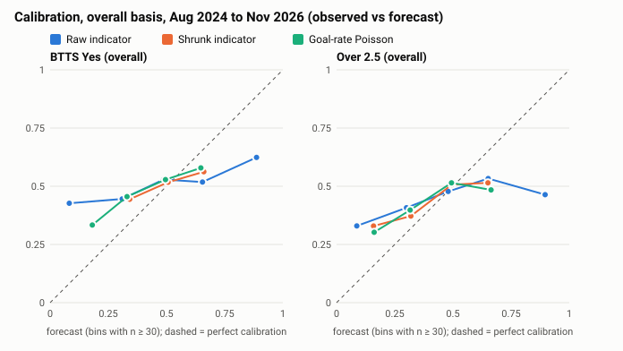

# Milestone 5.2 — BTTS and Over/Under 2.5: how informative are the historical indicators?

*16 November 2026. Research only: the production indicators (current season,
current competition, up to 10 matches per team, mean of the two team rates,
Overall default) are unchanged.*

**Reproduce:**

```
uv run python scripts/research_m52_goals.py
```

* Code: `src/diski9/research/historical_goals.py`.
* Tests: `tests/test_m52_evaluation.py`.
* Outputs: `docs/research/m52/goals_*`.

## Summary

* **Within a league, the current-season BTTS and Over 2.5 indicators barely
  distinguish high-scoring fixtures from low-scoring ones.** Their ranking
  ability (AUC, where 0.5 is a coin toss) is 0.48–0.54 within each league,
  compared with 0.54–0.56 across all leagues. The small apparent signal across
  the whole dataset mostly reflects which *league* a fixture is in. The PSL is
  low-scoring: Over 2.5 happens in 32% of PSL fixtures against 55% in the EPL.
* **Read as probabilities, the indicators are worse than simply quoting the
  league's own current-season rate**, at every sample size and in every league:
  * Brier score: raw indicator 0.264 against league rate 0.248 (BTTS, Overall)
  * shrinking towards the league rate narrows the gap but does not close it
    (0.252)
* **A research goal-rate model (Poisson or Dixon–Coles) built from the same
  data does no better.**
* **Overall beats Venue-specific for the raw indicator,** and significantly so
  (Brier −0.010 for BTTS, −0.011 for Over 2.5). Venue windows have about half
  the matches, and 42% of venue fixtures are below the six-match "Limited"
  threshold.
* **Market-implied probabilities could not be evaluated historically,** because
  no historical odds exist. They are very likely more informative and should be
  the primary goals-market number once validated.
* **Recommendation:** keep the indicators as *descriptive context*, labelled as
  history, not likelihood. Add the league average beside them. Show the
  market-implied probability as the main number. Do not present the indicator
  as a forecast.

## 1. Data and evaluation period

* **Fixtures:** the same four leagues as the Form Score research.
  * The test period is 16 August 2024 – 8 November 2026: 3,121 fixtures on the
    Overall basis, 3,004 on Venue.
  * Matches from 2023/24 feed only the league prior and model training.
* **Common sample:** both teams have at least one current-season match on the
  basis (the production indicator exists), and the league prior exists. Fixtures
  without an indicator, mostly opening rounds, are excluded: 3.6% (Overall) and
  7.2% (Venue).
* **Observed rates:** BTTS Yes 51.2%, Over 2.5 46.2% (Overall sample).

| League | BTTS Yes | Over 2.5 | Fixtures |
|---|---|---|---|
| EPL | 56.5% | 54.9% | 830 |
| Championship | 54.5% | 49.4% | 1,248 |
| PSL | 39.9% | 31.6% | 509 |
| PSL 1st Division | 46.1% | 39.1% | 534 |

* **Point in time:** windows use only matches before kickoff, in the same
  competition and season. Tests cover the same-kickoff exclusion, awarded
  matches, and previous-season and other-division exclusion.

## 2. Candidates

| Candidate | Definition |
|---|---|
| **Raw indicator** *(experiment: read as a probability)* | the production indicator, unchanged |
| **League rate** (baseline) | the competition's current-season rate before kickoff. With fewer than 30 league matches, it is blended with the previous season by weight n/30. This prior is league-level only. |
| **Shrunk indicator** | each team rate shrunk to the league rate with 5 pseudo-matches, (hits + 5 × league) ÷ (n + 5), then averaged |
| **Recalibrated indicator** | logistic regression on the raw indicator, refitted monthly, walk-forward |
| **Goal-rate Poisson / Dixon–Coles** | the historical attack × defence model (section 5), turned into probabilities |
| **Poisson + indicator** | logistic regression on both: does the indicator add anything beyond the model? |
| **Market-implied** | **not evaluable**: 0 historical fixtures have saved pre-kickoff odds |

## 3. Results

### 3.1 Observed frequency by indicator band (Overall basis)

| Indicator band | BTTS: n | BTTS observed | Over 2.5: n | Over 2.5 observed |
|---|---|---|---|---|
| 0–20% | 89 | 42.7% | 185 | 33.0% |
| 20–40% | 530 | 44.5% | 770 | 40.8% |
| 40–60% | 1,532 | 52.9% | 1,474 | 47.8% |
| 60–80% | 861 | 51.8% | 623 | 53.3% |
| 80–100% | 109 | 62.4% | 69 | 46.4% |

* A higher indicator does go with a somewhat higher realised rate. The
  relationship is weak and far flatter than the indicator suggests:
  * fixtures shown at 0–20% saw BTTS 43% of the time
  * fixtures shown at 80–100% saw it 62% of the time
* An indicator of 90% does not mean 90%.



### 3.2 Scores against actual outcomes

Lower Brier and log loss are better. Log loss clips forecasts to 2–98%,
because the raw indicator can be 0% or 100%.

**BTTS, Overall basis (n = 3,121):**

| Candidate | Brier | Log loss | AUC | Calibration error |
|---|---|---|---|---|
| League rate | **0.2484** | **0.6904** | 0.561 | 0.024 |
| Raw indicator (experiment) | 0.2643 | 0.7402 | 0.539 | 0.100 |
| Shrunk indicator | 0.2520 | 0.6981 | 0.552 | 0.056 |
| Recalibrated indicator | 0.2489 | 0.6910 | 0.538 | 0.007 |
| Goal-rate Poisson | 0.2538 | 0.7020 | 0.555 | 0.064 |
| Goal-rate Dixon–Coles | 0.2537 | 0.7017 | 0.555 | 0.063 |
| Poisson, recalibrated | 0.2477 | 0.6885 | 0.555 | 0.013 |
| Poisson + indicator | 0.2478 | 0.6887 | 0.555 | 0.012 |

**Over 2.5, Overall basis (n = 3,121):**

| Candidate | Brier | Log loss | AUC | Calibration error |
|---|---|---|---|---|
| League rate | **0.2433** | **0.6804** | **0.591** | 0.025 |
| Raw indicator (experiment) | 0.2605 | 0.7373 | 0.562 | 0.091 |
| Shrunk indicator | 0.2473 | 0.6895 | 0.581 | 0.046 |
| Recalibrated indicator | 0.2466 | 0.6865 | 0.560 | 0.012 |
| Goal-rate Poisson | 0.2529 | 0.7013 | 0.563 | 0.072 |
| Poisson, recalibrated | 0.2460 | 0.6849 | 0.562 | 0.021 |
| Poisson + indicator | 0.2460 | 0.6850 | 0.562 | 0.015 |

**Paired Brier differences against the league rate**, with a 95% interval
clustered by ISO week. Positive means worse than just quoting the league rate.

| | BTTS Overall | Over Overall | BTTS Venue | Over Venue |
|---|---|---|---|---|
| Raw indicator | +0.016 [+0.011, +0.021] | +0.017 [+0.012, +0.023] | +0.023 [+0.017, +0.030] | +0.025 [+0.017, +0.033] |
| Shrunk indicator | +0.004 [+0.001, +0.006] | +0.004 [+0.002, +0.006] | +0.003 [+0.000, +0.005] | +0.003 [+0.001, +0.006] |
| Recalibrated indicator | +0.000 [−0.003, +0.003] | +0.003 [+0.000, +0.006] | −0.000 [−0.003, +0.003] | +0.003 [−0.000, +0.006] |
| Goal-rate Poisson | +0.005 [+0.002, +0.009] | +0.010 [+0.006, +0.013] | +0.006 [+0.002, +0.009] | +0.008 [+0.004, +0.012] |
| Poisson + indicator | −0.001 [−0.004, +0.002] | +0.003 [−0.001, +0.006] | −0.001 [−0.004, +0.002] | +0.001 [−0.002, +0.005] |

**Does the indicator add anything beyond the goal-rate model?** No. Poisson +
indicator against Poisson alone (both recalibrated): BTTS +0.0001
[−0.0000, +0.0002], Over +0.0001 [−0.0003, +0.0005].

### 3.3 Within-league discrimination (AUC of the raw indicator)

| League | BTTS (Overall) | Over 2.5 (Overall) | BTTS (Venue) | Over 2.5 (Venue) |
|---|---|---|---|---|
| EPL | 0.512 | 0.486 | 0.493 | 0.508 |
| Championship | 0.514 | 0.521 | 0.533 | 0.534 |
| PSL | 0.515 | 0.543 | 0.540 | 0.545 |
| PSL 1st Division | 0.483 | 0.521 | 0.509 | 0.495 |

The goal-rate model is no better within leagues (AUC 0.49–0.57). For football
goals markets, two teams' last few matches simply carry very little
fixture-specific information. Most of the predictable variation is
between leagues.

### 3.4 Sample size and early season

**Overall basis, by the smaller of the two team samples:**

| Matches | Share of fixtures | BTTS AUC (raw) | Brier: league rate | Brier: raw | Brier: shrunk | Spread of indicator (sd) |
|---|---|---|---|---|---|---|
| 1–2 | 7.4% | 0.549 | 0.236 | **0.315** | 0.239 | 0.30 |
| 3–5 | 11.2% | 0.559 | 0.255 | 0.270 | 0.256 | 0.21 |
| 6–9 | 14.3% | 0.550 | 0.246 | 0.262 | 0.252 | 0.16 |
| 10 | 67.1% | 0.528 | 0.249 | 0.258 | 0.253 | 0.13 |

Over 2.5 follows the same pattern (raw Brier 0.318 at 1–2 matches, 0.253 at
10). The full table, including Venue, is in `goals_by_sample_size.csv`.

* **With 1–5 matches the raw indicator is badly miscalibrated.** It often reads
  0% or 100%, and its Brier score is 0.27–0.32 against 0.24–0.26 for the
  league rate.
* **Even at the full 10 matches it is still worse than the league rate.** So
  "five matches" is not enough, and neither is ten. The production "Limited"
  threshold of 6 flags the worst cases, but the problem does not disappear
  above it.
* **How common early-season cases are:**

  | Basis | Below 6 matches ("Limited") | No indicator | Full 10-match windows |
  |---|---|---|---|
  | Overall | 21.5% | 3.6% | 64.7% |
  | Venue | **41.5%** | 7.2% | 38.3% |

### 3.5 Overall versus Venue-specific

This uses the same 3,004 fixtures on both bases, as paired Brier differences
(Venue − Overall).

| | Raw indicator | Shrunk indicator |
|---|---|---|
| BTTS | **+0.0103 [+0.0044, +0.0166]**: Overall better | −0.0010 [−0.0034, +0.0014]: no difference |
| Over 2.5 | **+0.0114 [+0.0059, +0.0172]**: Overall better | −0.0006 [−0.0028, +0.0017]: no difference |

* As displayed, Overall is clearly better.
* Venue's disadvantage is entirely its smaller samples: once both are shrunk
  towards the league rate, they are equal.
* Venue-specific is only worth considering for late-season fixtures where both
  teams have about 10 venue matches, and even then it does not beat Overall.

## 4. Market and model comparison

* **Market-implied BTTS / O2.5 probabilities:** 0 settled fixtures with saved
  pre-kickoff odds exist, so no comparison is possible. The validation pipeline
  ([goal model report](milestone5_2_goal_model_research.md), section 7) will
  evaluate them as results arrive.
* **Market against indicator in the same fixture:** this needs settled
  fixtures, so the comparison has to wait.
* **Goal-rate Poisson and Dixon–Coles (research):**
  * The raw versions are over-confident: predicted totals range too widely. In
    the lowest band (predicted total under 2.25) they predict 1.89 goals
    against 2.21 observed; in the highest band (over 3.0), 3.34 against 2.74.
  * Recalibrated, they match the league rate but do not beat it.
  * Dixon–Coles adds nothing for these markets: Over 2.5 is identical, and the
    BTTS difference is −0.0001.

## 5. Research goal-rate model (for reference)

* **Model:** λ_home = league home goals × home attack × away defence (and
  likewise for away). Team ratios use current-season, current-competition
  matches only, shrunk with 5 pseudo-matches. The league prior is as above.
* **Mean predictions (Overall):** home 1.36 predicted against 1.39 observed;
  away 1.11 against 1.11.
* **Total-goals distribution:**

  | | 0 | 1 | 2 | 3 | 4 | 5+ |
  |---|---|---|---|---|---|---|
  | Observed | 8.3% | 20.0% | 25.5% | 22.3% | 13.7% | 10.3% |
  | Poisson | 9.8% | 21.4% | 24.6% | 19.8% | 12.6% | 11.8% |

  The model has too many 0–1 and 5+ goal games, and too few 2–3. That is the
  same over-dispersion of λ.

## 6. Usefulness for Diski 9 users

| | Understandable? | Informative? | Reliable? |
|---|---|---|---|
| Raw indicator (current) | Yes ("6 of 10 recent matches") | **Very little within a league** | Misleading as a percentage, especially early season |
| League rate | Yes ("PSL games: BTTS 40%") | Yes, it is the main source of variation | Stable |
| Shrunk indicator | Harder ("adjusted towards league average") | No better than the league rate | Stable |
| Market-implied | Yes (already shown) | Expected to be the best; **unvalidated** | Depends on fresh odds |

## 7. Limitations

* There are no historical odds, so the most important comparison (indicator
  against market) cannot be made yet.
* The shrinkage constant (5) and league-prior rule were fixed in advance, not
  tuned. A tuned version might do slightly better, but cannot exceed the
  recalibrated results, which are about equal to the league rate.
* Four leagues over about two and a half seasons. Results are consistent across
  leagues and bases.

## 8. Recommendation

| Candidate | Decision |
|---|---|
| Keep the current-season indicators as descriptive history ("BTTS in 6 of last 10") | **Keep**, but stop implying a likelihood. |
| Show the league's current-season rate next to the indicator | **Consider for Milestone 5.3.** It is simple, honest, and the strongest historical signal. |
| Make the market-implied BTTS / O2.5 probability the primary number | **Consider** (it is already displayed). Validate it with the pipeline as results arrive. |
| Overall as default | **Keep** (it is significantly better than Venue for the raw indicator). |
| Venue-specific option | **Keep as optional**, with the existing Limited warning. Consider hiding it until both teams have 6 or more venue matches. |
| Shrunk indicator in production | **Reject.** More complex, and still worse than the league rate. |
| Historical goal-rate Poisson / Dixon–Coles for BTTS / O2.5 | **Reject** (no better than the league rate). |
| Early season (fewer than 6 matches) | **Consider**: show the league rate instead of the team percentage, keep the counts ("2 of 3"), and keep the Limited flag. |
