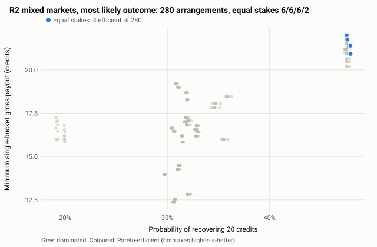
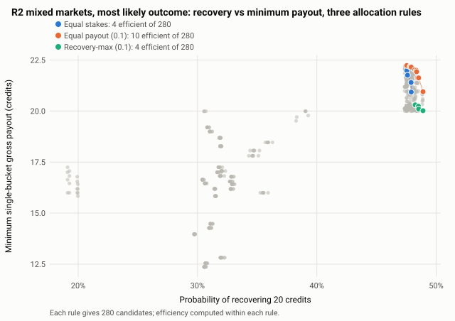
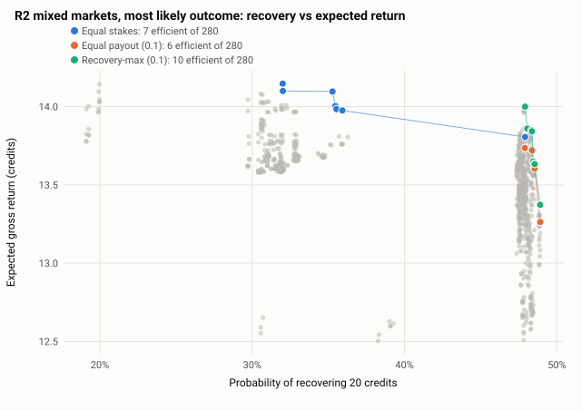
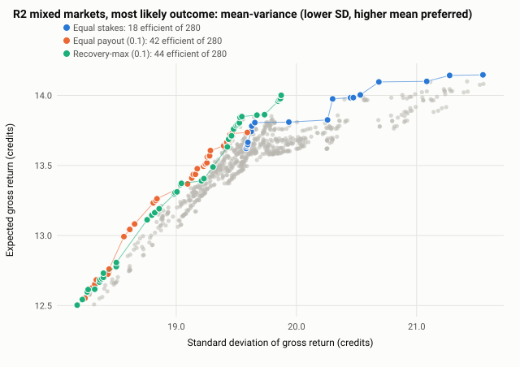
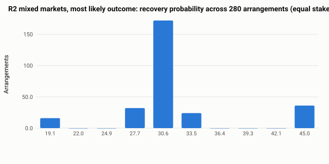
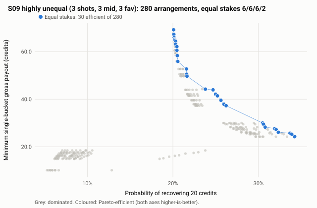
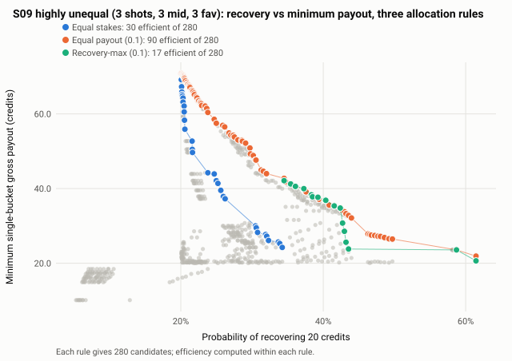
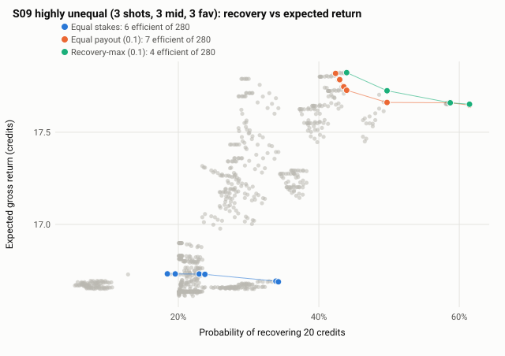
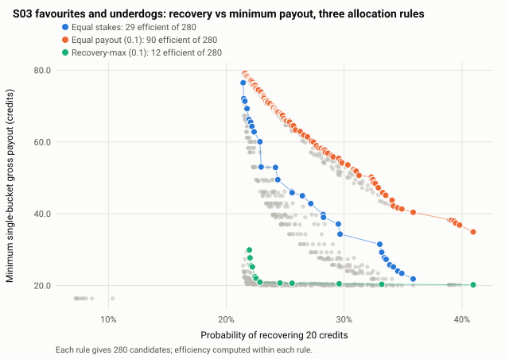
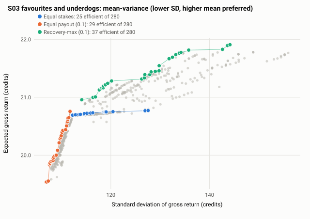

# Weekly Challenge portfolio optimisation — mathematical research (Phase 5B)

Research only. Nothing here is implemented in the app.

* **Branch:** `research/weekly-challenge-optimisation`, from `main` at v3.2.0 (`2b4dcd7`).
* **Goal Model 1.0 is unchanged:** k_s 12, k_t 96, m0 30, version 1.0.
* **Code:**
  * maths: `src/diski9/research/challenge_portfolio.py`
  * experiments: `challenge_experiments.py`
  * read-only data loading: `challenge_data.py`
  * charts: `challenge_charts.py`
  * runner: `scripts/research_challenge_portfolio.py`
  * tests: `tests/test_challenge_portfolio.py`
* **Results:** `docs/research/weekly_challenge/challenge_results.json`
* **Frozen real-data snapshot:** `docs/research/weekly_challenge/challenge_real_slates.json`

---

## Decision summary

| | Decision | Evidence |
|---|---|---|
| **Adopt** | Exact eight-state calculation of every portfolio metric (no simulation needed) | Matches the analytical E[R] identity and an exact rational implementation to machine precision. Monte Carlo agrees. |
| **Adopt** | 280 canonical partitions with stable IDs (`012\|345\|678`) | Tested: count, uniqueness, coverage, determinism. |
| **Adopt** | Credits as integer 0.1-credit ticks | Sums are exact by construction; increments are a single parameter. |
| **Adopt** | Equal stakes 6/6/6/2 as the **default** allocation | In 85% of 56,000 random partitions, allocation cannot change recovery at all. It is simple and transparent, and it never lands knife-edge just under 20. |
| **Adopt** | Show each bucket's **own payout and win probability**, and whether one winning bucket recovers 20 | The single most decision-relevant fact: it decides whether allocation matters at all. |
| **Adopt, with caveats** | A Pareto chart of the 280 arrangements for a declared allocation rule | The frontier is real but **sparse** (4–12 of 280 efficient in real slates) and **not robust to model error** (below). |
| **Adopt** | Primary chart axes: recovery probability (x) vs **expected gross return** (y), for one declared allocation rule (equal stakes) | Probability-weighted on both axes. Minimum payout is shown in the detail instead. Pooling several rules on one chart is not neutral (§15). |
| **Reject** | Recovery vs minimum single-bucket payout as the *primary* chart | Biased to equal payouts by construction. It ignores how likely the minimum-payout bucket is, and rewards long-shot buckets. |
| **Reject** | Mean-variance as a user-facing frontier | Returns are lumpy and heavily skewed. SD is dominated by the rare nine-fold win, so "volatility" misleads. |
| **Reject** | Recovery-maximisation as a default recommendation | It pushes bucket payouts to exactly 20.0, is the most sensitive to model error, and can lower expected return. |
| **Reject** | Whole-credit-only allocation (if allocation is user-adjustable) | Costs up to 11 percentage points of recovery in a real slate. 0.5-credit steps cost about 1 point; 0.1-credit steps about 0.1. |
| **Investigate** | A *guarded* equal-payout helper: balance payouts only when it does not lower recovery | Equal payouts help in 14% of partitions (mean +26 points) and hurt in 0.4% (down to −20 points), always at the 20-credit threshold. |
| **Investigate** | Fixture dependence and model uncertainty | Rankings are robust to hypothetical dependence, but the "best" arrangement is not robust to plausible model error. |
| **Investigate** | A variable nine-fold stake | Out of scope here. The nine-fold changes recovery only at extreme odds. |

---

## 1. Executive summary

1. **The maths is exact and cheap.**
   * Three disjoint buckets give 2³ = 8 win/loss states. Every metric (recovery
     probability, expected return, SD, payouts) comes exactly from these eight
     states.
   * All 280 partitions × all allocations on a 0.1-credit grid (7,381 per
     partition) take about 7 seconds per slate.
2. **Whether allocation matters is decided by one question: can a single winning
   bucket return 20 credits?**
   * If every bucket's payout is at least 20, recovery equals
     P(at least one bucket wins) = 1 − ∏(1 − P_j). That depends only on the
     grouping, so **no allocation rule can change it**.
   * This held in 85.1% of 56,000 random partitions, and in every partition of
     two of the four real slates.
3. **Where some bucket cannot recover alone, the allocation matters a lot.**
   * Equal payouts and recovery-maximisation both raise recovery, by a mean of
     +26 percentage points when they help (maximum +59).
   * But **equal payouts is not always better**: in 0.4% of partitions it
     lowered recovery (by up to 20 points). It does that by levelling every
     payout to just under 20.
4. **Recovery-maximisation works exactly but has an undesirable signature.**
   * It holds the "weak" buckets at exactly 20.0 credits and concentrates the
     rest. It sometimes raises and sometimes lowers expected return.
   * It leans hardest on the model's probabilities.
5. **The efficient frontier is real but sparse and stepped, not a curve.**
   * Real slates under equal stakes: 4–12 efficient arrangements of 280.
   * Symmetric slates collapse to a single coordinate.
6. **Frontier membership is not robust to model uncertainty.**
   * Perturbing each model probability by a modest logit noise (sd 0.3) left
     only 3–30% overlap (mean Jaccard) with the original frontier.
   * The top-recovery arrangement survived in 0–11 of 30 draws.
   * A "Diski 9 recommended arrangement" must therefore be presented as
     conditional on Goal Model 1.0, not as a fact.
7. **Hypothetical dependence barely re-orders arrangements** (Kendall τ ≥ 0.94,
   frontier overlap ≥ 0.82), but it shifts recovery up by up to about 7 points and expected
   return by large amounts. This is mostly through the nine-fold.
8. **The nine-fold almost never changes recovery.** In the one state where it
   pays, the three buckets have usually recovered already. The only exception
   needed odds near 1.03. It does add 3–36% of expected return.
9. **Real slates expose the model-vs-market gap.**
   * With model probabilities, expected gross return ranged from about 10–14
     credits (favourites; Goal Model 1.0 is more cautious than the market) to
     70–140 credits (positive-edge underdogs).
   * With market-implied probabilities, every slate sits near 16 credits: the
     compounded bookmaker margin.
   * Expected-return figures are therefore model claims and must be labelled as
     such.

## 2. Research questions

1. How many distinct arrangements exist, and how much do they differ?
2. How do equal stakes, equal payouts and recovery-maximisation compare on
   recovery, expected return, volatility and payouts?
3. When is one winning bucket enough? When are two needed? When does the
   nine-fold matter?
4. Does a meaningful efficient frontier exist? Which axes are most educational?
5. How sensitive are the conclusions to credit granularity, model error,
   market-implied probabilities and dependence between fixtures?

## 3. Mathematical definitions

**Inputs, for each selection i:**
* p_i: the Goal Model 1.0 probability of the chosen outcome.
* o_i: its consensus decimal odds, at 2-decimal precision.

**Buckets and the nine-fold:**
* Bucket j: P_j = ∏_{i∈j} p_i and O_j = ∏_{i∈j} o_i.
* Nine-fold: P_9 = ∏ p_i and O_9 = ∏ o_i.

**Stakes:** s_A + s_B + s_C = 18 with each s_j ≥ 2, and s_9 = 2, for a total of 20.

**Payouts:**
* Bucket j: R_j = s_j O_j.
* Nine-fold: R_9 = 2 O_9.

**Return:**

R = R_A I_A + R_B I_B + R_C I_C + R_9 I_9, where **I_9 = I_A I_B I_C**.
The nine-fold is not a fourth independent bet.

**Metrics:**
* Net result: Π = R − 20.
* Recovery: P_recover = P(R ≥ 20).
* Profit: P(R > 20).
* Complete loss: P(no bucket wins).
* At least one bucket wins: P(any) = 1 − ∏(1 − P_j).
* Expected gross return: E[R]. Expected net: E[R] − 20.
* Standard deviation: σ_R.
* Maximum payout: R(1,1,1).
* Minimum single-bucket payout: min_j R_j.

**Expected return is not potential payout.** The maximum payout is what happens
in the single best state; E[R] is the probability-weighted average over all
eight states.

## 4. Independence assumption

* **Primary model:** fixture outcomes are independent. This is the standard
  accumulator assumption, and it gives P_9 = P_A P_B P_C.
* **Why it may fail:**
  * shared influences, such as league-wide weather, a refereeing trend, or a
    common information shock;
  * correlated model errors, since one model prices all nine outcomes;
  * logically linked outcomes. These cannot occur here: each fixture appears
    once, and only one outcome per fixture is chosen.
* **No correlation model is calibrated.** Section 12.3 uses clearly labelled
  hypothetical scenarios instead.

## 5. Partition enumeration

**Construction:**
* Selections are numbered 0–8.
* Each partition is canonical: groups are sorted internally and ordered by their
  smallest element.
* They are generated by placing selection 0 with 2 of the remaining 8 (28 ways),
  then the smallest remaining selection with 2 of the remaining 5 (10 ways).
* That gives 28 × 10 = 280 = 9! / ((3!)³ 3!).
* Bucket labels A, B and C are canonical positions, not user choices.
* IDs are the canonical string, e.g. `012|345|678`. They run in lexicographic
  order from `012|345|678` to `078|156|234`.

**Tested:**
* exactly 280 unique partitions, not the 84 three-element subsets;
* each selection appears exactly once in every partition;
* deterministic order;
* identical inputs collapse to a single objective point.

## 6. Allocation strategies and constraints

* **Credits are integer ticks of 0.1:**
  * the buckets share exactly 180 ticks, each with at least 20;
  * increments of 0.1, 0.5 and 1.0 credit are 1, 5 and 10 ticks;
  * the grids hold 7,381, 325 and 91 allocations, all enumerated exhaustively;
  * every allocation sums to exactly 20 credits (integer arithmetic), and the
    two-credit minimum is never clipped away.
* **Equal stakes:** 6 / 6 / 6 / 2.
* **Equal payouts:**
  * Continuous: s_j = Q / O_j with Q = 18 / Σ(1/O_j).
  * If any s_j < 2, "water-filling" applies: those buckets are held at 2 (their
    payout then sits *above* the common level), and the remaining credits
    equalise the rest, iterating.
  * This minimises max − min payout exactly. Tests verify it against an
    independent linear programme.
  * Discrete versions minimise the payout range over the grid. Ties go, in
    order, to the smaller squared deviation, the higher E[R], and then the
    lexicographically smallest stakes.
  * The squared-deviation objective was also run (§13).
* **Recovery-maximisation:**
  * Discrete: exhaustive search of the grid.
  * Sequential tie-breaks: higher E[R], lower σ, smaller payout range,
    lexicographic stakes. These are **sequential tie-breaks, not a multi-objective
    optimisation**.
  * Continuous: an exact threshold formulation (§7.2), not a local optimiser.

## 7. Exact eight-state return distribution

### 7.1 Computation

Each state (a, b, c) has:
* probability ∏ P_j^{s_j} (1 − P_j)^{1 − s_j}, where s_j ∈ {0, 1} marks whether
  bucket j wins in that state;
* return a R_A + b R_B + c R_C + abc R_9.

E[R], Var(R), P(R ≥ 20) and P(R > 20) are sums over these eight states.

**Independent checks, all in the tests:**
* E[R] = Σ_j P_j s_j O_j + P_9 (2 O_9);
* P(any) = 1 − ∏(1 − P_j);
* P(1,1,1) = P_9 = P_A P_B P_C;
* an exact rational (`Fraction`) implementation agrees to within 1e-12;
* Monte Carlo with 400,000 draws agrees to within 0.003.

**Hand-checked example 1 (fair coins):** every p = 0.5 and every o = 2.00.
* Each bucket: P_j = 1/8 and O_j = 8, so R_j = 48 at 6 credits.
* Nine-fold: R_9 = 2 × 512 = 1,024, with P_9 = 1/512.
* E[R] = 3 × (1/8 × 48) + 1/512 × 1,024 = 18 + 2 = **20** exactly (fair odds).
* P_recover = P(any) = 1 − (7/8)³ = **169/512 = 33.0%**, because a single bucket
  (48 credits) already recovers.

**Hand-checked example 2 (low odds):** every p = 0.8 and every o = 1.20.
* Each bucket: P_j = 0.512 and R_j = 6 × 1.728 = 10.368 < 20, so one bucket is
  not enough.
* Two buckets: 20.736 ≥ 20.
* P_recover = P(≥ 2 of 3) = 3(0.512)²(0.488) + 0.512³ = **0.5180**.

### 7.2 Exact continuous recovery maximum

P(R ≥ 20) depends only on which states reach 20.

* Those states form an **up-set**: a state with more winning buckets pays at
  least as much. There are exactly 19 up-sets of the seven non-empty states.
* For each up-set, the stakes achieving it form a convex polygon on the
  allocation simplex, bounded by the linear constraints R(s) ≥ 20.
* Feasibility is decided by a linear programme. The most probable feasible
  up-set is the global optimum; among its stakes, the one with the highest E[R]
  is reported.
* Tests confirm two things: on random low-odds cases, a rational brute force
  over the whole-credit grid never beats the discrete optimiser; and the
  continuous optimum is never below any grid optimum and is actually achieved by
  the reported stakes.

## 8. Efficient-frontier methodology

* **Dominance:** u dominates v if it is at least as good on both axes and
  strictly better on one. Directions are declared per chart; SD is
  lower-is-better.
* **Tolerances:**
  * coordinates are snapped to grids first: probability 1e-12, credits 1e-6;
  * points with *identical* snapped coordinates never dominate each other, so a
    shared efficient coordinate keeps every partition that has it;
  * the report counts partitions and distinct coordinates separately.
* **Order-independence:** the result is tested to be invariant to enumeration
  order.
* **Frontiers computed** (each separately per allocation rule, plus a combined
  pool of 840 candidates):
  * C: recovery vs minimum payout;
  * B: recovery vs expected return;
  * A: mean-variance.
* **Nothing is smoothed.** The charts join efficient points with a thin line in
  x order only to show the step structure.

## 9. Synthetic experiments (13 scenarios; seeds fixed in the script)

**Recovery, equal stakes vs the other strategies.** Recovery figures are
min–max across the 280 arrangements. "Mean change" is the recovery change vs
equal stakes, averaged over all 280 arrangements, with how many got better or
worse.

| Scenario | Recovery: equal stakes | Recovery: equal payout | Equal payout, mean change (better / worse) | Recovery-max, best | Recovery-max, mean change |
|---|---|---|---|---|---|
| S01 identical (0.50 @ 2.00) | 33.0% – 33.0% | 33.0% | 0 | 33.0% | 0 |
| S02 similar coin-flips | 32.1 – 32.8% | 32.8% | 0 | 32.8% | 0 |
| S03 favourites + underdogs | 7.2 – 35.9% | 41.0% | +1.1 pp (10 / 0) | 41.0% | +1.1 pp |
| S04 strong favourites (~1.2) | 19.0 – 19.0% | 19.0% | 0 | **62.3%** | **+40.2 pp** |
| S05 long shots | 2.7 – 3.5% | 3.5% | 0 | 3.5% | 0 |
| S06 same odds, different p | 31.6 – 35.8% | 35.8% | 0 | 35.8% | 0 |
| S07 model above market | 36.2 – 41.3% | 41.3% | 0 | 41.3% | 0 |
| S08 model below market | 17.0 – 32.8% | 33.9% | +4.9 pp (100 / 0) | 33.9% | +4.9 pp |
| S09 highly unequal | 5.3 – 34.2% | 61.4% | +11.7 pp (100 / 0) | 61.4% | +11.7 pp |
| S10 odds 1.20 (one bucket insufficient) | 51.8 – 51.8% | 51.8% | 0 | 51.8% | 0 |
| S11 odds ~1.30 (two buckets needed) | 40.4 – 40.4% | 40.4% | 0 | 46.1% | +4.3 pp |
| S12 extreme favourites (1.03) | 69.3 – 69.3% | 69.3% | 0 | 69.3% | 0 |
| S13 low odds, mixed | 18.1 – 42.5% | 62.1% | +21.4 pp (169 / **8**) | 62.1% | +24.0 pp |

**Arrangements, frontier and expected return per scenario:**

| Scenario | One bucket recovers (of 280) | Equal payout infeasible | Efficient (equal stakes / equal payout / recovery-max) | Distinct coordinates (equal stakes) | E[R] range, equal stakes |
|---|---|---|---|---|---|
| S01 | 280 | 0 | 280 / 280 / 280 | 1 | 20.00 |
| S02 | 280 | 0 | 16 / 17 / 9 | 280 | 16.65 – 16.66 |
| S03 | 270 | 112 | 29 / 90 / 12 | 263 | 20.68 – 20.77 |
| S04 | 0 | 0 | 12 / 24 / 6 | 12 | 16.72 – 16.73 |
| S05 | 280 | 1 | 20 / 44 / 8 | 280 | 17.19 – 17.23 |
| S06 | 280 | 0 | 1 / 1 / 1 | 245 | 18.83 – 21.15 |
| S07 | 280 | 0 | 27 / 51 / 9 | 280 | 28.63 – 28.65 |
| S08 | 180 | 0 | 24 / 34 / 8 | 280 | 9.39 – 9.42 |
| S09 | 180 | 176 | 30 / 90 / 17 | 273 | 16.63 – 16.73 |
| S10 | 0 | 0 | 280 / 280 / 280 | 1 | 17.31 |
| S11 | 0 | 0 | 10 / 5 / 1 | 280 | 16.88 – 16.89 |
| S12 | 0 | 0 | 280 / 280 / 280 | 1 | 19.21 |
| S13 | 90 | 189 | 15 / 38 / 10 | 276 | 17.26 – 17.28 |

What these show:

* **Symmetry and collapse:**
  * S01, S10 and S12 (identical selections) give a single coordinate, so all 280
    arrangements are "efficient" (they tie).
  * S06 (identical odds, so every bucket pays 48) gives exactly one efficient
    arrangement: the one with the highest recovery.
* **Two buckets needed (S04, S11):**
  * Equal payouts cannot help: equalising leaves every bucket below 20.
  * Recovery-max deliberately makes one bucket big enough to recover alone
    (S04: 19% → 62%). This is the largest single effect in the study. It comes
    with lower minimum payouts and, in S11, more volatility.
* **Unequal odds (S03, S09, S13):** equal payout is often infeasible against the
  two-credit minimum, yet it lifts recovery when it pulls a weak bucket over 20.
* **S13 is the counter-example:** in 8 arrangements equal payout lowers recovery.
* **The nine-fold changes recovery only in S12** (all odds 1.03). There, the three
  buckets winning returns 18 × 1.0927 = 19.67 < 20, and only the nine-fold
  (2 × 1.305) lifts the state over 20: +69 points.

### 9.1 Random study (200 seeded realistic slates × 280 = 56,000 partitions)

How the slates were generated:
* p ~ Beta(2.2, 2.6), clipped to 0.08–0.92;
* market probability = p × exp(N(0, 0.12));
* odds = 1 / (market probability × 1.05), rounded to 2 dp.

Results:
* **Allocation cannot change recovery:** in 47,635 partitions (85.1%), every
  bucket recovers alone at 6/6/6. In 66 of the 200 slates, this held for all 280
  partitions.
* **Equal payout vs equal stakes (continuous):**
  * better in 7,997 (14.3%), with a mean gain of **+25.9 points** (maximum +59.3);
  * **worse in 225 (0.4%)**, with a mean loss of −10.1 points (minimum −19.9);
  * the same in 47,778 (85.3%);
  * exact equal payouts were infeasible in 24,322 partitions (43.4%).
* **Recovery-max (0.5-credit grid) vs equal stakes:** better in 8,252 (14.7%),
  with a mean gain of +25.8 points (maximum +59.3).
* **The nine-fold changed recovery in 0 of 56,000 partitions.**

## 10. Real-data experiments

**The snapshot** (frozen in `weekly_challenge/challenge_real_slates.json`):
* taken 17 Nov 2026 at 22:01 UTC, for the window of 20–23 Nov 2026;
* 60 eligible fixtures: EPL 10, Championship 12, Ligue 1 9, Bundesliga 9,
  Serie A 10, La Liga 10;
* the PSL and PSL 1st Division had no qualifying odds;
* every selected market was fresh, with 6–10 independent bookmaker groups (at
  least 3 required).
* This is a *research* snapshot, not an immutable Challenge submission. Only the
  database was read; tests confirm nothing was written.

**Selection rules** (deterministic; fixtures taken round-robin across leagues in
kickoff order):
* **R1 model favourites (1X2):** the most likely 1X2 outcome.
* **R2 mixed markets:** cycling 1X2 → BTTS → Over/Under 2.5, taking the most
  likely outcome in that market.
* **R3 largest positive model edge:** in any market (the only edge-driven slate).
* **R4 mid-probability outcomes:** model probability between 30% and 50%.

**Results:**

| Slate | Recovery: equal stakes | Best recovery (equal payout / recovery-max) | Mean change vs equal stakes, equal payout (better / worse) | One bucket recovers | E[R], equal stakes | E[R], recovery-max | Efficient (equal stakes / equal payout / recovery-max) |
|---|---|---|---|---|---|---|---|
| R1 favourites | 10.0 – 37.1% | 38.0% / 38.0% | +11.2 pp (210 / 0) | 70 | 10.33 – 11.42 | 9.14 – 11.48 | 5 / 12 / 6 |
| R2 mixed markets | 19.1 – 47.9% | 48.9% / 48.9% | +14.4 pp (241 / 0) | 36 | 13.58 – 14.15 | 12.50 – 14.00 | 4 / 10 / 4 |
| R3 positive edge | 13.7 – 20.7% | 20.7% / 20.7% | 0 | 280 | 69.6 – 89.4 | 69.8 – 140.6 | 12 / 20 / 5 |
| R4 mid-probability | 21.5 – 21.9% | 21.9% / 21.9% | 0 | 280 | 12.98 – 14.76 | 13.38 – 19.27 | 5 / 3 / 7 |

**The three allocations on the best equal-stakes arrangement of each slate:**

| Slate (arrangement) | Rule | Stakes | Bucket payouts | Recovery | E[R] | σ |
|---|---|---|---|---|---|---|
| R2 (`068\|157\|234`) | Equal stakes | 6 / 6 / 6 | 20.93 / 23.32 / 22.63 | 47.9% | 13.81 | 19.7 |
| | Equal payout (0.1) | 6.4 / 5.7 / 5.9 | 22.33 / 22.15 / 22.25 | 47.9% | 13.72 | 19.6 |
| | Recovery-max (0.1) | 5.8 / 5.2 / 7.0 | 20.23 / 20.21 / 26.40 | 47.9% | 14.00 | 19.9 |
| R1 (`024\|158\|367`) | Equal stakes | 6 / 6 / 6 | 23.32 / 35.37 / 20.14 | 37.1% | 10.50 | 17.9 |
| | Equal payout (0.1) | 6.4 / 4.2 / 7.4 | 24.87 / 24.76 / 24.84 | 37.1% | 10.89 | 17.8 |
| | Recovery-max (0.1) | 5.2 / 3.4 / 9.4 | 20.21 / 20.04 / 31.55 | 37.1% | 11.28 | 18.3 |
| R3 (`023\|178\|456`) | Equal stakes | 6 / 6 / 6 | 53 / 304 / 1,620 | 20.7% | 73.5 | 2,580 |
| | Equal payout (0.1) | 13.6 / 2.4 / 2.0 | 120 / 122 / 540 | 20.7% | 59.0 | 2,561 |
| | Recovery-max (0.1) | 2.3 / 2.0 / 13.7 | 20.4 / 101 / 3,699 | 20.7% | 87.2 | 2,628 |

How to read these:

* **All three rules recover equally** on these arrangements, because every
  bucket already recovers alone. The rules differ only in where the money sits:
  * equal payout balances the payouts;
  * recovery-max (with the E[R] tie-break) moves credits towards the bucket with
    the highest P_j·O_j and holds the others at exactly 20.0.
* **R3 shows why expected return must be labelled as a model claim.**
  * It mixes model-favoured underdogs, e.g. Como v Cagliari away: model 23%,
    market 10%, odds 9.55.
  * That yields E[R] of 70–140 credits, about 36% of it from the nine-fold.
  * It is the known Goal Model 1.0 favourite/underdog caution, not market
    mispricing.
* **Market-implied probabilities** (separately labelled sensitivity):
  * E[R] sits near 16 credits for every slate (R1 16.40, R2 16.33, R3 16.35,
    R4 15.73). That is the compounded margin: about 0.95 per selection, about 0.86
    per bucket, about 0.63 for the nine-fold.
  * Recovery rises for the favourite slates (R1 up to 59.3%, R2 up to 59.4%,
    because the market rates favourites higher than the model) and falls for R3
    (5.0–11.8%).

## 11. Charts

All figures are SVGs in `docs/research/weekly_challenge/figures/`, built from calculated values
only. Grey points are dominated; coloured points are efficient within their
allocation rule.

**R2 mixed-markets slate (real data)**







**S09 highly unequal slate (synthetic)**





**S03 favourites and underdogs (synthetic)**




## 12. Sensitivity analysis

### 12.1 Credit granularity

**Recovery gap vs the continuous optimum, recovery-max.** Values are the mean
gap across 280 arrangements; the brackets give the largest single gap. Every
other scenario: 0 at every increment.

| Slate | 0.1 credit | 0.5 credit | 1.0 credit |
|---|---|---|---|
| R2 mixed | 0.14 pp | 1.01 pp | **3.99 pp** (11.0) |
| R1 favourites | 0.00 | 0.02 | 0.25 (7.4) |
| S13 low odds | 0.05 | 0.31 | 0.57 (9.6) |

* **Single arrangements can differ more.** Even at 0.1 credits, one R2
  arrangement recovers 10.1 points less than the continuous optimum (8.3 in S13).
  Its continuous optimum needs a payout of *exactly* 20.0 credits, which no
  0.1-credit stake reaches.
* **Equal payouts at whole credits** lose 5.0 points of recovery in R2 (1.9 in
  S13, 0.7 in R1) vs continuous. The payout range grows from about 0.3–0.6
  credits (0.1 steps) to about 3–6 credits (1.0 steps) in real slates with
  feasible equalisation.
* **Granularity only matters where payouts sit near 20.** There it matters a lot.

### 12.2 Model-probability error

Each model probability was perturbed on the logit scale, N(0, 0.3), with the
odds fixed, over 30 draws. Results for the equal-stakes recovery-vs-minimum-payout
frontier, non-degenerate slates:

* **Overlap with the original frontier (mean Jaccard):**
  * real slates: R1 0.28, R2 0.26, R3 0.26, R4 0.18;
  * synthetic slates: 0.03–0.30.
  * Exception: S04 (strong favourites) kept an identical frontier, because its
    12 coordinates are far apart.
* **The top-recovery arrangement survived:**
  * R1 5/30, R2 1/30, R3 11/30, R4 0/30;
  * synthetic slates: 0–11 of 30.
* **29–123 different arrangements** appeared on at least one perturbed frontier
  (non-degenerate slates).

**Conclusion:** which arrangement is "efficient" depends strongly on small
probability differences. The *structure* is robust (whether one bucket
recovers; which rule helps). The *identity* of the optimal arrangement is not.

### 12.3 Dependence between fixtures (hypothetical)

The scenario is a one-factor Gaussian copula:
* fixture i wins when √ρ·F + √(1 − ρ)·e_i < Φ⁻¹(p_i);
* every marginal p_i is preserved, and ρ = 0 is independence;
* it is integrated exactly with 96-node Gauss-Hermite quadrature and validated
  by Monte Carlo;
* stakes are those chosen under independence.

Results for ρ = 0.05 / 0.10 / 0.20:

* **Ranking of arrangements by recovery:**
  * Kendall τ vs independence at least 0.94 (non-degenerate slates; R2 at least
    0.996);
  * frontier overlap (Jaccard) at least 0.82;
  * the top arrangement was kept in every slate except S04 (where recovery is
    nearly flat across arrangements) and S11 under recovery-max; in both the
    differences are tiny.
* **Recovery level:** about +0.4 to +7 points (up to +11 in S04), because
  positive within-bucket dependence raises each bucket's win probability.
* **Expected return:** large increases, mostly via the nine-fold:
  * R2 +1.6 / +3.4 / +7.4 credits;
  * R3 +98 / +306 / +1,192 credits.

**Caveats:**
* ρ is not calibrated, and a single positive factor is not the only plausible
  structure. Outcome pairs can be negatively related, e.g. a favourite and an
  Over in different leagues are unrelated, and shocks can work in either
  direction.
* **Conclusion:** rankings are robust to modest positive dependence. Absolute
  nine-fold expectations are not.

## 13. Equal payouts vs equal stakes

* **Recovery:**
  * Equal payouts improve recovery only when equal stakes leave some bucket
    below 20 while the levelled payout clears 20 (14.3% of random partitions).
  * They **reduce** recovery when levelling drags a bucket that previously
    cleared 20 to just below it (0.4%). For example, S13 `012|356|478`:
    * equal stakes pay 9.12 / 98.30 / 37.42, recovery 18.9%;
    * equal payout pays 19.45 / 32.77 / 19.96, recovery **13.1%**.
  * A near-identical arrangement (`012|346|578`) lands at 20.06 and *gains*:
    18.1% → 58.5%. **The effect is a knife-edge at 20 credits.**
* **When equal payouts make no difference:**
  * When every bucket already recovers (85%), equal payouts change nothing about
    recovery. They change only the minimum payout (up) and expected return (up
    or down: R3 73.5 → 59.0).
  * When even the levelled payout is below 20 (S04, S10, S11), they cannot help
    at all.
* **Volatility:** equal payouts lower SD in 273–280 of the 280 arrangements in
  every real slate (R2: 18.2–19.6 vs 19.6–21.6 for equal stakes). The reduction
  is modest, and it was higher in a handful of arrangements (R1 7, R3 2, R4 3).
* **Feasibility:** exact equalisation was infeasible in 43% of random partitions
  and in 141 of 280 R3 arrangements (long-shot buckets).
* **Balancing objective:** minimax range vs squared deviation give different
  recovery in 49 of 4,760 slate-partitions. The difference reached up to 48.6
  points, again because one lands just above 20 and the other just below.
* **Conclusion:** equal payouts is not universally better. Any equal-payout
  feature must check the 20-credit threshold.

## 14. Recovery optimisation

* **The exact formulation works:**
  * on average the continuous optimum (up-set + LP) is within 0.14 points of the
    0.1-credit grid on every slate;
  * single arrangements can be up to 10.1 points higher, where the optimum needs
    a payout of exactly 20;
  * discrete exhaustive search is the reference for any real credit increment.
* **Highest recovery is not highest expected return.** Recovery counts how often
  R ≥ 20, regardless of by how much; expected return weights every state by its
  size.
  * Maximising recovery first shrinks weaker buckets to exactly 20 credits, the
    least needed to keep their states recovering.
  * The tie-break then moves surplus credits to the bucket with the highest
    P_j·O_j.
  * When no tie exists, recovery-max sacrifices expected return to cross the
    threshold: R1 E[R] falls as low as 9.14, vs at least 10.33 under equal stakes.
* **Where it shines:** "two buckets needed" slates. It makes one bucket
  self-sufficient (S04: 19% → 62%).
* **Its signature:** payouts at exactly 20.0, the lowest minimum payout of the
  three rules, and the strongest dependence on model probabilities.
* **Recommendation:** it is unsuitable as an unexplained default. It is useful as
  an explicit what-if ("the allocation that maximises your chance of getting 20
  back, according to the model").

## 15. Does a meaningful frontier exist?

**Yes, but it is small, stepped and model-dependent.**

* **Recovery vs minimum payout, equal stakes:** 4–12 efficient arrangements of
  280 in real slates. That is meaningful (a real trade-off between spreading
  strong and weak selections) but sparse.
* **Degenerate cases** (identical or near-identical selections) collapse to one
  coordinate, and must be reported as "all arrangements are equivalent".
* **Pooling all three rules (840 candidates):** the recovery-vs-minimum-payout
  frontier is almost entirely equal-payout candidates, because equal payouts
  maximise the minimum payout by construction (e.g. R2: 10 of 10 efficient
  candidates).
* **Pooling all three rules for recovery vs expected return,** recovery-max
  takes nearly every efficient spot (R1 12/12, R2 10/14 with the other 4 equal
  stakes, R3 5/5, R4 10/10). It maximises recovery, then E[R].
* **So any pooled chart favours the rule whose objective matches its axes.** A
  user-facing chart should plot the 280 arrangements under one declared rule.
  Within each rule, the per-rule frontiers are small:
  * recovery vs expected return, equal stakes: R1 14, R2 7, R3 6, R4 10 efficient;
  * recovery vs minimum payout, equal stakes: 4–12 efficient.

## 16. Recommended default allocation strategy

* **Default: equal stakes 6 / 6 / 6 / 2.**
  * It is transparent and never knife-edge.
  * It is optimal for recovery in about 85% of partitions, where nothing can
    beat it.
* **Always show the user:**
  * each bucket's payout and win probability;
  * whether one winning bucket recovers 20.
* **Optional assist (to investigate):** a guarded equal-payout or recovery
  suggestion, offered only when some bucket cannot recover alone and the
  suggestion strictly raises recovery. Show its effect on expected return and
  the minimum payout.
* **If allocation is user-adjustable,** use 0.5-credit steps at least. 0.1-credit
  steps are effectively exact.

## 17. Recommended primary chart axes

* **Recommend:** X = probability of recovering 20 credits; Y = expected gross
  return, for the 280 arrangements under **one declared allocation rule**
  (default: equal stakes). Both axes are probability-weighted and understandable
  ("how often do I get my 20 back?" vs "what do I get on average?").
  * Pooled rules are not shown on the primary chart (§15).
  * Caveat: the Y values are model-based. Under equal stakes, expected return
    varies little across arrangements (R2: 13.6–14.2), so the chart mostly shows
    recovery differences. That is honest, not a defect.
* **Keep minimum single-bucket payout as a secondary display, not an axis.**
  As an axis it is misleading:
  * it ignores how likely that bucket is to win (e.g. R3: a 53-credit minimum
    payout on a bucket with a 15% chance);
  * it rewards spreading long shots;
  * it hands the frontier to equal payouts by construction.
* **Do not use a mean-variance chart for users:** SD is dominated by the
  one-in-thousands nine-fold state (R3: σ ≈ 2,600 against an E[R] of 74).

## 18. Risks, limitations and unresolved decisions

* **Independence** is assumed. Dependence is not calibrated (§12.3).
* **Model error dominates:** frontier identity is fragile (§12.2), and Goal
  Model 1.0's caution on favourites distorts expected returns (R1 low, R3 high).
* **Consensus odds are reference prices,** not executable. Real-data inputs
  expire; the frozen snapshot keeps this report reproducible.
* **Only one real window was tested.** No PSL or PSL 1st Division odds were
  available.
* **Unresolved decisions:**
  * whether stakes are user-adjustable at all;
  * the increment;
  * whether to show a recommended arrangement or only the efficient set;
  * a variable nine-fold stake;
  * how scoring and leaderboards treat virtual returns;
  * what is frozen in the immutable submission snapshot (fixture IDs, outcomes,
    model probabilities, consensus odds, bookmaker groups, timestamps, model
    version).

## 19. Proposed design principles for the Weekly Challenge

1. Exact calculation from the eight states; never Monte Carlo for displayed
   numbers.
2. Integer credit ticks; totals exact; the two-credit minimum enforced, never
   clipped.
3. Always distinguish **expected return** from **potential payout**, and recovery
   probability from profit probability.
4. Explain the threshold: "one winning bucket returns X credits — enough /
   not enough to recover 20".
5. Label everything model-based as conditional on Goal Model 1.0. Show the
   market-implied view alongside where useful.
6. Present the efficient set honestly: it is sparse, it can be degenerate, and
   ties are shown as ties.
7. No recommendation that is not efficient under the declared chart. No
   smoothing.
8. Freeze an immutable submission snapshot. It is distinct from research
   snapshots.
9. No real-money language, stakes advice or bookmaker links.

## 20. Reproduction

Two commands: the first re-analyses the frozen snapshot, the second runs the
tests.

```bash
uv run python scripts/research_challenge_portfolio.py --replay
uv run pytest -q tests/test_challenge_portfolio.py
```

* `--replay` reproduces every number and figure from the frozen snapshot; the
  output is identical between runs.
* Omitting `--replay` rebuilds the real slates from the live local database
  (read-only) and refreshes the snapshot.
* `--no-real` runs the synthetic and random studies only.
* Synthetic inputs and the random study use fixed seeds (base seed 20261117).
