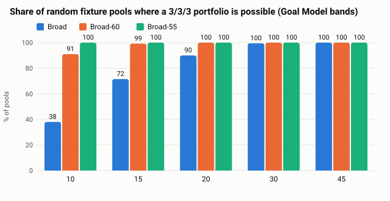

# Risk-structured Weekly Challenge — quantitative research (Phase 6A.1)

Research only. No production code, UI, database or challenge rules were changed.

| | |
|---|---|
| Branch | `research/weekly-challenge-risk-structure`, from `feature/weekly-challenge-engine` (`48392c1`) |
| Code | `src/diski9/research/risk_pool.py` (read-only pool builder) · `src/diski9/research/risk_structure.py` (bands, feasibility, exact metrics, strategies) · `scripts/research_risk_structure.py` (experiments) · `tests/test_risk_structure.py` |
| Data | `docs/research/weekly_challenge_risk/pool_weekend.json`, `pool_fortnight.json` (real) · `results.json` (all numbers below) · `feasibility_by_pool_size.svg` |
| Reproduce | `uv run python scripts/research_risk_structure.py` (about 16 minutes; `--quick` about 5 minutes) |

## 1. Executive summary

1. **The two tighter candidate band sets cannot be built from real fixtures.**
   * In the real weekend pool, Goal Model 1.0's highest probability for any outcome
     is **75.7%**. None of the 420 eligible outcomes reaches 80%.
   * **Conservative** (A 80–95%) is infeasible for every bucket size.
   * **Moderate** (A 75–90%) has one qualifying outcome under the model.
   * Even under market probabilities, only one outcome reaches 80%.
   * The reasons: 1X2 favourites above 80% are rare, BTTS and Over/Under outcomes
     almost never exceed about 65–70%, and Goal Model 1.0 is cautious on favourites.
2. **"Broad" (A 65–95%) is feasible in a full weekend pool but fragile in smaller
   rounds.**
   * With model bands, a 3/3/3 portfolio is possible in only 40% of random
     10-fixture pools and 72% of 15-fixture pools.
   * An adjusted **Broad-60** (A ≥ 60%, B 40–60%, C 20–40%) is feasible in 90–99%
     of such pools (100% with market bands).
3. **Combining picks changes their risk.**
   * Three picks at 65–75% give a Bucket A that wins only about 30% of the time.
   * Three picks at 20–40% give a Bucket C that wins about 2.5% of the time and
     pays about 1,000–1,500 credits: a lottery ticket.
   * **4/3/2 balances the buckets best:** Broad-60 bucket win chances are 17% /
     12% / 8%.
   * **5/3/1 inverts the risk labels:** its single-pick "riskiest" Bucket C wins
     29% of the time, more often than the five-pick "safest" Bucket A at 11%.
4. **The structure limits extremes.**

   | | Original design | Broad-60 · 4/3/2 |
   |---|---|---|
   | Long-shot strategy: chance of zero payout | 99% | 78% |
   | Largest possible payout | 7.4 billion credits | 67,000 credits |
   | Share of all positive season winnings taken by the top 1% (market scenario) | 30% | 14–18% (structured designs) |

   It does **not** remove the dominance of rare big rounds on a cumulative-net
   season table. In every design, the season winner's single best round was
   typically as large as their whole season total.
5. **Strategy choice doesn't change expected return at market prices.**
   * Valued at market probabilities, **every strategy and configuration returns
     about 77–81 credits per 100**. That is the compounded bookmaker margin.
   * So strategy choice changes how spread-out the outcomes are, not the
     market-expected value.
   * Model-based expected returns are far higher for underdog-heavy picks (up to
     thousands of credits). That reflects Goal Model 1.0's underdog optimism, not
     real value.
6. **Market probabilities are the more defensible measure for eligibility.**
   * Model bands are thinner at the top (21 vs 33 outcomes ≥ 65%).
   * They shift favourites down (−6.1 points) and long shots up (+4.5 points)
     relative to the market.
   * They reclassify 24–28% of outcomes under plausible model error.
   * Market probabilities are observable, margin-free and consistent with the odds
     shown.
7. **Provisional recommendation:**
   * **Broad-60 bands, 4/3/2, 40/30/20/10 credits, strict construction,
     classification by margin-adjusted market probability.**
   * The evidence rests on **one real fixture pool** and simulated results. It is
     sufficient to rule configurations out, but not to confirm long-run behaviour
     (§14).

## 2. Data sources and limitations

| Data | Status | Use |
|---|---|---|
| `pool_weekend.json` | **Real**, point-in-time as of 17 Nov 2026 22:00 UTC, window 20–23 Nov | Main pool: 68 fixtures, of which **60** have eligible outcomes (420 outcomes, 6 leagues) |
| `pool_fortnight.json` | **Real**, same time, window 18 Nov – 1 Dec | Larger pool: 89 fixtures, 623 eligible outcomes |
| Model probabilities | Real: Goal Model 1.0, screener cache, unchanged | Classification and modelled metrics |
| Market probabilities | Real: strict Challenge consensus (≥ 3 independent groups, fresh, complete market), proportional margin removal | Classification and the market benchmark |
| Market-implied goal rates | Derived (`market_implied_xg.fit`) for all 60 weekend fixtures | Market-truth scoreline simulation |
| Bootstrapped pools | **Synthetic**: random fixtures resampled from the real weekend pool | Pool-size feasibility; leaderboard rounds |
| Match results | **Synthetic**: Poisson scorelines from model or market goal rates | Leaderboard simulation only |
| Historical odds | **Unavailable** (never backfilled) | — |
| Settled results for these fixtures | **Unavailable** (future matches) | — |
| Phase 5B slates | Not used for feasibility: they are chosen portfolios, not complete pools | — |

**Limitations:**
* There is only one real weekly pool. International breaks, midweek rounds and
  PSL rounds are not represented (the PSL had no qualifying odds).
* Eligibility is evaluated at one snapshot time. Results are simulated, so no
  empirical long-run performance is claimed.

## 3. Methodology

* **Bands are half-open and non-overlapping:** [lo, hi), with Bucket A's top
  closed. Tests check that no probability falls in two bands.

  | Set | A | B | C | Uncovered |
  |---|---|---|---|---|
  | Conservative | [80%, 95%] | [65%, 80%) | [55%, 65%) | < 55%, > 95% |
  | Moderate | [75%, 90%] | [60%, 75%) | [50%, 60%) | < 50%, > 90% |
  | Broad | [65%, 95%] | [40%, 65%) | [20%, 40%) | < 20%, > 95% |
  | **Broad-60** (adjusted) | [60%, 95%] | [40%, 60%) | [20%, 40%) | < 20%, > 95% |
  | Broad-55 (adjusted) | [55%, 95%] | [35%, 55%) | [15%, 35%) | < 15%, > 95% |

  The uncovered ranges cost little: no eligible outcome exceeds 95%. Below 20%
  sits 5% of model outcomes and 10% of market outcomes. Excluding those is the
  intended long-shot limit.
* **Feasibility:** an exact count of valid portfolios (nine distinct fixtures, one
  outcome each, the required count per band), computed with a generating-function
  calculation over fixtures. It is verified against brute force in the tests.
* **Portfolio metrics:**
  * the exact eight-state distribution;
  * D-15 rounding (each accumulator's payout rounded half-up to 0.01 credit);
  * the nine-fold paid only when all three buckets win.
  * The evaluator reproduces the Phase 6A engine exactly for 3/3/3 at
    30/30/30/10 (tested).
* **Strategies (avoiding selection bias):**
  * random (400 portfolios per configuration);
  * favourite (highest probability in each band);
  * long shot (lowest);
  * mid-band;
  * model-value (highest model probability × odds).
  * The original design uses the same strategies on free choice, grouped by the
    Phase 6A recommendation.
* **Leaderboard simulation:**
  * 30 rounds × 100 players × 10 seasons per design and scenario;
  * a strategy mix of 40% random and 15% each for the other four;
  * participant-level noise, so players with the same strategy differ;
  * every player faces the same simulated scorelines;
  * two truth scenarios: **model** (Goal Model goal rates) and **market**
    (market-implied goal rates).
* **Sensitivity:** logit noise (sd 0.3) on model probabilities, 20 draws.
* **Fixed seeds:** base seed 61101.

## 4. Probability bands

**Exact count of valid portfolios** (real weekend pool; model / market
classification):

| Bands | 3/3/3 | 4/3/2 | 5/3/1 | Bucket A outcomes (fixtures), model |
|---|---:|---:|---:|---|
| Conservative | 0 / 0 | 0 / 0 | 0 / 0 | 0 (0) |
| Moderate | 0 / 3.7×10¹⁰ | 0 / 4.2×10⁸ | 0 / 0 | 1 (1) |
| Broad | 7.1×10¹⁴ / 1.8×10¹⁵ | 6.6×10¹³ / 3.2×10¹⁴ | 3.0×10¹² / 3.0×10¹³ | 21 (13) |
| Broad-60 | 6.1×10¹⁵ / 9.5×10¹⁵ | 1.4×10¹⁵ / 3.7×10¹⁵ | 1.8×10¹⁴ / 7.4×10¹⁴ | 46 (27) |
| Broad-55 | 3.2×10¹⁶ / 2.3×10¹⁶ | 2.0×10¹⁶ / 1.5×10¹⁶ | 6.9×10¹⁵ / 5.4×10¹⁵ | 102 (50) |

Large counts don't mean easy choices: the binding constraint is the number of
**distinct fixtures** with a Bucket A outcome (13 for Broad under the model).

**Share of random fixture pools where a portfolio is possible** (synthetic
subsets of the real pool; model / market):

| Bands · sizes | 10 fixtures | 15 | 20 | 30 |
|---|---|---|---|---|
| Broad · 3/3/3 | 40% / 85% | 72% / 97% | 90% / 99% | 100% / 100% |
| Broad · 4/3/2 | 8% / 64% | 43% / 91% | 71% / 99% | 95% / 100% |
| Broad · 5/3/1 | 2% / 38% | 16% / 75% | 46% / 95% | 84% / 100% |
| **Broad-60 · 4/3/2** | 77% / **97%** | 94% / **99.8%** | 100% / 100% | 100% / 100% |
| Broad-60 · 3/3/3 | 90% / 99% | 99% / 100% | 100% | 100% |
| Broad-55 · any | 100% | 100% | 100% | 100% |

**Single-league rounds** are infeasible or nearly so for every configuration. For
example, the EPL alone (10 fixtures) cannot fill Broad-60 · 3/3/3 under the
model. Rounds must span several leagues.

## 5. Bucket sizes

**Random portfolios, Broad-60, 40/30/20/10, model probabilities:**

| Sizes | Bucket win chance A / B / C | Bucket payout A / B / C (mean) | Recovery | Chance of zero payout | Largest possible payout (mean) |
|---|---|---|---:|---:|---:|
| 3/3/3 | 27.0% / 12.5% / 2.4% | 114 / 213 / 1,068 | 31.7% | 62.3% | 11,973 |
| **4/3/2** | **17.4% / 12.5% / 8.3%** | **162 / 209 / 282** | **33.6%** | 66.2% | **4,698** |
| 5/3/1 | 11.4% / 12.4% / 28.7% | 230 / 209 / 77 | 25.7% | 55.4% | 2,042 |

How the three sizes behave:

* **3/3/3** makes C a lottery: a 2.4% chance of about 1,000+ credits. A is the
  only bucket with a meaningful chance, and it pays little.
* **4/3/2** gives the most even risk ladder and graded payouts. The safer bucket
  pays least and the riskier bucket pays most, which is the intuitive structure to
  teach. It also has the tightest upper tail of the feasible sizes.
* **5/3/1** inverts the labels:
  * the single "riskiest" C pick wins 29% of the time, against 11% for the
    five-pick "safest" A;
  * its 20 credits pay only about 77;
  * it would teach the wrong lesson about combining picks.
* **Recovery without all nine winning:** in every feasible configuration and
  strategy tested, 0% of portfolios needed all nine outcomes to win before they
  could recover 100.

## 6. Credit allocations

**Broad-60 · 4/3/2, random portfolios:**

| Allocation | A alone recovers | Recovery (model / market) | Expected gross, model / market | Bucket payouts A / B / C | Zero payout |
|---|---:|---|---|---|---:|
| 30/30/30/10 | 80% | 30.6% / 31.4% | 83.6 / 80.5 | 120 / 217 / 407 | 66.3% |
| **40/30/20/10** | **100%** | **33.6% / 35.1%** | 80.6 / 79.1 | 162 / 209 / 282 | 66.2% |
| 50/25/15/10 | 100% | 32.6% / 33.6% | 79.7 / 78.2 | 205 / 181 / 216 | 66.3% |

* **Bucket A recovering alone** needs combined odds of at least 100 ÷ stake:
  3.33 at 30 credits, 2.50 at 40, 2.00 at 50.
  * Four Broad-60 picks typically combine to odds of about 3.5–4.5.
  * So at **40 credits Bucket A recovers on its own in effectively every
    portfolio**. At 30 credits it falls short in about 1 in 5.
* **50/25/15** adds nothing to recovery once A already clears 100 at 40. It
  flattens the payout ladder and lowers market expected value slightly.
  * **Why market expected value falls:** a four-leg bucket compounds the
    bookmaker margin more than a two-leg one, so moving credits into A costs about
    1–2 credits of market expected value.
* **Recommendation: 40/30/20/10.**
  * It gives the highest recovery among the three allocations.
  * Bucket A reliably recovers on its own.
  * Riskier buckets pay more, a clear payout ladder.
* **This conclusion depends on 4/3/2.** For 3/3/3, a weighting of 50/25/15 or more
  is needed before A recovers alone.

## 7. Strict vs flexible construction

* **Strict:** exactly n_A / n_B / n_C picks in bands A / B / C.
* **Flexible candidates** (any nine picks, then grouped as in Phase 6A):
  * **F1 "anchor":** at least 4 picks at ≥ 55%, at most 2 picks below 30%, and none
    below 15%. Only **11.5%** of random free portfolios satisfy it. In practice
    users would have to steer towards it, so it is as restrictive as strict bands
    but harder to explain. Mean recovery is 36.3%, with a maximum payout of about
    8,700.
  * **F2 "floor":** at least 3 picks at ≥ 50%, and none below 20%. **47.7%** of
    random free portfolios satisfy it. It allows six picks at about 20%, so
    lottery tails remain (mean maximum payout about 22,000).

| | Strict 4/3/2 | Flexible (F1 / F2) |
|---|---|---|
| Explaining it | "4 safer, 3 middle, 2 riskier": one progress bar per bucket | Several counting rules |
| User freedom | Lower | Higher |
| Tail control | Bounded by the band edges | F2 weak; F1 strong but rarely met unaided |
| Grouping step | None: picks define the buckets | Still needs a grouping step (Phase 6A or a new one) |

**Recommendation: strict.** It is simpler, the tails are controlled by
construction, and it maps directly to a step-by-step builder.

## 8. Market vs model classification

* **Agreement:** model and market place the same outcome in the same band (or
  both outside the bands) for **76–81%** of outcomes. Among banded outcomes,
  agreement is 76–80% for the Broad family, and only 42–54% for Conservative and
  Moderate.
* **Systematic gap** (model − market):

  | Market probability | Gap | Outcomes |
  |---|---:|---:|
  | ≥ 60% | **−6.1 pp** | 67 |
  | < 25% | **+4.5 pp** | 77 |

  This is Goal Model 1.0's known compression (cautious on favourites, generous to
  underdogs). Under model bands:
  * Bucket A is thinner (21 vs 33 outcomes at ≥ 65%);
  * some market long shots move up into Bucket C;
  * the model's apparent value on underdogs inflates modelled expected returns
    (§9).
* **Robustness:** with logit noise sd 0.3 on model probabilities, **24–28%** of
  outcomes change band (Broad family).
* **Recommendation:** classify by **margin-adjusted market probability**. The
  required complete market is already a Challenge eligibility rule. Display Goal
  Model 1.0 probabilities alongside, as Diski 9's view. This keeps "which bucket"
  observable and stable, while "what the model thinks" remains the educational
  layer.
* **Product tension:** this moves away from "we calculate the probabilities" for
  eligibility. It needs your decision (§14).

## 9. Payout and recovery distributions

**Random portfolios, 30/30/30/10 unless stated:**

| Design | Recovery | Zero payout | Median payout | 90th-percentile payout | Expected gross, model | Expected gross, market |
|---|---:|---:|---:|---:|---:|---:|
| Original (free, Phase 6A grouping) | 26.9% | 73.1% | 0 | 204 | 94.1 | 80.7 |
| Broad · 3/3/3 | 15.4% | 58.1% | 0 | 196 | 89.4 | 80.5 |
| Broad-60 · 3/3/3 · 40/30/20/10 | 31.7% | 62.3% | 0 | 209 | 85.9 | 80.3 |
| **Broad-60 · 4/3/2 · 40/30/20/10** | 33.6% | 66.2% | 0 | 230 | 80.6 | 79.1 |
| Broad-55 · 4/3/2 · 40/30/20/10 | 26.1% | 73.8% | 0 | 295 | 86.7 | 79.4 |

**Strategy extremes, original design:**

| Strategy | Chance of zero payout | Largest possible payout | Expected gross, model | Expected gross, market |
|---|---:|---:|---:|---:|
| Long shots | 99.1% | 7.4 × 10⁹ | 359 | 81 |
| Model-value | — | 1.6 × 10⁹ | 4,403 | 82 |
| Favourites | 28.3% | 328 | — | 81 |

Under **Broad-60 · 4/3/2**:
* long shots have a 77.8% chance of zero payout and a largest possible payout of
  67,395;
* favourites recover 11.7% of the time;
* a random entry recovers 33.6%.

**The market column is the honest benchmark.** Every design returns about 80 per
100 at market prices. Structure changes the shape of the distribution, not its
market mean.

## 10. Leaderboard incentives and fairness

Season tables use cumulative net credits. There are 10 seasons per cell, so the
counts below are indicative only.

| Design | Truth scenario | Season winners by strategy | Winner's best round ÷ season total (median) | Top 1% share of all positive winnings |
|---|---|---|---:|---:|
| Original | market | long shot 6, random 3, mid-band 1 | 1.16 | 0.30 |
| Original | model | model-value 6, long shot 3, random 1 | 0.86 | 0.26 |
| Broad · 3/3/3 · 30/30/30/10 | market | long shot 6, random 2, favourite 1, mid-band 1 | 1.08 | 0.17 |
| Broad-60 · 3/3/3 · 40/30/20/10 | market | random 6, long shot 2, mid-band 1, model-value 1 | 1.11 | 0.18 |
| Broad-55 · 4/3/2 · 40/30/20/10 | market | random 3, long shot 3, mid-band 2, favourite 1, model-value 1 | 1.04 | **0.14** |

Findings:

* **A single round decides the season in every design.** The season winner's best
  round is about their whole season total (ratios ≥ 1 mean their other rounds
  summed to a loss).
  * Cumulative net rewards variance: at market prices every strategy has roughly
    the same, negative, expected value, so the higher-variance entries win the
    table.
  * Risk structure **reduces** this: the top 1% share drops from 0.30 to
    0.14–0.18, and long-shot strategies win fewer seasons in the 4/3/2 design.
  * It does **not** eliminate it.
* **Under the model scenario,** model-value strategies dominate. That only holds
  if Goal Model 1.0's underdog optimism were correct; the market scenario suggests
  otherwise. Treat it as a stress case, not a forecast.
* **Implication for scoring:** consider a season score less sensitive to single
  jackpots. Options:
  * a sum of weekly ranking points;
  * a capped weekly net (for example ±200);
  * median-of-rounds.

  This interacts with the earlier Phase 5C season-scoring decision (D-09).
* **Mean season totals** are dominated by single jackpots (for example, one
  "model-value" player's market-scenario mean of +11,207). They are reported in
  `results.json`, but are not stable with 10 seasons.

## 11. Sensitivity and robustness

* **Band membership is fragile under model error:** 24–28% of outcomes move band
  at logit sd 0.3. Market classification avoids this dependence.
* **Pool size matters most:**
  * Broad needs about 20–30 fixtures for reliable feasibility under the model;
  * Broad-60 · 4/3/2 needs about 15 (10 with market bands).
* **Rankings across configurations are stable** between the model and market
  evaluations. Recovery under market probabilities is within about 1–2 points of
  model recovery for random portfolios in every structured configuration.
  Expected return is not stable (model vs market).
* **Not tested:** dependence between fixtures, and more than one real round.

## 12. Implications for Phase 6A and Phase 6B

**Reusable as is:**
* input validation (`make_selection`, `validate_selections`);
* exact `Decimal` odds and D-15 rounding (`round_credits`);
* the eight-state calculation;
* recovery against 100.00;
* expected returns;
* `payout_distribution` and the at-least / exactly queries.

The research evaluator reuses the same maths and matches the engine exactly for
3/3/3 at 30/30/30/10.

**Would need generalising:**
* bucket sizes (currently fixed at 3/3/3);
* the allocation (a module constant `30/30/30/10`);
* accumulator construction, so that bucket membership is supplied by the user's
  band choices.

**No longer needed under strict construction:**
* the 280-partition generation;
* the efficient frontier;
* the recommendation.

In strict construction the picks define the buckets, so there is nothing to
group, and **the 280-grouping optimisation disappears**. The Phase 5C frontier
chart would be replaced by a per-bucket progress builder plus the payout-
probability chart (still fully applicable).

**Optional constrained alternative (not implemented):**
* Under a flexible rule, a player's nine picks could be assigned to buckets of
  sizes 4/3/2 in 9! / (4! 3! 2!) = 1,260 ways.
* The Phase 6A Pareto and recommendation logic would generalise directly.
* It is only worth it if flexible construction is chosen.

## 13. Recommended configuration (provisional)

| Factor | Recommendation | Evidence |
|---|---|---|
| Bands | **Broad-60:** A [60%, 95%], B [40%, 60%), C [20%, 40%) | Conservative and Moderate infeasible; Broad fragile in smaller rounds; Broad-55 lets C reach 15% and has longer tails (largest payout about 340,000) |
| Sizes | **4/3/2** | Most even bucket risk (17 / 12 / 8%); graded payouts; bounded tail; 5/3/1 inverts the labels; 3/3/3 makes C a lottery |
| Allocation | **40/30/20/10** | Bucket A recovers on its own in effectively all portfolios; highest recovery of the tested allocations; clear payout ladder |
| Construction | **Strict** | Simple; tails bounded by construction; flexible rules either rarely satisfied (F1) or weak (F2) |
| Classification | **Margin-adjusted market probability**; Goal Model shown alongside | Observable; stable; consistent with odds; avoids model compression |

**Strongest vs weakest:**

| | Configuration | Why |
|---|---|---|
| Strongest | Broad-60 · 4/3/2 · 40/30/20/10 (market bands) | Feasible in 97–99.8% of 10–15-fixture pools; even bucket ladder; recovery about 34–35%; largest payout bounded to tens of thousands |
| Viable alternative | Broad-60 · 3/3/3 · 50/25/15/10 | Simpler, symmetric sizes, recovery 36.7%; but C stays a 2.4% lottery |
| Weakest feasible | Broad · 5/3/1 (any allocation) | Lowest feasibility in small pools (2–16%); inverted risk labels |
| Infeasible | Conservative (all), Moderate (model) | No qualifying Bucket A outcomes |

**Is this better than the original?**
* Partly. It bounds extremes and forces probability-aware construction. It reduces
  payout concentration (0.30 → 0.14–0.18) and strategy-driven extremes.
* It gives up the 280-grouping lesson, and it does not by itself fix season
  scoring.

## 14. Outstanding product decisions

1. **Adopt the risk structure at all,** or keep the original free choice with the
   280-grouping frontier, perhaps adding only a long-shot floor of about 20%.
2. **Probability source for eligibility:** market (recommended) or model.
3. **Band edges:** Broad-60 (recommended), or a variant.
4. **Sizes and allocation:** 4/3/2 at 40/30/20/10 (recommended), or 3/3/3 at
   50/25/15/10.
5. **Season scoring:** cumulative net is dominated by single jackpots in every
   design. Choose a less jackpot-sensitive rule (this updates D-09).
6. **Minimum round size:** require at least 15 fixtures from at least 3 leagues
   before a round opens.
7. **Evidence still missing:**
   * **At least 6–8 real weekly pools,** snapshotted at the planned publish time
     and covering an international break, to confirm feasibility across rounds.
   * **Settled results** for those rounds, for an empirical check of the
     leaderboard findings.
